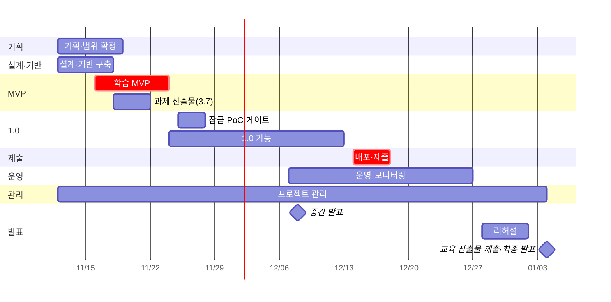

# 📊 WBS (Work Breakdown Structure)

> **프로젝트** 하루(Haru) — 초중학생 학습·안전 관리 앱
> **문서 버전** v1.1 · **작성일** 2026-11-12 · **개정일** 2026-11-14 · **상태** 계획 확정(초안)
> **기준 문서** 기획서 v0.4 · 기능 명세서 v0.1 · 기술 명세서 v0.1
> **팀** 오병훈(리드) · 윤기화 · 심환석 · 차해든 · 최강현 = **5명** + AI 코딩 에이전트
> **고정 마감** MVP 기능구현 11/22 · MVP 검증·배포 11/24(상한 11/29) · **중간 발표 12/08** · 기능 동결 12/13 · 스토어 제출 12/18 · **교육 산출물 제출·최종 발표 2027-01-04**
>
> **v1.1 개정 사유** 교강사 검토(11/14) 반영 — ① 문서 간 인원·작업방식 불일치 ② 발표일 1/4 ③ MVP를 기능구현·검증배포로 분리 ④ 담당 과부하 분산 ⑤ 누락 산출물(에이전트 6종·관리자·교육용 웹) 추가 ⑥ 잠금 PoC 게이트 ⑦ 평가 2트랙 분리. 상세는 **9. 개정 이력**.

---

## 1. 계층 구조

```
하루(Haru) 프로젝트
├─ 1. 기획·범위 확정            → 범위가 정해진다
├─ 2. 설계·기반 구축            → 개발이 시작될 수 있다
├─ 3. 학습 MVP                 → 부모 자료가 자녀 미션이 된다
├─ 4. 1.0 기능                 → 잠금·위치·통계가 붙는다
├─ 5. 배포·제출                → 스토어에 올라간다
├─ 6. 운영·모니터링             → 비용과 사용을 측정한다
└─ 7. 프로젝트 관리             → 문서·회의·발표가 남는다
```

**100% 규칙**: 각 영역의 하위 작업을 모두 끝내면 그 영역이 끝난다. 범위 밖(실시간 위치 추적·성적 순위·유치원·고등·재수 문제)은 **WBS에서 제외**했다.

---

## 2. 작업 계획표

> **병행 표시**: 🟡M = 목업으로 선행 가능 · 🟡A = API 계약만 있으면 선행 가능 · 🔴 = 선행 완료 필수

### 1. 기획·범위 확정

| ID | 작업 | 담당 | 검토 | 공수 | 선행 | 기간 | 산출물 | 병행 | 상태 |
| --- | --- | --- | --- | --- | --- | --- | --- | --- | --- |
| 1.1.1 | 기능 명세서 v0.1 팀 리뷰 및 v1.0 확정 | 오병훈 | 윤기화 | 1일 | – | 11/12–13 | 기능 명세서 v1.0 | 🔴 | 진행 |
| 1.1.2 | 앱 구조안 비교 후 결정 (단일 vs 2종) 및 번들 ID 확정 | 오병훈 | 차해든 | 0.5일 | 1.1.1 | 11/13 | 결정 기록 | 🔴 | 할일 |
| 1.1.3 | 정책 파라미터 확정 (반경 150m·한도 20건·잠금 트리거) | 오병훈 | 심환석 | 1일 | 1.1.1 | 11/13–14 | 정책표 | 🔴 | 할일 |
| 1.1.4 | 개인정보·위치 규제 체크리스트 작성 | 오병훈 | 최강현 | 1일 | – | 11/13–14 | 규제 체크리스트 | 🟡M | 할일 |
| 1.1.5 | MVP 12화면 명세서·와이어프레임 작성 | 차해든 | 오병훈 | 2일 | 1.1.1 | 11/13–14 | 화면 명세서(MVP) | 🟡M | 할일 |
| 1.1.6 | 1.0 화면 20종 명세서 작성 | 차해든 | 오병훈 | 3일 | 1.1.5 | 11/17–19 | 화면 명세서(1.0) | 🟡M | 할일 |
| **1.1.7** | **인원·작업방식 합의 및 4문서 동기화** (기획서·WBS·기능·기술 명세서의 인원/날짜/역할 단일화) | **오병훈** | **전원** | 0.5일 | 1.1.1 | **11/15** | **합의 회의록 · 문서 v1.1/v0.4** | 🔴 | **신규** |
| **1.1.8** | **요구 산출물 대조표** (산출물 작성 안내 ↔ 문서 목차) | **오병훈** | **전원** | 0.5일 | 1.1.7 | **11/15** | **산출물 매핑표** | 🔴 | **신규** |

### 2. 설계·기반 구축

| ID | 작업 | 담당 | 검토 | 공수 | 선행 | 기간 | 산출물 | 병행 | 상태 |
| --- | --- | --- | --- | --- | --- | --- | --- | --- | --- |
| 2.1.1 | 저장소·브랜치·PR 규칙 세팅 | 최강현 | 오병훈 | 0.5일 | – | 11/12 | README·브랜치 규칙 | 🔴 | 할일 |
| 2.1.2 | 가족·학습 영역 ERD 및 스키마 작성 | 윤기화 | 심환석 | 2일 | 1.1.3 | 11/13–14 | ERD·마이그레이션 | 🔴 | 할일 |
| 2.1.3 | RLS 정책 작성과 pgTAP 교차접근 테스트 | 윤기화 | 오병훈 | 2일 | 2.1.2 | 11/15–16 | RLS 테스트 결과 | 🔴 | 할일 |
| 2.1.4 | `/v1` API 계약서 및 에러 코드 정의 | 윤기화 | 차해든 | 1.5일 | 2.1.2 | 11/14–15 | API 명세서 | 🔴 | 할일 |
| 2.2.1 | Flutter 모노레포 구성 (parent·child·shared) | 차해든 | 윤기화 | 2일 | 1.1.2 | 11/13–14 | 실행되는 앱 2개 | 🔴 | 할일 |
| 2.2.2 | FastAPI 프로젝트 골격·설정·구조화 로깅 구성 | 윤기화 | 최강현 | 1일 | 2.1.4 | 11/14 | 서버 골격 | 🔴 | 할일 |
| 2.2.3 | Supabase 프로젝트·버킷·CLI 마이그레이션 구성 | 최강현 | 윤기화 | 1일 | 2.1.2 | 11/14 | Supabase 환경 | 🔴 | 할일 |
| 2.2.4 | Docker Compose 작성 (**api·worker·nginx**, Redis 제외) | 최강현 | 윤기화 | 1.5일 | 2.2.2 | 11/15–16 | compose.yml | 🔴 | 할일 |
| 2.2.5 | GitHub Actions CI 작성 (테스트·이미지 빌드) | 최강현 | 윤기화 | 1.5일 | 2.2.4 | 11/16–17 | CI 파이프라인 | 🔴 | 할일 |
| 2.2.6 | EC2·도메인·**nginx + certbot** TLS 배포 구성 | 최강현 | 오병훈 | 2일 | 2.2.4 | 11/17–18 | https 접속 URL | 🔴 | 할일 |
| 2.3.1 | 소셜 로그인 연동 (Google·Apple) | 차해든 | 윤기화 | 2일 | 2.2.1 | 11/15–16 | 로그인 화면 | 🟡A | 할일 |
| 2.3.2 | 문자 인증 API 구현 (발송·검증·5회 제한) | 윤기화 | 최강현 | 1.5일 | 2.2.2 | 11/16–17 | 인증 API | 🔴 | 할일 |
| 2.3.3 | 자녀 프로필·법정대리인 동의 저장 API와 동의 문자 | 윤기화 | 오병훈 | 1.5일 | 2.3.2 | 11/17–18 | 동의 저장 로직 | 🔴 | 할일 |
| 2.3.4 | 연결 코드 발급·claim API 구현 (6자리·10분·1회용) | 윤기화 | 최강현 | 1.5일 | 2.3.3 | 11/17–18 | 연결 API | 🔴 | 할일 |
| 2.3.5 | 자녀 앱 연결 코드 입력 화면 구현 | 차해든 | 윤기화 | 1일 | 2.3.4 | 11/18 | C-02 화면 | 🟡A | 할일 |

### 3. 학습 MVP

| ID | 작업 | 담당 | 검토 | 공수 | 선행 | 기간 | 산출물 | 병행 | 상태 |
| --- | --- | --- | --- | --- | --- | --- | --- | --- | --- |
| 3.1.1 | PDF·CSV 파싱 모듈 작성 (30쪽·20MB 제한) | 심환석 | 윤기화 | 2일 | 2.1.4 | 11/16–17 | 파서 모듈 | 🔴 | 할일 |
| 3.1.2 | 업로드 API·Storage 연동·사용량 한도 집행 | 윤기화 | 최강현 | 2일 | 2.2.3 | 11/18–19 | 업로드 API | 🔴 | 할일 |
| 3.1.3 | 자료 업로드·진행률 화면 구현 | 차해든 | 윤기화 | 1.5일 | 3.1.2 | 11/19–20 | P-05 화면 | 🟡A | 할일 |
| 3.2.1 | LangGraph 세트 생성 그래프 골격 작성 | 심환석 | 윤기화 | 3일 | 3.1.1 | 11/16–18 | 그래프 정의 | 🔴 | 할일 |
| 3.2.2 | OpenAI 생성 어댑터와 Pydantic 출력 스키마 | 심환석 | 윤기화 | 2일 | 3.2.1 | 11/17–18 | 생성 모듈 | 🔴 | 할일 |
| 3.2.3 | Gemini 검수·교차검증·재생성 2회 로직 | 심환석 | 오병훈 | 2일 | 3.2.2 | 11/18–19 | 검수 모듈 | 🔴 | 할일 |
| 3.2.4 | 작업 큐(`FOR UPDATE SKIP LOCKED`)·워커 구현 | 윤기화 | 심환석 | 2일 | 3.2.1 | 11/19–20 | 워커 | 🔴 | 할일 |
| 3.2.5 | **내부 검수 평가셋 20건** 구축과 정답률 측정 | 심환석 | 오병훈 | 2일 | 3.2.3 | 11/20–21 | 평가 결과서(내부) | 🔴 | 할일 |
| **3.2.6** | **BFCL 원본 30문항 평가 실행과 기록** (내부 20건과 별도 트랙) | **심환석** | **오병훈** | 1일 | 3.2.3 | **11/21–22** | **평가 결과서(BFCL)** | 🟡A | **신규** |
| 3.3.1 | 문항 검수 API 구현 (승인·수정·삭제) | 윤기화 | 심환석 | 1.5일 | 3.2.2 | 11/19–20 | 검수 API | 🔴 | 할일 |
| 3.3.2 | 문항 검수 화면 구현 (원문 근거 표시) | 차해든 | 오병훈 | 2일 | 3.3.1 | 11/20–21 | P-06 화면 | 🟡A | 할일 |
| 3.3.3 | 생성 진행률 Realtime 구독 연동 | 차해든 | 최강현 | 1일 | 3.3.2 | 11/21 | 실시간 진행률 | 🟡A | 할일 |
| 3.4.1 | 균등 배분 규칙·간격반복 5단계 엔진 작성 | 심환석 | 윤기화 | 2일 | 3.2.2 | 11/18–19 | 배분 엔진 | 🔴 | 할일 |
| 3.4.2 | 커리큘럼·오늘 미션 API 구현 | 윤기화 | 심환석 | 2일 | 3.4.1 | 11/19–20 | 미션 API | 🔴 | 할일 |
| 3.4.3 | 커리큘럼 설정 화면 구현 | 차해든 | 오병훈 | 1.5일 | 3.4.2 | 11/20–21 | P-07 화면 | 🟡A | 할일 |
| 3.4.4 | 자녀 오늘 미션 화면과 7일치 로컬 저장 | 차해든 | 윤기화 | 2일 | 3.4.2 | 11/20–21 | C-03 화면 | 🟡A | 할일 |
| 3.4.5 | 오프라인 채점·서버 동기화 구현 | 윤기화 | 차해든 | 2일 | 3.4.4 | 11/21–22 | 동기화 로직 | 🔴 | 할일 |
| 3.5.1 | 오답노트 API·화면 구현 | 차해든 | 윤기화 | 1.5일 | 3.4.5 | 11/21–22 | C-05 · P-08 | 🟡A | 할일 |
| 3.5.2 | 부모 오늘 현황 화면 구현 | 차해든 | 오병훈 | 1일 | 3.4.5 | 11/22 | P-02 화면 | 🟡A | 할일 |
| 3.5.3 | AI 판단 근거 1줄 생성 로직 구현 | 심환석 | 윤기화 | 1일 | 3.2.3 | 11/22 | 근거 문장 | 🟡A | 할일 |
| 3.6.1 | MVP 통합 테스트 시나리오 작성·실행 | 오병훈 | 윤기화 | 2일 | 3.5.2 | 11/22–23 | 테스트 결과서 | 🔴 | 할일 |
| 3.6.2 | 실기기 2대 E2E 검증 (가입→연결→미션→현황) | 차해든 | 최강현 | 1일 | 3.6.1 | 11/23 | E2E 기록 | 🔴 | 할일 |
| 3.6.3 | 테스트 트랙 빌드 배포 (TestFlight·내부 테스트) | 최강현 | 오병훈 | 1일 | 3.6.2 | **11/24** | 빌드 URL | 🔴 | 할일 |
| 3.6.4 | MVP 회고와 1.0 범위 조정 | 오병훈 | 전원 | 0.5일 | 3.6.3 | 11/25 | 회고록 | 🔴 | 할일 |

#### 3.7 과제 요구 산출물 (신규)

> 교강사 지적: "단일 에이전트·협업·자기 성찰·가드레일·Auto-Healing 산출물의 작업 위치가 WBS에서 보여야 한다."
> 이 묶음은 **3.2의 파이프라인 위에 얹는 설계·검증 산출물**이며, 별도 문서로 남긴다.

| ID | 작업 | 담당 | 검토 | 공수 | 선행 | 기간 | 산출물 | 병행 | 상태 |
| --- | --- | --- | --- | --- | --- | --- | --- | --- | --- |
| 3.7.1 | **단일 에이전트** 정의·구현 (문항 생성 에이전트 1개: 역할·도구·출력 스키마) | 심환석 | 윤기화 | 1일 | 3.2.2 | 11/18–19 | 에이전트 설계서 §1 | 🟡A | 신규 |
| 3.7.2 | **협업 구조** (생성→검수 핸드오프, 역할 분리, 실패 시 반환 경로) | 심환석 | 오병훈 | 1일 | 3.2.3 | 11/19–20 | 오케스트레이션 도면 | 🟡A | 신규 |
| 3.7.3 | **자기 성찰** 루프 (검수 불합격 → 자기 수정 → 재생성 최대 2회 → 폐기) | 심환석 | 윤기화 | 1일 | 3.2.3 | 11/20 | 재생성 로직·기록 | 🟡A | 신규 |
| 3.7.4 | **가드레일** (금지 표현·개인정보·환각·프롬프트 주입 차단 표) | 오병훈 | 심환석 | 1.5일 | 3.2.3 | 11/20–21 | 가드레일 표·테스트 | 🟡A | 신규 |
| 3.7.5 | **Auto-Healing** (LLM 실패·형식 오류 시 대체 모델 → 규칙 폴백, 복구 기록) | 심환석 | 오병훈 | 1일 | 3.7.3 | 11/21 | 폴백 로직·복구율 | 🟡A | 신규 |
| 3.7.6 | **교육용 웹 앱** (학부모용 학습 현황 웹, Flutter Web 또는 React) | 차해든 | 윤기화 | 4일 | 3.5.2 | 12/08–11 | 배포 URL·화면 흐름 | 🟡A | 신규 |

### 4. 1.0 기능

| ID | 작업 | 담당 | 검토 | 공수 | 선행 | 기간 | 산출물 | 병행 | 상태 |
| --- | --- | --- | --- | --- | --- | --- | --- | --- | --- |
| **4.0.1** | **잠금 실기기 PoC** (Android 접근성 / iOS FamilyControls 권한·차단) | **최강현** | **오병훈** | 2일 | 3.6.4 | **11/25–27** | **PoC 결과서** | 🔴 | **신규** |
| **4.0.2** | **PoC 게이트 회의** → iOS 차단 포함/제외, 범위 확정 | **오병훈** | **전원** | 0.5일 | 4.0.1 | **11/28** | **범위 결정 기록** | 🔴 | **신규** |
| 4.1.1 | 잠금 정책·규칙 엔진 설계서 작성 | 심환석 | 윤기화 | 2일 | 3.6.4 | 11/24–25 | 규칙 엔진 설계 | 🔴 | 할일 |
| 4.1.2 | Android 차단 구현 (Kotlin AccessibilityService) | 최강현 | 차해든 | 4일 | 4.0.2 | 11/29–12/02 | 차단 모듈 | 🔴 | 할일 |
| 4.1.3 | iOS 차단 구현 (FamilyControls + 확장 3종) — **4.0.2 승인 시에만** | 최강현 | 차해든 | 5일 | 4.0.2 | **12/08–12** | 차단 확장 | 🔴 | 할일 |
| 4.1.4 | 해제 요청·승인 API와 푸시 연동 | 윤기화 | 심환석 | 2일 | 4.1.1 | 12/02–03 | 해제 승인 | 🟡A | 할일 |
| 4.1.5 | 가족 약속 동의 화면 구현 | 차해든 | 오병훈 | 2일 | 4.1.1 | 12/02–03 | C-07 화면 | 🟡A | 할일 |
| 4.2.1 | 장소 등록·주소 검색 API 구현 | 윤기화 | 최강현 | 2일 | 3.6.4 | 11/30–12/01 | 장소 API | 🔴 | 할일 |
| 4.2.2 | 지오펜스 등록과 진입·이탈 이벤트 수집 | 최강현 | 차해든 | 3일 | 4.2.1 | 12/03–05 | 지오펜스 모듈 | 🔴 | 할일 |
| 4.2.3 | 체크인 판정·정확도 임계 처리 | 최강현 | 윤기화 | 2일 | 4.2.2 | **12/08–09** | 체크인 로직 | 🟡A | 할일 |
| 4.2.4 | 위치 제공 통보와 기록 테이블 구현 | 윤기화 | 오병훈 | 1.5일 | 4.2.1 | 12/04–05 | 제공 기록 | 🟡A | 할일 |
| 4.3.1 | 일 단위 집계 배치와 daily_stats 구현 | 윤기화 | 심환석 | 2일 | 3.6.4 | 12/01–02 | 집계 배치 | 🔴 | 할일 |
| 4.3.2 | 통계·주간 리포트 화면 구현 | 차해든 | 오병훈 | 2일 | 4.3.1 | **12/10–11** | P-15·P-16 | 🟡A | 할일 |
| 4.3.3 | 주간 AI 리포트 생성·발송 로직 | 심환석 | 윤기화 | 2일 | 4.3.1 | 12/04–05 | 리포트 생성기 | 🟡A | 할일 |
| 4.4.1 | 관리자 API·전용 인증 구현 | 윤기화 | 최강현 | 2일 | 3.6.4 | 11/30–12/01 | 관리자 API | 🔴 | 할일 |
| 4.4.2 | 관리자 웹 4종 화면 구현 (React·Vite·Tailwind) | **윤기화** | 오병훈 | 4일 | 4.4.1 | 12/01–04 | A-01~04 | 🟡A | 할일 |
| 4.4.3 | 감사 로그 기록·조회 구현 | 윤기화 | 오병훈 | 1일 | 4.4.2 | 12/05 | 감사 로그 | 🟡A | 할일 |
| 4.5.1 | 기본 팩 수집 스크립트와 출처 기록 (BeautifulSoup) | 심환석 | 오병훈 | 3일 | 3.6.4 | 11/24–26 | 수집 데이터 | 🟡A | 할일 |
| 4.5.2 | 기본 팩 저작권·라이선스 검토 (**자료별 이용조건·AI 입력·변형·배포 범위**) | 오병훈 | 심환석 | 1일 | 4.5.1 | 11/27 | **출처·이용조건 표** | 🔴 | 할일 |
| 4.5.3 | pgvector 임베딩과 유사문항 중복 방지 구현 | 심환석 | 윤기화 | 2일 | 4.5.1 | 12/01–02 | 중복 방지 | 🟡A | 할일 |
| 4.6.1 | 개인정보처리방침·이용약관·위치기반약관 초안 작성 | 오병훈 | 최강현 | 3일 | 1.1.4 | 11/26–28 | 공개 문서 초안 | 🟡M | 할일 |
| 4.6.2 | 정적 사이트 빌드·배포 (약관·지원 페이지) | 차해든 | 최강현 | 1일 | 4.6.1 | 11/29 | 공개 URL | 🟡A | 할일 |

### 5. 배포·제출

| ID | 작업 | 담당 | 검토 | 공수 | 선행 | 기간 | 산출물 | 병행 | 상태 |
| --- | --- | --- | --- | --- | --- | --- | --- | --- | --- |
| 5.1.1 | 베타 가정 3~5곳 모집과 동의 확보 | 오병훈 | 차해든 | 3일 | 4.6.2 | 12/01–03 | 참여 명단 | 🔴 | 할일 |
| 5.1.2 | 베타 운영과 피드백 수집 | 오병훈 | 차해든 | 5일 | 5.1.1 | 12/07–11 | 피드백 목록 | 🔴 | 할일 |
| 5.1.3 | 베타 반영 버그 수정 | 차해든 | 윤기화 | 3일 | 5.1.2 | 12/10–12 | 수정 PR | 🟡A | 할일 |
| 5.2.1 | 기능 동결 선언과 릴리스 노트 작성 | 오병훈 | 전원 | 0.5일 | 5.1.3 | 12/13 | 릴리스 노트 | 🔴 | 할일 |
| 5.2.2 | 심사용 계정·설명·스크린샷·시연 영상 제작 | 오병훈 | 차해든 | 3일 | 5.2.1 | 12/14–16 | 심사 자료 | 🔴 | 할일 |
| 5.2.3 | 최종 빌드·서명·스토어 업로드 | 최강현 | 오병훈 | 1일 | 5.2.2 | 12/17 | 업로드 빌드 | 🔴 | 할일 |
| 5.2.4 | App Store·Google Play 1차 제출 | 오병훈 | 최강현 | 0.5일 | 5.2.3 | 12/18 | 제출 확인 | 🔴 | 할일 |
| 5.2.5 | 리젝 사유 대응과 재제출 | 오병훈 | 최강현 | 5일 | 5.2.4 | 12/21–27 | 대응 기록 | 🔴 | 할일 |
| **5.2.6** | **잠금·위치 없는 대체 시연 경로** 제작 (승인 지연 대비) | **오병훈** | **차해든** | 1일 | 5.2.2 | **12/14–15** | **대체 시연 시나리오** | 🟡M | **신규** |

### 6. 운영·모니터링

| ID | 작업 | 담당 | 검토 | 공수 | 선행 | 기간 | 산출물 | 병행 | 상태 |
| --- | --- | --- | --- | --- | --- | --- | --- | --- | --- |
| 6.1.1 | 모니터링 대시보드·장애 알림 구성 | 최강현 | 윤기화 | 2일 | 2.2.6 | 12/07–08 | 대시보드 | 🟡A | 할일 |
| 6.1.2 | LLM·서버 원가 실측과 운영비 표 작성 | 심환석 | 오병훈 | 2일 | 5.1.2 | 12/09–10 | 원가표 | 🟡A | 할일 |
| 6.1.3 | 구독 후보 10명 모집과 사용 데이터 측정 | 오병훈 | 차해든 | 10일 | 5.1.1 | 12/07–18 | 사용 데이터 | 🔴 | 할일 |
| 6.2.1 | 맘카페·부동산 카페 가입과 수요 조사 | 오병훈 | 차해든 | 5일 | – | 12/07–11 | 조사 결과 | 🟡M | 할일 |
| 6.2.2 | 인스타 공식·홍보단 계정 운영 | 차해든 | 윤기화 | 10일 | – | 12/07–18 | 게시물·유입 | 🟡M | 할일 |
| 6.2.3 | 당근마켓 사업자 등록 필요 여부 확인 | 오병훈 | – | 1일 | – | 12/08 | 확인 결과 | 🟡M | 할일 |
| 6.3.1 | 매출·비용 장부 정리 | 오병훈 | – | 2일 | 6.1.2 | 12/21–22 | 장부 | 🟡A | 할일 |
| 6.3.2 | 법인세·과세 대상 여부 검토 | 오병훈 | – | 1일 | 6.3.1 | 12/23 | 검토 메모 | 🟡A | 할일 |

### 7. 프로젝트 관리

| ID | 작업 | 담당 | 검토 | 공수 | 선행 | 기간 | 산출물 | 병행 | 상태 |
| --- | --- | --- | --- | --- | --- | --- | --- | --- | --- |
| 7.1.1 | 일일 스탠드업 진행과 막힘 공유 | 오병훈 | 전원 | 매일 0.2일 | – | 상시 | 스탠드업 기록 | 🔴 | 진행 |
| 7.1.2 | 주간 계획 대비 실적 점검과 WBS 갱신 | 오병훈 | 전원 | 매주 0.5일 | – | 매주 금 | 갱신된 WBS | 🔴 | 진행 |
| 7.2.1 | 기술 명세서 v1.0 확정 | 윤기화 | 심환석 | 2일 | 1.1.3 | 11/14–15 | 기술 명세서 | 🔴 | 할일 |
| 7.2.2 | API·DB 설계서 확정 | 윤기화 | 오병훈 | 1일 | 2.1.4 | 11/16 | 설계서 | 🔴 | 할일 |
| 7.2.3 | 문서 인계 정리 (저장소·계정·비밀값) | 오병훈 | 최강현 | 2일 | 5.2.5 | 12/28–29 | 인계 문서 | 🟡A | 할일 |
| **7.2.4** | **확인 상태 표 유지** (신고·동의·스토어 정책: 확인 상태·근거 원문·확인일) | **오병훈** | **전원** | 주 0.3일 | 1.1.4 | **상시** | **확인 상태 표** | 🟡M | **신규** |
| **7.2.5** | **테스트 자료 출처 표 유지** (자료별 이용조건·AI 입력·변형·배포 범위) | **오병훈** | **심환석** | 주 0.3일 | 4.5.2 | **상시** | **출처 표** | 🟡M | **신규** |
| **7.3.0** | **중간 발표 준비·발표** | **오병훈** | **전원** | 1일 | 3.7.1~3.7.5 | **12/08** | **중간 발표 자료·피드백 기록** | 🔴 | **신규** |
| 7.3.1 | 발표 자료 초안 작성 | 오병훈 | 차해든 | 3일 | 5.2.4 | **12/19–22** | 발표 초안 | 🟡A | 할일 |
| 7.3.2 | 시연 리허설 3회 | 오병훈 | 전원 | 3일 | 7.3.1 | **12/28–01/02** | 리허설 기록 | 🔴 | 할일 |
| 7.3.3 | **최종 발표와 교육 산출물 검토·제출** | 오병훈 | 전원 | 1일 | 7.3.2 | **01/04** | 최종·교육 산출물, 제출 확인 | 🔴 | 할일 |

---

## 3. 간트 차트 (주차별 계획 · 실적)

기준일: **2026-11-14** · ■ 계획 / ● 실적

| 영역 | 1주<br>11/09 | 2주<br>11/16 | 3주<br>11/23 | 4주<br>11/30 | 5주<br>12/07 | 6주<br>12/14 | 7주<br>12/21 | 8주<br>12/28 | 9주<br>01/04 | 상태 |
| --- | --- | --- | --- | --- | --- | --- | --- | --- | --- | --- |
| 1 기획·범위 | ■ | ■ | | | | | | | | 진행 |
| 2 설계·기반 | ■ | ■ | | | | | | | | 진행 |
| 3 학습 MVP | | ■ | ■ | | | | | | | 할일 |
| 3.7 산출물 | | ■ | | | | | | | | 할일 |
| 4 1.0 기능 | | | ■ | ■ | ■ | | | | | 할일 |
| 5 배포·제출 | | | | ■ | ■ | ■ | ■ | | | 할일 |
| 6 운영·모니터링 | | | | | ■ | ■ | ■ | ■ | | 할일 |
| 7 프로젝트 관리 | ■ | ■ | ■ | ■ | ■ | ■ | ■ | ■ | ■ | 진행 |
| **외부 승인** | | | | | | | | | | |
| Apple Family Controls | ○ | ○ | ○ | | | | | | | 신청 |
| 위치기반서비스 신고 | ○ | ○ | ○ | ○ | | | | | | 확인 |
| 스토어 심사 | | | | | | ○ | ○ | ○ | | 대기 |
| **발표 준비** | | | | | | | | ■ | ■ | |

> 9주차(01/04)는 **발표 주간**이며 개발 주간이 아니다. 발표일은 **2027-01-04**.
>
> **외부 승인은 팀이 통제할 수 없다.** 그래서 9.3 출시 전략(승인 없이 내는 대체 빌드)을 WBS와 별도로 유지한다.



---

## 4. 마일스톤

| ID | 마일스톤 | 판정 기준(무엇이 돌아가는가) | 날짜 |
| --- | --- | --- | --- |
| **M1** | 범위 승인 | 기능·화면·정책 명세서 3종 승인 + **인원·작업방식 합의(1.1.7)** | **11/15** |
| **M2** | 기반 동작 | 두 실기기에서 **가입 → 연결 → 로그인 유지** | **11/18** |
| **M3a** | **학습 MVP 기능 구현 완료** | 부모 PDF 업로드 → 검수 → **자녀 미션 완료** → 부모 현황이 **개발 빌드에서** 동작 | **11/22** |
| **M3b** | **학습 MVP 검증·배포 완료** | 실기기 2대 E2E 통과 + **TestFlight·내부 테스트 배포 완료** | **11/24** (상한 11/29) |
| **M3c** | 과제 산출물 완비 | 에이전트 6종(3.7.1~3.7.5) + 평가 2트랙(3.2.5·3.2.6) 결과서 | **11/22** |
| **MP** | **중간 발표** | 발표 자료·시연 경로 점검 + 피드백 기록 | **12/08** |
| **M4** | 잠금·위치 동작 | **4.0.2 게이트 통과 후** 차단 앱 실행 차단 · 지정 장소 진입 알림 | **12/12** (PoC 11/27·게이트 11/28) |
| **M5** | 기능 동결 | 신규 기능 추가 중단, 베타 반영만 | **12/13** |
| **M6** | 1차 제출 | 두 스토어 제출 완료 | **12/18** |
| **M7** | 공개 | 승인·공개 또는 반려 대응 현황 기록 | **01/03** |
| **M8** | **교육 산출물 제출·최종 발표** | 교육 결과 문서 검토·제출 + 시연 리허설 3회 통과 | **01/04** |

---

## 5. 핵심 경로와 병렬 작업

**핵심 경로 (여기가 늦으면 전체가 늦는다)**

```
1.1.1 명세 확정 → 1.1.7 인원·작업방식 합의 → 2.1.2 DB 스키마 → 2.1.4 API 계약
   → 3.1.1 파싱 → 3.2.1 그래프 → 3.2.3 검수 → 3.4.2 미션 API
   → 3.4.5 오프라인 동기화 → 3.6.2 E2E → 3.6.3 배포 → 5.2.3 최종 빌드 → 5.2.4 제출
   → 7.3.2 리허설 → 7.3.3 발표(01/04)
```

**병렬로 끊어낸 작업 (의존성 해소)**

| 병렬 작업 | 끊는 방법 | 표시 |
| --- | --- | --- |
| 1.1.5 화면 명세 ↔ 2.1.2 DB 설계 | 화면은 목업 데이터로 먼저 제작 | 🟡M |
| 2.2.4 Docker ↔ 3.x 개발 | 로컬 Supabase·모의 API로 선행 | 🟡M |
| 4.1.3 iOS 차단 ↔ 4.2 위치 | **최강현의 4.1.3을 12/08로 이동**(4.0.2 게이트 후), 4.2.3 체크인도 12/08 이후로 | 🔴 |
| 4.4.2 관리자 웹 ↔ 3.x | 관리자 API 계약(4.4.1)만 있으면 화면 먼저 | 🟡A |
| 4.5.1 기본 팩 수집 ↔ 3.x | 배치 작업이라 언제든 병렬 | 🟡A |
| 3.7.6 교육용 웹 ↔ 4.3 통계 | 통계 API(4.3.1) 계약 후 화면 병렬 | 🟡A |
| 5.2.6 대체 시연 ↔ 심사 대기 | 승인 지연과 무관하게 먼저 제작 | 🟡M |

---

## 6. 일정 관리 규칙

1. **주간 단위 갱신**: 매주 금요일 7.1.2에서 계획 대비 실적을 비교한다.
2. **진척률 계산**: `완료 작업 수 ÷ 전체 작업 수`. "거의 다"라는 표현은 쓰지 않는다.
3. **지연 기록 3종**: 원인 · 영향(어느 마일스톤) · 변경 예정일. 셋 중 하나라도 없으면 이슈로 등록하지 않는다.
4. **상태 5단계**: 할일 / 진행 / 검토 중 / 완료 / 막힘. **막힘은 당일 스탠드업에서 공유**한다.
5. **범위 변경**: 기능 추가는 반드시 **다른 기능을 빼거나 마일스톤을 옮긴 뒤** 승인한다.
6. **버퍼 분리**: 개별 작업에 여유를 숨기지 않는다. **12/23~12/27을 팀 버퍼**로 둔다.
   ※ v1.0의 12/28~01/03 버퍼는 **리허설 기간과 겹치므로 이동**했다.
7. **문서 일치 규칙 (신규)**: 인원·날짜·담당은 **기획서·WBS·기능 명세서·기술 명세서 4개 문서에서 동일해야** 한다. 문서를 고칠 때는 4개를 같은 커밋에서 고친다.
8. **단독 vs 공동 (신규)**: MVP는 **5명 공동 구현**이다. "리드 단독 구현"으로 표기하지 않는다.

---

## 7. 완료 기준 (Definition of Done)

**팀 공통**

- [ ] 코드가 `main`에 머지됨
- [ ] 다른 팀원 1명 이상 리뷰
- [ ] 테스트 통과 (pytest·pgTAP·flutter test)
- [ ] 관련 문서·README 갱신
- [ ] **문서 4종(기획서·WBS·기능·기술)의 인원·날짜·담당이 일치** (v1.1 신규)

**작업별 예시**

| 작업 | 완료 기준 |
| --- | --- |
| 2.3.4 연결 코드 API | 6자리 코드가 발급되고, 만료·재사용·5회 실패가 각각 거부되며, 테스트 5개가 통과한다 |
| 3.2.3 검수 로직 | 불합격 문항이 재생성 2회 후 폐기되고, **내부 평가셋 20건에서 정답률 95% 이상**이다 |
| **3.2.6 BFCL 평가** | 원본 30문항을 실행하고, **내부 20건과 분리된 결과 표**(목적·자료·결과)를 남긴다 |
| **3.7.4 가드레일** | 금지 표현·개인정보·프롬프트 주입 **각 3케이스**를 차단하고 로그를 남긴다 |
| **3.7.5 Auto-Healing** | 첫 모델 실패 시 대체 모델 → 규칙 폴백으로 **응답이 나가고**, 복구 건수·복구율이 기록된다 |
| 3.4.5 오프라인 동기화 | 비행기 모드에서 미션 완료가 가능하고, 복구 후 서버에 1회만 반영된다 |
| **4.0.1 잠금 PoC** | 실기기에서 차단 대상 앱 실행 시 **2초 내 차단 화면**, 전화·문자는 통과. iOS는 권한 승인 여부를 기록 |
| 4.1.2 Android 차단 | 차단 대상 앱 실행 시 2초 내 차단 화면이 뜨고, 전화·문자는 차단되지 않는다 |
| **4.5.2 이용조건** | 자료별 **이용조건·AI 입력·변형·배포 범위**가 표로 남고, 근거 원문 링크가 있다 |
| 5.2.4 1차 제출 | 두 스토어 콘솔에서 "심사 중" 상태가 확인된다 |
| **5.2.6 대체 시연** | 잠금·위치 없이 **가입→업로드→검수→미션→현황**을 5분 안에 시연할 수 있다 |

---

## 8. 담당별 공수 (예상, 일 · v1.1 조정)

| 담당 | 1~2주 | 3~5주 | 6~9주 | 합계(v1.0) | **합계(v1.1)** | 비고 |
| --- | --- | --- | --- | --- | --- | --- |
| **오병훈** (리드) | 6 | 11.5 | 14 | 29 | **31.5** | 1.1.7·1.1.8·3.7.4·4.0.2·5.2.6·7.2.4·7.2.5 추가 |
| **윤기화** | 12 | 12 | 8 | 28 | **32** | 4.4.2 관리자 웹 이관(차해든→윤기화) |
| **심환석** | 12 | 15 | 2 | 23 | **29** | 3.7.1·3.7.2·3.7.3·3.7.5 + 3.2.6 |
| **차해든** | 12 | 14 | 2 | 32 | **28** | 4.4.2 이관(-4), 3.7.6 교육용 웹(+4), 4.3.2 지연 |
| **최강현** | 11 | 15 | 6 | 31 | **32** | 4.0.1 PoC(+2), 4.1.3·4.2.3 지연 |

> ⚠️ **여전히 오병훈·윤기화·최강현이 31~32일로 높다.**
> 대응: ① 3.7.6 교육용 웹은 **4.3.2와 화면 재사용** ② 4.1.3 iOS는 4.0.2에서 **제외 가능** ③ 6.2 마케팅은 **12월 한정**으로 주 단위 배분
> **※ 각 담당자는 이 표의 자기 행을 확인하고 공수·완료 기준을 직접 검토해야 한다** (교강사 지적: "각 담당자가 자기 작업·공수·완료 기준을 확인").

---

## 9. 개정 이력 (v1.0 → v1.1)

| # | 지적 사항 | 수정 내용 | 위치 |
| --- | --- | --- | --- |
| 1 | 인원 불일치(4 vs 5) | 팀 = 리드 1 + **팀원 4**로 통일. 기획서 2절·10.2도 동시 수정 | 표지 · 1.1.7 |
| 2 | "리드 MVP 단독 구현" vs 5명 배정 | **5명 공동 구현**으로 확정(6절 규칙 8). 소유: 심환석 AI, 윤기화 API·DB, 차해든 화면 | 6절 · 8절 |
| 3 | 발표일 1/4 | M8 **01/04**, 7.3.3 **01/04**, 7.3.2 리허설 **12/28–01/02**, 간트 종료 **2027-01-04** | M8 · 7.3 · 간트 |
| 4 | MVP 날짜 3개 혼재 | **M3a(기능구현 11/22) · M3b(검증·배포 11/24)** 분리. 3.6.3 = 11/24 | M3a·M3b |
| 5 | 차해든·최강현 과부하 | 4.4.2 → 윤기화, 4.1.3 → 12/08–12, 4.2.3 → 12/08–09, 4.3.2 → 12/10–11 | 4.1.3·4.2.3·4.3.2·4.4.2 |
| 6 | 관리자 웹 담당 | 4.4.2 담당 **윤기화**, 검토 오병훈 | 4.4.2 |
| 7 | 누락 산출물 | **3.7 에이전트 6종** + **3.7.6 교육용 웹** 신설 | 3.7 |
| 8 | 잠금 PoC 게이트 | **4.0.1 PoC(11/25–27) · 4.0.2 게이트(11/28)**, 5.2.6 대체 시연 | 4.0 · 5.2.6 |
| 9 | 평가 2트랙 분리 | **3.2.5 내부 20건** / **3.2.6 BFCL 30문항** 분리, DoD에 분리 명시 | 3.2.5·3.2.6 · 7절 |
| 10 | 이용조건 확인 | 4.5.2를 "**자료별 이용조건·AI 입력·변형·배포 범위**"로 확장, 7.2.5 상시 표 추가 | 4.5.2 · 7.2.5 |
| 11 | 신고·정책 확인 상태 | **7.2.4 확인 상태 표** 상시 유지(상태·근거 원문·확인일) | 7.2.4 |
| 12 | 문서 간 일치 | **6절 규칙 7(문서 일치)** · DoD 체크박스 추가 | 6절 · 7절 |
| 13 | Redis 혼재 | 2.2.4에서 **Redis 제거**(기획서 6.2·7.4와 일치) | 2.2.4 |
| 14 | Caddy vs nginx | **nginx + certbot**으로 통일 | 2.2.6 |
| 15 | 버퍼 겹침 | 버퍼 **12/23–12/27**로 이동(리허설과 분리) | 6절 규칙 6 |
| 16 | 병행 가능 여부 | 모든 표에 **병행 컬럼(🟡M·🟡A·🔴)** 추가 | 2절 전체 |

---

## 10. 다음 확인 때 제출물

- [ ] **전원 합의 회의록** (인원 5명·공동 구현·발표 1/4)
- [ ] **기획서 v0.4** · **WBS v1.1** · 기능 명세서 · 기술 명세서 (인원·날짜·담당 일치)
- [ ] **학습 MVP 화면 흐름** (P-01~P-08 · C-01~C-06 연결도)
- [ ] **테스트 자료 출처 표** (이용조건·AI 입력·변형·배포)
- [ ] **확인 상태 표** (신고·동의·스토어 정책 + 근거 원문 + 확인일)
- [ ] **평가 2트랙 결과** (내부 20건 / BFCL 30문항 분리)
- [ ] **잠금 PoC 결과서** (가능하나 11/27 이후)
