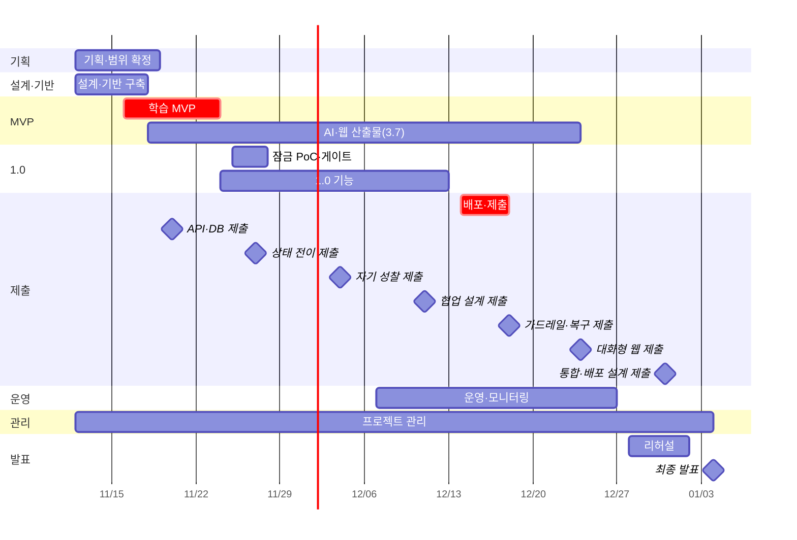

# 📊 WBS (Work Breakdown Structure)

> **프로젝트** 하루(Haru) — 초1~고1 학습·안전 관리 앱
> **문서 버전** v1.2.1 · **작성일** 2026-11-12 · **개정일** 2026-11-17 · **상태** 팀 협의 결과 반영
> **기준 문서** 기획서 v0.5.1 · 기능 명세서 v0.3.1 · 기술 명세서 v0.3.1
> **팀** 오병훈(리드) · 윤기화 · 심환석 · 차해든 · 최강현 = **5명** + AI 코딩 에이전트
> **고정 마감** MVP 기능구현 11/22 · MVP 검증·배포 11/24(상한 11/29) · 교육 산출물 단계 제출 11/20~12/31 · 스토어 제출 12/18 · **최종 취합·발표 2027-01-04**
>
> **v1.1 개정 사유** 교강사 검토(11/14) 반영 — ① 문서 간 인원·작업방식 불일치 ② 발표일 1/4 ③ MVP를 기능구현·검증배포로 분리 ④ 담당 과부하 분산 ⑤ 누락 산출물(에이전트 5종·관리자·교육용 웹) 추가 ⑥ 잠금 PoC 게이트 ⑦ 평가 2트랙 분리. 상세는 **9. 개정 이력**.
>
> **v1.2 개정 사유** 강사 2차 피드백(11/17) 반영 — ① 단계별 검토·제출 8개와 1/4 최종 취합 분리 ② 열람형 웹과 대화형 AI 웹 분리 ③ 대화형 웹을 결정·구현·권한·시험·배포로 작업화 ④ 12/9~13 담당 충돌 해소 ⑤ 고정 작업 공수 전건 재합산. 상세는 **9. 개정 이력**.
>
> **v1.2.1 개정 사유** `팀 협의 필요사항.md` 반영 — 초1~고1 대상, 웹 기술 분리 확정, 학부모용 대화형 웹 승인, SMS·관리자 인증, 14일 무료 정책, 위치 10분 체류 알림, 사진 OCR·자료 출처, iOS 조건부 포함 상태를 동기화.

---

## 1. 계층 구조

```
하루(Haru) 프로젝트
├─ 1. 기획·범위 확정            → 범위가 정해진다
├─ 2. 설계·기반 구축            → 개발이 시작될 수 있다
├─ 3. 학습 MVP                 → 부모 자료가 자녀 미션이 된다
├─ 4. 1.0 기능                 → 잠금·위치·통계가 붙는다
├─ 5. 배포·제출                → 스토어에 올라간다
├─ 6. 운영·모니터링             → 비용과 사용을 측정한다
└─ 7. 프로젝트 관리             → 문서·회의·발표가 남는다
```

**100% 규칙**: 각 영역의 하위 작업을 모두 끝내면 그 영역이 끝난다. 학습 대상은 **초1~고1**이며, 범위 밖(실시간 위치 추적·성적 순위·유치원·고2 이상·재수 문제)은 **WBS에서 제외**했다.

---

## 2. 작업 계획표

> **병행 표시**: 🟡M = 목업으로 선행 가능 · 🟡A = API 계약만 있으면 선행 가능 · 🔴 = 선행 완료 필수

### 1. 기획·범위 확정

| ID | 작업 | 담당 | 검토 | 공수 | 선행 | 기간 | 산출물 | 병행 | 상태 |
| --- | --- | --- | --- | --- | --- | --- | --- | --- | --- |
| 1.1.1 | 기능 명세서 v0.1 팀 리뷰 및 v1.0 확정 | 오병훈 | 윤기화 | 1일 | – | 11/12–13 | 기능 명세서 v1.0 | 🔴 | 진행 |
| 1.1.2 | 앱 구조안 비교 후 결정 (단일 vs 2종) 및 번들 ID 확정 | 오병훈 | 차해든 | 0.5일 | 1.1.1 | 11/13 | 결정 기록 | 🔴 | 할일 |
| 1.1.3 | 정책 파라미터 확정 (반경 150m·한도 20건·잠금 트리거) | 오병훈 | 심환석 | 1일 | 1.1.1 | 11/13–14 | 정책표 | 🔴 | 할일 |
| 1.1.4 | 개인정보·위치 규제 체크리스트 작성 | 오병훈 | 최강현 | 1일 | – | 11/13–14 | 규제 체크리스트 | 🟡M | 할일 |
| 1.1.5 | MVP 논리 화면 13개(실제 상태 15개) 명세서·와이어프레임 작성 | 차해든 | 오병훈 | 2일 | 1.1.1 | 11/13–14 | 화면 명세서(MVP) | 🟡M | 할일 |
| 1.1.6 | 1.0 화면 20종 명세서 작성 | 차해든 | 오병훈 | 3일 | 1.1.5 | 11/17–19 | 화면 명세서(1.0) | 🟡M | 할일 |
| **1.1.7** | **인원·작업방식 합의 및 4문서 동기화** (기획서·WBS·기능·기술 명세서의 인원/날짜/역할 단일화) | **오병훈** | **전원** | 0.5일 | 1.1.1 | **11/15** | **합의 회의록 · 문서 v1.1/v0.4** | 🔴 | **신규** |
| **1.1.8** | **요구 산출물 대조표** (산출물 작성 안내 ↔ 문서 목차) | **오병훈** | **전원** | 0.5일 | 1.1.7 | **11/15** | **산출물 매핑표** | 🔴 | **신규** |

### 2. 설계·기반 구축

| ID | 작업 | 담당 | 검토 | 공수 | 선행 | 기간 | 산출물 | 병행 | 상태 |
| --- | --- | --- | --- | --- | --- | --- | --- | --- | --- |
| 2.1.1 | 저장소·브랜치·PR 규칙 세팅 | 최강현 | 오병훈 | 0.5일 | – | 11/12 | README·브랜치 규칙 | 🔴 | 할일 |
| 2.1.2 | 가족·학습 영역 ERD 및 스키마 작성 | 윤기화 | 심환석 | 2일 | 1.1.3 | 11/13–14 | ERD·마이그레이션 | 🔴 | 할일 |
| 2.1.3 | RLS 정책 작성과 pgTAP 교차접근 테스트 | 윤기화 | 오병훈 | 2일 | 2.1.2 | 11/15–16 | RLS 테스트 결과 | 🔴 | 할일 |
| 2.1.4 | `/v1` API 계약서 및 에러 코드 정의 | 윤기화 | 차해든 | 1.5일 | 2.1.2 | 11/14–15 | API 명세서 | 🔴 | 할일 |
| 2.2.1 | Flutter 모노레포 구성 (parent·child·shared) | 차해든 | 윤기화 | 2일 | 1.1.2 | 11/13–14 | 실행되는 앱 2개 | 🔴 | 할일 |
| 2.2.2 | FastAPI 프로젝트 골격·설정·구조화 로깅 구성 | 윤기화 | 최강현 | 1일 | 2.1.4 | 11/14 | 서버 골격 | 🔴 | 할일 |
| 2.2.3 | Supabase 프로젝트·버킷·CLI 마이그레이션 구성 | 최강현 | 윤기화 | 1일 | 2.1.2 | 11/14 | Supabase 환경 | 🔴 | 할일 |
| 2.2.4 | Docker Compose 작성 (**api·worker·nginx**, Redis 제외) | 최강현 | 윤기화 | 1.5일 | 2.2.2 | 11/15–16 | compose.yml | 🔴 | 할일 |
| 2.2.5 | GitHub Actions CI 작성 (테스트·이미지 빌드) | 최강현 | 윤기화 | 1.5일 | 2.2.4 | 11/16–17 | CI 파이프라인 | 🔴 | 할일 |
| 2.2.6 | EC2·도메인·**nginx + certbot** TLS 배포 구성 | 최강현 | 오병훈 | 2일 | 2.2.4 | 11/17–18 | https 접속 URL | 🔴 | 할일 |
| 2.3.1 | 소셜 로그인 연동 (Google·Apple) | 차해든 | 윤기화 | 2일 | 2.2.1 | 11/15–16 | 로그인 화면 | 🟡A | 할일 |
| 2.3.2 | 문자 인증 API 구현 (발송·검증·5회 제한) — 공급사 계약·발신번호 발급 완료 | 윤기화 | 심환석 | 1.5일 | 2.2.2 | 11/16–17 | 인증 API | 🔴 | 진행 |
| 2.3.3 | 자녀 프로필·법정대리인 동의 저장 API와 동의 문자 | 윤기화 | 오병훈 | 1.5일 | 2.3.2 | 11/17–18 | 동의 저장 로직 | 🔴 | 할일 |
| 2.3.4 | 연결 코드 발급·claim API 구현 (6자리·10분·1회용) | 윤기화 | 최강현 | 1.5일 | 2.3.3 | 11/17–18 | 연결 API | 🔴 | 할일 |
| 2.3.5 | 자녀 앱 연결 코드 입력 화면 구현 | 차해든 | 윤기화 | 1일 | 2.3.4 | 11/18 | C-02 화면 | 🟡A | 할일 |

### 3. 학습 MVP

| ID | 작업 | 담당 | 검토 | 공수 | 선행 | 기간 | 산출물 | 병행 | 상태 |
| --- | --- | --- | --- | --- | --- | --- | --- | --- | --- |
| 3.1.1 | **PDF·사진 OCR 중심 파싱 모듈** 작성 (CSV 호환, 30쪽·사진 10장·20MB 제한) | 심환석 | 윤기화 | 2일 | 2.1.4 | 11/16–17 | 파서·OCR 모듈 | 🔴 | 진행 |
| 3.1.2 | 업로드 API·Storage 연동·사용량 한도 집행 | 윤기화 | 최강현 | 2일 | 2.2.3 | 11/18–19 | 업로드 API | 🔴 | 할일 |
| 3.1.3 | 자료 업로드·진행률 화면 구현 | 차해든 | 윤기화 | 1.5일 | 3.1.2 | 11/19–20 | P-05 화면 | 🟡A | 할일 |
| 3.2.1 | LangGraph 세트 생성 그래프 골격 작성 | 심환석 | 윤기화 | 3일 | 3.1.1 | 11/16–18 | 그래프 정의 | 🔴 | 할일 |
| 3.2.2 | OpenAI 생성 어댑터와 Pydantic 출력 스키마 | 심환석 | 윤기화 | 2일 | 3.2.1 | 11/17–18 | 생성 모듈 | 🔴 | 할일 |
| 3.2.3 | Gemini 검수·교차검증·재생성 2회 로직 | 심환석 | 오병훈 | 2일 | 3.2.2 | 11/18–19 | 검수 모듈 | 🔴 | 할일 |
| 3.2.4 | 작업 큐(`FOR UPDATE SKIP LOCKED`)·워커 구현 | 윤기화 | 심환석 | 2일 | 3.2.1 | 11/19–20 | 워커 | 🔴 | 할일 |
| 3.2.5 | **내부 검수 평가셋 20건** 구축과 정답률 측정 | 심환석 | 오병훈 | 2일 | 3.2.3 | 11/20–21 | 평가 결과서(내부) | 🔴 | 할일 |
| **3.2.6** | **BFCL 원본 30문항 평가 실행과 기록** (내부 20건과 별도 트랙) | **심환석** | **오병훈** | 1일 | 3.2.3 | **11/21–22** | **평가 결과서(BFCL)** | 🟡A | **신규** |
| 3.3.1 | 문항 검수 API 구현 (승인·수정·삭제) | 윤기화 | 심환석 | 1.5일 | 3.2.2 | 11/19–20 | 검수 API | 🔴 | 할일 |
| 3.3.2 | 문항 검수 화면 구현 (원문 근거 표시) | 차해든 | 오병훈 | 2일 | 3.3.1 | 11/20–21 | P-06 화면 | 🟡A | 할일 |
| 3.3.3 | 생성 진행률 Realtime 구독 연동 | 차해든 | 최강현 | 1일 | 3.3.2 | 11/21 | 실시간 진행률 | 🟡A | 할일 |
| 3.4.1 | 균등 배분 규칙·간격반복 5단계 엔진 작성 | 심환석 | 윤기화 | 2일 | 3.2.2 | 11/18–19 | 배분 엔진 | 🔴 | 할일 |
| 3.4.2 | 커리큘럼·오늘 미션 API 구현 | 윤기화 | 심환석 | 2일 | 3.4.1 | 11/19–20 | 미션 API | 🔴 | 할일 |
| 3.4.3 | 커리큘럼 설정 화면 구현 | 차해든 | 오병훈 | 1.5일 | 3.4.2 | 11/20–21 | P-07 화면 | 🟡A | 할일 |
| 3.4.4 | 자녀 오늘 미션 화면과 7일치 로컬 저장 | 차해든 | 윤기화 | 2일 | 3.4.2 | 11/20–21 | C-03 화면 | 🟡A | 할일 |
| 3.4.5 | 오프라인 채점·서버 동기화 구현 | 윤기화 | 차해든 | 2일 | 3.4.4 | 11/21–22 | 동기화 로직 | 🔴 | 할일 |
| 3.5.1 | 오답노트 API·화면 구현 | 차해든 | 윤기화 | 1.5일 | 3.4.5 | 11/21–22 | C-05 · P-08 | 🟡A | 할일 |
| 3.5.2 | 부모 오늘 현황 화면 구현 | 차해든 | 오병훈 | 1일 | 3.4.5 | 11/22 | P-02 화면 | 🟡A | 할일 |
| 3.5.3 | AI 판단 근거 1줄 생성 로직 구현 | 심환석 | 윤기화 | 1일 | 3.2.3 | 11/22 | 근거 문장 | 🟡A | 할일 |
| 3.6.1 | MVP 통합 테스트 시나리오 작성·실행 | 오병훈 | 윤기화 | 2일 | 3.5.2 | 11/22–23 | 테스트 결과서 | 🔴 | 할일 |
| 3.6.2 | 실기기 2대 E2E 검증 (가입→연결→미션→현황) | 차해든 | 최강현 | 1일 | 3.6.1 | 11/23 | E2E 기록 | 🔴 | 할일 |
| 3.6.3 | 테스트 트랙 빌드 배포 (TestFlight·내부 테스트) | 최강현 | 오병훈 | 1일 | 3.6.2 | **11/24** | 빌드 URL | 🔴 | 할일 |
| 3.6.4 | MVP 회고와 1.0 범위 조정 | 오병훈 | 전원 | 0.5일 | 3.6.3 | 11/25 | 회고록 | 🔴 | 할일 |

#### 3.7 과제 요구 산출물 (신규)

> 교강사 지적: "단일 에이전트·협업·자기 성찰·가드레일·Auto-Healing 산출물의 작업 위치가 WBS에서 보여야 한다."
> 이 묶음은 **3.2의 파이프라인 위에 얹는 설계·검증 산출물**이며, 별도 문서로 남긴다.

| ID | 작업 | 담당 | 검토 | 공수 | 선행 | 기간 | 산출물 | 병행 | 상태 |
| --- | --- | --- | --- | --- | --- | --- | --- | --- | --- |
| 3.7.1 | **단일 에이전트** 정의·구현 (역할·도구·상태·전이·실패 종료·출력 스키마) | 심환석 | 윤기화 | 1일 | 3.2.2 | 11/18–19 | 상태 전이 그래프·에이전트 설계서 | 🟡A | 신규 |
| 3.7.2 | **협업 구조** (생성→검수 핸드오프, 역할 분리, 실패 시 반환 경로) | 심환석 | 오병훈 | 1일 | 3.2.3 | 11/19–20 | 오케스트레이션 도면 | 🟡A | 신규 |
| 3.7.3 | **자기 성찰** 루프 (검수 불합격 → 자기 수정 → 재생성 최대 2회 → 폐기) | 심환석 | 윤기화 | 1일 | 3.2.3 | 11/20 | 재생성 로직·기록 | 🟡A | 신규 |
| **3.7.3b** | 자기 성찰 로직 테스트 실행·결과서 작성 | 심환석 | 윤기화 | 1일 | 3.7.3 | 12/03 | 성공·1회 수정·2회 폐기 로그 | 🔴 | 신규 |
| 3.7.4 | **가드레일** (금지 표현·개인정보·환각·프롬프트 주입 차단 표) | 오병훈 | 심환석 | 1.5일 | 3.2.3 | 11/20–21 | 가드레일 표·테스트 | 🟡A | 신규 |
| 3.7.5 | **Auto-Healing** (LLM 실패·형식 오류 시 대체 모델 → 규칙 폴백, 복구 기록) | 심환석 | 오병훈 | 1일 | 3.7.3 | 11/21 | 폴백 로직·복구율 | 🟡A | 신규 |
| 3.7.6a | **열람형 웹 설계·API 계약** (현황·주간 리포트, 대화 기능 없음) | 차해든 | 윤기화 | 1일 | 3.5.2·4.3.1 | 12/08 | 화면 흐름·API 매핑·권한표 | 🟡A | 신규 |
| 3.7.6b | **열람형 웹 구현·배포** (**Flutter Web 확정**) | 차해든 | 윤기화 | 3일 | 3.7.6a | **12/09–11** | 현황·리포트 URL·README | 🔴 | 확정 |
| **3.7.7** | **학부모용 대화형 AI 웹 범위·교육 요건 확정** (개념 설명·힌트·유사 문제) | 오병훈 | 강사·매니저 | 0.5일 | 1.1.8 | **12/09** | 승인 근거·범위 결정서 | 🔴 | **협의 완료** |
| **3.7.8** | 대화형 웹 아키텍처·대화 계약 설계 (**Streamlit + FastAPI 확정**) | 심환석 | 윤기화 | 1일 | 3.7.7 | 12/12 | 상태 흐름·API·출력 스키마 | 🔴 | 신규 |
| **3.7.9** | 대화 API·학습 데이터·인증/RLS 연결 | 심환석 | 윤기화 | 3일 | 3.7.8 | 12/14–16 | `/v1/chat/*`·권한 테스트 | 🔴 | 신규 |
| **3.7.10** | **학부모용** 대화형 웹 UI 구현 (세트 선택·다중 턴·근거·초기화) | 차해든 | 심환석 | 2일 | 3.7.8 | 12/17–18 | Streamlit UI·시연 흐름 | 🟡A | 신규 |
| **3.7.11** | 대화형 웹 시험 (정상·문맥·근거 없음·가드레일) | 심환석 | 오병훈 | 2일 | 3.7.9·3.7.10 | 12/21–22 | 29건 이상 테스트 결과서 | 🔴 | 신규 |
| **3.7.12** | 대화형 웹 HTTPS 배포·README·대체 시연 패키지 | 윤기화 | 최강현 | 1.5일 | 3.7.11 | 12/23–24 | URL·README·3분 영상·로컬 실행본 | 🔴 | 신규 |

**대화형 웹 최소 범위·지연 대체 경로**

| 상황 | 유지할 최소 범위 | 지원·대체 경로 |
| --- | --- | --- |
| 정상 | 학부모가 승인된 학습 세트 1개 이상으로 개념 설명·힌트·유사 문제, 다중 턴, 근거 표시, 세션 초기화 | 심환석 API·가드레일, 차해든 UI, 윤기화 인증·배포, 최강현 배포 점검 |
| AWS 준비 지연 | 위 최소 범위를 익명 샘플 세트로 실행 | 로컬 Docker/Streamlit 실행본 + 3분 시연영상 + 테스트 결과를 먼저 제출. 임시 HTTPS 호스트는 강사·매니저 확인 후 사용 |
| 스토어 승인 지연 | 대화형 웹과 열람형 웹은 계속 제출 | 웹 산출물은 앱 스토어 승인과 분리. 앱 연결 대신 익명 샘플·가짜 계정으로 시연 |
| 일정 지연 | 일반 검색·자유 주제·성과 분석·관리 기능 제외 | 세 가지 대화 의도와 근거·가드레일만 유지. 축소 범위도 3.7.7 승인 근거에 기록 |

### 4. 1.0 기능

| ID | 작업 | 담당 | 검토 | 공수 | 선행 | 기간 | 산출물 | 병행 | 상태 |
| --- | --- | --- | --- | --- | --- | --- | --- | --- | --- |
| **4.0.1** | **잠금 실기기 PoC** (Android 접근성 / iOS FamilyControls 권한·차단) | **심환석** | **오병훈** | 2일 | 3.6.4 | **11/25–27** | **기능 구현 결과·승인 신청 기록** | 🔴 | **구현 완료·Apple 회신 대기** |
| **4.0.2** | **PoC 게이트 회의** → Apple 승인 시 iOS 차단 포함, 미승인 시 제외 빌드 | **오병훈** | **전원** | 0.5일 | 4.0.1 | **11/28** | **조건부 포함 결정 기록** | 🔴 | **조건부 확정** |
| 4.1.1 | 잠금 정책·규칙 엔진 설계서 작성 | 심환석 | 윤기화 | 2일 | 3.6.4 | 11/24–25 | 규칙 엔진 설계 | 🔴 | 할일 |
| 4.1.2 | Android 차단 구현 (Kotlin AccessibilityService) | 최강현 | 차해든 | 4일 | 4.0.2 | 11/29–12/02 | 차단 모듈 | 🔴 | 할일 |
| 4.1.3 | iOS 차단 구현 (FamilyControls + 확장 3종) — Apple 배포 권한 승인 시 적용 | 최강현 | 차해든 | 5일 | 4.0.2 | **12/08–12** | 차단 확장·승인 회신 | 🔴 | **기능 완료·배포 승인 대기** |
| 4.1.4 | 해제 요청·승인 API와 푸시 연동 | 윤기화 | 심환석 | 2일 | 4.1.1 | 12/02–03 | 해제 승인 | 🟡A | 할일 |
| 4.1.5 | 가족 약속 동의 화면 구현 | 차해든 | 오병훈 | 2일 | 4.1.1 | 12/02–03 | C-07 화면 | 🟡A | 할일 |
| 4.2.1 | 장소 등록·주소 검색 API 구현 | 윤기화 | 최강현 | 2일 | 3.6.4 | 11/30–12/01 | 장소 API | 🔴 | 할일 |
| 4.2.2 | 지오펜스 등록과 **학원 반경 10분 체류 도착 이벤트** 수집 | 최강현 | 차해든 | 3일 | 4.2.1 | 12/03–05 | 지오펜스·체류 판정 모듈 | 🔴 | 할일 |
| 4.2.3 | 체크인 판정·정확도 임계 처리 | 최강현 | 윤기화 | 2일 | 4.2.2 | **12/08–09** | 체크인 로직 | 🟡A | 할일 |
| 4.2.4 | 위치 제공 통보와 기록 테이블 구현 | 윤기화 | 오병훈 | 1.5일 | 4.2.1 | 12/04–05 | 제공 기록 | 🟡A | 할일 |
| 4.3.1 | 일 단위 집계 배치와 daily_stats 구현 | 윤기화 | 심환석 | 2일 | 3.6.4 | 12/01–02 | 집계 배치 | 🔴 | 할일 |
| 4.3.2 | 통계·주간 리포트 화면 구현 (3.7.6b 컴포넌트 재사용) | 차해든 | 오병훈 | 2일 | 3.7.6b | **12/12–13** | P-15·P-16 | 🔴 | 일정 조정 |
| 4.3.3 | 주간 AI 리포트 생성·발송 로직 | 심환석 | 윤기화 | 2일 | 4.3.1 | 12/04–05 | 리포트 생성기 | 🟡A | 할일 |
| 4.4.1 | 관리자 API·전용 인증 구현 (**관리자 1계정·30분 세션·접근 감사 로그**) | 윤기화 | 최강현 | 2일 | 3.6.4 | 11/30–12/01 | 관리자 API | 🔴 | **구현 완료** |
| 4.4.2 | 관리자 웹 4종 화면 구현 (React·Vite·Tailwind) | **윤기화** | 오병훈 | 4일 | 4.4.1 | 12/01–04 | A-01~04 | 🟡A | 할일 |
| 4.4.3 | 감사 로그 기록·조회 구현 | 윤기화 | 오병훈 | 1일 | 4.4.2 | 12/05 | 감사 로그 | 🟡A | 할일 |
| 4.5.1 | 기본 팩·자료 출처 기록 (사진 OCR·PDF·AI 생성·저작권 만료 문학, 유료 데이터는 추후) | 심환석 | 오병훈 | 3일 | 3.6.4 | 11/24–26 | 출처별 수집 데이터 | 🟡A | 범위 확정 |
| 4.5.2 | 기본 팩 저작권·라이선스 검토 (**자료별 이용조건·AI 입력·변형·배포 범위**) | 오병훈 | 심환석 | 1일 | 4.5.1 | 11/27 | **출처·이용조건 표** | 🔴 | 할일 |
| 4.5.3 | pgvector 임베딩과 유사문항 중복 방지 구현 (**OpenAI·Gemma 후보 비교 후 모델·차원 확정**) | 심환석 | 윤기화 | 2일 | 4.5.1 | 12/01–02 | 후보 비교·중복 방지 | 🟡A | **모델 결정 보류** |
| 4.6.1 | 개인정보처리방침·이용약관·위치기반약관 초안 작성 | 오병훈 | 최강현 | 3일 | 1.1.4 | 11/26–28 | 공개 문서 초안 | 🟡M | 할일 |
| 4.6.2 | 정적 사이트 빌드·배포 (약관·지원 페이지) | 차해든 | 최강현 | 1일 | 4.6.1 | 11/29 | 공개 URL | 🟡A | 할일 |

### 5. 배포·제출

| ID | 작업 | 담당 | 검토 | 공수 | 선행 | 기간 | 산출물 | 병행 | 상태 |
| --- | --- | --- | --- | --- | --- | --- | --- | --- | --- |
| 5.1.1 | 베타 가정 3~5곳 모집과 동의 확보 | 오병훈 | 차해든 | 3일 | 4.6.2 | 12/01–03 | 참여 명단 | 🔴 | 할일 |
| 5.1.2 | 베타 운영과 피드백 수집 | 오병훈 | 차해든 | 5일 | 5.1.1 | 12/07–11 | 피드백 목록 | 🔴 | 할일 |
| 5.1.3 | 베타 반영 버그 수정 | 윤기화 | 차해든 | 3일 | 5.1.2 | 12/10–12 | 수정 PR | 🟡A | 담당 이관 |
| 5.2.1 | 기능 동결 선언과 릴리스 노트 작성 | 오병훈 | 전원 | 0.5일 | 5.1.3 | 12/13 | 릴리스 노트 | 🔴 | 할일 |
| 5.2.2 | 심사용 계정·설명·스크린샷·시연 영상 제작 | 오병훈 | 차해든 | 3일 | 5.2.1 | 12/14–16 | 심사 자료 | 🔴 | 할일 |
| 5.2.3 | 최종 빌드·서명·스토어 업로드 | 최강현 | 오병훈 | 1일 | 5.2.2 | 12/17 | 업로드 빌드 | 🔴 | 할일 |
| 5.2.4 | App Store·Google Play 1차 제출 | 오병훈 | 최강현 | 0.5일 | 5.2.3 | 12/18 | 제출 확인 | 🔴 | 할일 |
| 5.2.5 | 리젝 사유 대응과 재제출 | 오병훈 | 최강현 | 5일 | 5.2.4 | 12/21–27 | 대응 기록 | 🔴 | 할일 |
| **5.2.6** | **잠금·위치 없는 대체 시연 경로** 제작 (승인 지연 대비) | **오병훈** | **차해든** | 1일 | 5.2.2 | **12/14–15** | **대체 시연 시나리오** | 🟡M | **신규** |

### 6. 운영·모니터링

| ID | 작업 | 담당 | 검토 | 공수 | 선행 | 기간 | 산출물 | 병행 | 상태 |
| --- | --- | --- | --- | --- | --- | --- | --- | --- | --- |
| 6.1.1 | 모니터링 대시보드·장애 알림 구성 | 최강현 | 윤기화 | 2일 | 2.2.6 | 12/07–08 | 대시보드 | 🟡A | 할일 |
| 6.1.2 | LLM·서버 원가 실측과 운영비 표 작성 (**구독 횟수 한도 산정**) | 심환석 | 오병훈 | 2일 | 5.1.2 | **12/09–10** | 원가표·한도 제안 | 🟡A | 할일 |
| 6.1.3 | **14일 무료 후 구독** 정책·구독 후보 소규모 사용 데이터 측정 | 오병훈 | 차해든 | 3일 | 7.4.6 | 12/25–27 | 후보 3명 사용 메모·구독안 | 🟡M | 정책 확정·횟수 보류 |
| 6.2.1 | 커뮤니티 수요 조사 (질문지·응답 요약) | 차해든 | 오병훈 | 2일 | 3.7.12 | 12/25–26 | 조사 결과 | 🟡M | 범위 축소·이관 |
| 6.2.2 | 인스타 공식 계정 최소 운영 (필수 산출물 이후) | 오병훈 | 차해든 | 3일 | 5.2.4 | 12/19–21 | 게시물 3건·유입 기록 | 🟡M | 범위 축소·이관 |
| 6.2.3 | 당근마켓 사업자 등록 필요 여부 확인 | 오병훈 | – | 1일 | – | 12/08 | 확인 결과 | 🟡M | 할일 |
| 6.3.1 | 매출·비용 장부 정리 | 오병훈 | – | 2일 | 6.1.2 | 12/21–22 | 장부 | 🟡A | 할일 |
| 6.3.2 | 법인세·과세 대상 여부 검토 | 오병훈 | – | 1일 | 6.3.1 | 12/23 | 검토 메모 | 🟡A | 할일 |

### 7. 프로젝트 관리

| ID | 작업 | 담당 | 검토 | 공수 | 선행 | 기간 | 산출물 | 병행 | 상태 |
| --- | --- | --- | --- | --- | --- | --- | --- | --- | --- |
| 7.1.1 | 일일 스탠드업 진행과 막힘 공유 | 전원(순번제) | 오병훈 | 매일 0.2일 | – | 상시 | 스탠드업 기록 | 🔴 | 진행 |
| 7.1.2 | 주간 계획 대비 실적 점검과 WBS 갱신 | 윤기화 | 오병훈 | 매주 0.5일 | – | 매주 금 | 갱신된 WBS | 🔴 | 담당 분산 |
| 7.2.1 | 기술 명세서 v1.0 확정 | 윤기화 | 심환석 | 2일 | 1.1.3 | 11/14–15 | 기술 명세서 | 🔴 | 할일 |
| 7.2.2 | API·DB 설계서 확정 | 윤기화 | 오병훈 | 1일 | 2.1.4 | 11/16 | 설계서 | 🔴 | 할일 |
| 7.2.3 | 문서 인계 정리 (저장소·계정·비밀값) | 윤기화 | 최강현 | 2일 | 5.2.5 | 12/26–27 | 인계 문서 | 🟡A | 담당·일정 조정 |
| **7.2.4** | **확인 상태 표 유지** (신고·동의·스토어 정책: 확인 상태·근거 원문·확인일) | **최강현** | **오병훈** | 주 0.3일 | 1.1.4 | **상시** | **확인 상태 표** | 🟡M | **담당 분산** |
| **7.2.5** | **테스트 자료 출처 표 유지** (자료별 이용조건·AI 입력·변형·배포 범위) | **심환석** | **오병훈** | 주 0.3일 | 4.5.2 | **상시** | **출처 표** | 🟡M | **담당 분산** |
| 7.3.1 | 발표 자료 초안 작성 | 오병훈 | 차해든 | 3일 | 5.2.4 | **12/19–22** | 발표 초안 | 🟡A | 할일 |
| 7.3.2 | 시연 리허설 3회 | 차해든 | 전원 | 2일 | 7.3.1 | **01/01–02** | 리허설 기록 | 🔴 | 담당·일정 조정 |
| 7.3.3 | **최종 발표** | 오병훈 | 전원 | 0.5일 | 7.3.2·7.4.8 | **01/04** | 발표 완료 기록 | 🔴 | 최종 제출과 분리 |

#### 7.4 단계별 산출물 검토·제출

> 아래 작업은 산출물을 만드는 작업과 별개인 **검토·제출 작업**이다. 각 단계의 제출은 1월 4일까지 미룰 수 없고, 1월 4일에는 제출본을 최종 취합한다.

| ID | 작업 | 담당 | 검토 | 공수 | 선행 | 기간 | 산출물 | 병행 | 상태 |
| --- | --- | --- | --- | --- | --- | --- | --- | --- | --- |
| **7.4.1** | API 설계·DB 스키마 검토 및 제출 | 윤기화 | 오병훈 | 0.5일 | 2.1.2·2.1.4 | **11/20** | 제출본·제출 확인 | 🔴 | 신규 |
| **7.4.2** | 단일 에이전트 상태 전이 그래프 검토 및 제출 | 심환석 | 윤기화 | 0.5일 | 3.7.1 | **11/27** | 설계서·제출 확인 | 🔴 | 신규 |
| **7.4.3** | 자기 성찰 로직 테스트 결과 검토 및 제출 | 심환석 | 윤기화 | 0.5일 | 3.7.3b | **12/04** | 테스트 결과서·제출 확인 | 🔴 | 신규 |
| **7.4.4** | 협업 아키텍처 설계서 검토 및 제출 | 심환석 | 오병훈 | 0.5일 | 3.7.2 | **12/11** | 설계서·제출 확인 | 🔴 | 신규 |
| **7.4.5** | 가드레일·Auto-Healing 결과 검토 및 제출 | 오병훈 | 심환석·윤기화 | 0.5일 | 3.7.4·3.7.5 | **12/18** | 설계·구현 결과서·제출 확인 | 🔴 | 신규 |
| **7.4.6** | 대화형 AI 웹 검토 및 제출 | 오병훈 | 전원 | 0.5일 | 3.7.12 | **12/24** | URL·README·테스트·영상·제출 확인 | 🔴 | 신규 |
| **7.4.7a** | 통합 테스트 결과서 작성·검토 | 오병훈 | 윤기화 | 1일 | 3.7.11·5.2.5 | 12/28–30 | 통합 테스트 결과서 | 🔴 | 신규 |
| **7.4.7b** | 배포 아키텍처 설계도 작성·검토 | 최강현 | 윤기화 | 1일 | 3.7.12·5.2.5 | 12/28–30 | 배포 구성도·복구 경로 | 🟡A | 신규 |
| **7.4.7c** | 통합 테스트·배포 설계 묶음 제출 | 오병훈 | 최강현 | 0.5일 | 7.4.7a·7.4.7b | **12/31** | 제출 묶음·제출 확인 | 🔴 | 신규 |
| **7.4.8** | 단계별 제출본 최종 취합·소스·영상 패키징 | 오병훈 | 전원 | 1일 | 7.4.1~7.4.7c | **01/03–04** | 최종 제출 패키지·제출 확인 | 🔴 | 신규 |

---

## 3. 간트 차트 (주차별 계획 · 실적)

기준일: **2026-11-17** · ■ 계획 / ● 실적

| 영역 | 1주<br>11/09 | 2주<br>11/16 | 3주<br>11/23 | 4주<br>11/30 | 5주<br>12/07 | 6주<br>12/14 | 7주<br>12/21 | 8주<br>12/28 | 9주<br>01/04 | 상태 |
| --- | --- | --- | --- | --- | --- | --- | --- | --- | --- | --- |
| 1 기획·범위 | ■ | ■ | | | | | | | | 진행 |
| 2 설계·기반 | ■ | ■ | | | | | | | | 진행 |
| 3 학습 MVP | | ■ | ■ | | | | | | | 할일 |
| 3.7 AI·웹 산출물 | | ■ | ■ | | ■ | ■ | ■ | | | 할일 |
| 4 1.0 기능 | | | ■ | ■ | ■ | | | | | 할일 |
| 5 배포·제출 | | | | ■ | ■ | ■ | ■ | | | 할일 |
| 6 운영·모니터링 | | | | | ■ | ■ | ■ | ■ | | 할일 |
| 7 프로젝트 관리 | ■ | ■ | ■ | ■ | ■ | ■ | ■ | ■ | ■ | 진행 |
| **7.4 단계 제출** | | ■ | ■ | ■ | ■ | ■ | ■ | ■ | ■ | 할일 |
| **외부 승인** | | | | | | | | | | |
| Apple Family Controls | ○ | ○ | ○ | | | | | | | 신청 |
| 위치기반서비스 신고 | ○ | ○ | ○ | ○ | | | | | | 확인 |
| 스토어 심사 | | | | | | ○ | ○ | ○ | | 대기 |
| **발표 준비** | | | | | | | | ■ | ■ | |

> 9주차(01/04)는 **발표 주간**이며 개발 주간이 아니다. 발표일은 **2027-01-04**.
>
> **외부 승인은 팀이 통제할 수 없다.** 그래서 9.3 출시 전략(승인 없이 내는 대체 빌드)을 WBS와 별도로 유지한다.



---

## 4. 마일스톤

| ID | 마일스톤 | 판정 기준(무엇이 돌아가는가) | 날짜 |
| --- | --- | --- | --- |
| **M1** | 범위 승인 | 기능·화면·정책 명세서 3종 승인 + **인원·작업방식 합의(1.1.7)** | **11/15** |
| **M2** | 기반 동작 | 두 실기기에서 **가입 → 연결 → 로그인 유지** | **11/18** |
| **M3a** | **학습 MVP 기능 구현 완료** | 부모 PDF 업로드 → 검수 → **자녀 미션 완료** → 부모 현황이 **개발 빌드에서** 동작 | **11/22** |
| **M3b** | **학습 MVP 검증·배포 완료** | 실기기 2대 E2E 통과 + **TestFlight·내부 테스트 배포 완료** | **11/24** (상한 11/29) |
| **M3c** | AI 1차 산출물 구현 | 에이전트 **5종**(3.7.1~3.7.5) + 평가 2트랙(3.2.5·3.2.6) 구현·초안 | **11/22** |
| **M4** | 잠금·위치 동작 | **4.0.2 게이트 통과 후** 차단 앱 실행 차단 · 지정 장소 진입 알림 | **12/12** (PoC 11/27·게이트 11/28) |
| **M5** | 기능 동결 | 신규 기능 추가 중단, 베타 반영만 | **12/13** |
| **M6** | 1차 제출 | 두 스토어 제출 완료 | **12/18** |
| **M7** | 공개 | 승인·공개 또는 반려 대응 현황 기록 | **01/03** |
| **M8** | **최종 발표** | 시연 리허설 3회 통과 + 산출물 완비 | **01/04** |
| **S1** | API·DB 제출 | API 설계·DB 스키마 제출 확인 | **11/20** |
| **S2** | 상태 전이 제출 | 단일 에이전트 상태 전이 그래프 제출 확인 | **11/27** |
| **S3** | 자기 성찰 제출 | 자기 성찰 테스트 결과 제출 확인 | **12/04** |
| **S4** | 협업 설계 제출 | 협업 아키텍처 설계서 제출 확인 | **12/11** |
| **S5** | 가드레일·복구 제출 | 가드레일 설계·Auto-Healing 결과 제출 확인 | **12/18** |
| **S6** | 대화형 웹 제출 | URL 또는 승인된 대체 실행본·README·테스트·영상 제출 | **12/24** |
| **S7** | 통합·배포 설계 제출 | 통합 테스트 결과·배포 아키텍처 제출 확인 | **12/31** |
| **S8** | 최종 취합 제출 | S1~S7 최종본 + 발표·소스·시연영상 패키지 | **01/04** |

---

## 5. 핵심 경로와 병렬 작업

**핵심 경로 (여기가 늦으면 전체가 늦는다)**

```
1.1.1 명세 확정 → 1.1.7 인원·작업방식 합의 → 2.1.2 DB 스키마 → 2.1.4 API 계약
   → 3.1.1 파싱 → 3.2.1 그래프 → 3.2.3 검수 → 3.4.2 미션 API
   → 3.4.5 오프라인 동기화 → 3.6.2 E2E → 3.6.3 배포 → 5.2.3 최종 빌드 → 5.2.4 제출
   → 3.7.7 대화 범위 확정 → 3.7.8 설계 → 3.7.9 API·권한 → 3.7.10 UI
   → 3.7.11 시험 → 3.7.12 배포 → 7.4.6(12/24) → 7.4.7a/b/c(12/31)
   → 7.4.8 최종 취합 → 7.3.2 리허설 → 7.3.3 발표(01/04)
```

**병렬로 끊어낸 작업 (의존성 해소)**

| 병렬 작업 | 끊는 방법 | 표시 |
| --- | --- | --- |
| 1.1.5 화면 명세 ↔ 2.1.2 DB 설계 | 화면은 목업 데이터로 먼저 제작 | 🟡M |
| 2.2.4 Docker ↔ 3.x 개발 | 로컬 Supabase·모의 API로 선행 | 🟡M |
| 4.1.3 iOS 차단 ↔ 4.2 위치 | **최강현의 4.1.3은 구현 완료·배포 승인 대기**로 갱신하고, 4.2.3 체크인은 12/08 이후 유지 | 🔴 |
| 4.4.2 관리자 웹 ↔ 3.x | 관리자 API 계약(4.4.1)만 있으면 화면 먼저 | 🟡A |
| 4.5.1 기본 팩 수집 ↔ 3.x | 배치 작업이라 언제든 병렬 | 🟡A |
| 3.7.6b 열람형 웹 ↔ 4.3.2 통계 화면 | 같은 담당 충돌을 없애기 위해 **병렬 금지**. 3.7.6b(12/9~11) 뒤 4.3.2(12/12~13)로 직렬화 | 🔴 |
| 3.7.9 대화 API ↔ 3.7.10 UI | 3.7.8 계약 뒤 API와 UI를 병렬 구현, 3.7.11에서 합침 | 🟡A |
| 5.2.6 대체 시연 ↔ 심사 대기 | 승인 지연과 무관하게 먼저 제작 | 🟡M |

---

## 6. 일정 관리 규칙

1. **주간 단위 갱신**: 매주 금요일 7.1.2에서 계획 대비 실적을 비교한다.
2. **진척률 계산**: `완료 작업 수 ÷ 전체 작업 수`. "거의 다"라는 표현은 쓰지 않는다.
3. **지연 기록 3종**: 원인 · 영향(어느 마일스톤) · 변경 예정일. 셋 중 하나라도 없으면 이슈로 등록하지 않는다.
4. **상태 5단계**: 할일 / 진행 / 검토 중 / 완료 / 막힘. **막힘은 당일 스탠드업에서 공유**한다.
5. **범위 변경**: 기능 추가는 반드시 **다른 기능을 빼거나 마일스톤을 옮긴 뒤** 승인한다.
6. **버퍼 분리**: 개별 작업에 여유를 숨기지 않는다. **12/23~12/27을 팀 버퍼**로 둔다.
   ※ v1.0의 12/28~01/03 버퍼는 **리허설 기간과 겹치므로 이동**했다.
7. **문서 일치 규칙 (신규)**: 인원·날짜·담당은 **기획서·WBS·기능 명세서·기술 명세서 4개 문서에서 동일해야** 한다. 문서를 고칠 때는 4개를 같은 커밋에서 고친다.
8. **단독 vs 공동 (신규)**: MVP는 **5명 공동 구현**이다. "리드 단독 구현"으로 표기하지 않는다.
9. **단계 제출 규칙 (v1.2)**: 7.4.1~7.4.7c는 해당 날짜에 검토·제출한다. 1/4 최종 취합은 앞선 제출을 대신하지 않는다.
10. **마감 변경 근거 (v1.2)**: 마감을 바꾸려면 산출물·기존일·변경일·승인자·회의록/메신저 근거·확인일을 기록하고 기획서와 WBS를 함께 고친다. 현재 합의된 마감 변경은 없다.

---

## 7. 완료 기준 (Definition of Done)

**팀 공통**

- [ ] 코드가 `main`에 머지됨
- [ ] 다른 팀원 1명 이상 리뷰
- [ ] 테스트 통과 (pytest·pgTAP·flutter test)
- [ ] 관련 문서·README 갱신
- [ ] **문서 4종(기획서·WBS·기능·기술)의 인원·날짜·담당이 일치** (v1.1 신규)

**작업별 예시**

| 작업 | 완료 기준 |
| --- | --- |
| 2.3.4 연결 코드 API | 6자리 코드가 발급되고, 만료·재사용·5회 실패가 각각 거부되며, 테스트 5개가 통과한다 |
| 3.2.3 검수 로직 | 불합격 문항이 재생성 2회 후 폐기되고, **내부 평가셋 20건에서 정답률 95% 이상**이다 |
| **3.2.6 BFCL 평가** | 원본 30문항을 실행하고, **내부 20건과 분리된 결과 표**(목적·자료·결과)를 남긴다 |
| **3.7.4 가드레일** | 금지 표현·개인정보·프롬프트 주입 **각 3케이스**를 차단하고 로그를 남긴다 |
| **3.7.5 Auto-Healing** | 첫 모델 실패 시 대체 모델 → 규칙 폴백으로 **응답이 나가고**, 복구 건수·복구율이 기록된다 |
| 3.4.5 오프라인 동기화 | 비행기 모드에서 미션 완료가 가능하고, 복구 후 서버에 1회만 반영된다 |
| **4.0.1 잠금 PoC** | 실기기에서 차단 대상 앱 실행 시 **2초 내 차단 화면**, 전화·문자는 통과. iOS는 권한 승인 여부를 기록 |
| 4.1.2 Android 차단 | 차단 대상 앱 실행 시 2초 내 차단 화면이 뜨고, 전화·문자는 차단되지 않는다 |
| **4.5.2 이용조건** | 자료별 **이용조건·AI 입력·변형·배포 범위**가 표로 남고, 근거 원문 링크가 있다 |
| 5.2.4 1차 제출 | 두 스토어 콘솔에서 "심사 중" 상태가 확인된다 |
| **5.2.6 대체 시연** | 잠금·위치 없이 **가입→업로드→검수→미션→현황**을 5분 안에 시연할 수 있다 |
| **3.7.6b 열람형 웹** | 로그인·자녀 선택·오늘 현황·주간 리포트를 열람하고 대화 기능과 섞이지 않는다 |
| **3.7.9 대화 API** | 승인된 학습 세트만 조회하고 타 가족 접근 0건, 자녀 실명·연락처·좌표의 LLM 전송 0건이다 |
| **3.7.11 대화형 웹 시험** | 정상 10·다중 턴 5·근거 없음 5·가드레일 3종×3 이상 결과와 재현 절차가 남는다 |
| **3.7.12 대화형 웹 배포** | HTTPS URL 또는 승인된 대체 실행본, README, 테스트 결과, 3분 영상이 함께 준비된다 |
| **7.4 단계 제출** | 제출본·검토자·제출 시각·제출 위치가 기록되고, 반려 시 수정본 링크가 연결된다 |

---

## 8. 담당별 공수 (고정 작업 전건 재합산 · v1.2)

> 계산식: 작업 계획표에서 담당자에게 배정된 `N일` 고정 작업을 전부 합산했다. `매일 0.2일`, `매주 0.5일`, `주 0.3일` 같은 반복 업무와 **검토자 시간은 포함하지 않았으므로 실제 부하는 아래보다 크다.**

| 담당 | v1.1 문서 표기 | v1.1 행 재합산 | **v1.2 고정 공수** | 실제 증감 | 조정 내용 |
| --- | ---: | ---: | ---: | ---: | --- |
| **오병훈** (리드) | 31.5일 | 58일 | **48.5일** | **-9.5일** | 구독 측정 10→3일, 수요조사·홍보 이관/축소. 단계 제출 검토·최종 취합 추가 |
| **윤기화** | 32일 | 38일 | **45일** | **+7일** | 베타 수정 이관, 대화형 웹 인증·배포, API·DB 단계 제출 추가 |
| **심환석** | 29일 | 30일 | **38.5일** | **+8.5일** | 대화 설계·API·시험, 자기 성찰 테스트, 상태 전이/성찰/협업 단계 제출 추가 |
| **차해든** | 28일 | 43.5일 | **36.5일** | **-7일** | 홍보 10일 제거, 열람형 웹·통계·대화 UI를 직렬 배치, 수요조사 2일 이관 |
| **최강현** | 32일 | 26.5일 | **27.5일** | **+1일** | 12/31 배포 아키텍처 설계도 추가 |

**반복·검토 부하 (고정 공수 밖)**

- 일일 스탠드업은 **전원 순번제**, 주간 WBS 갱신은 윤기화가 기록을 지원해 오병훈에게 집중되지 않게 한다.
- 7.2.4 확인 상태 표는 최강현이 정책·스토어 항목을, 7.2.5 출처 표는 심환석이 AI 입력·변형 항목을 나눠 갱신한다.
- 각 단계 제출의 검토자는 최소 0.25~0.5일을 별도 확보한다. 제출 당일 신규 기능 작업을 배정하지 않는다.
- 오병훈 48.5일과 윤기화 45일은 여전히 높다. 지연 시 **캐릭터·장식 요소를 먼저 축소**하고 최강현이 충돌 구간을 지원한다. 이후에도 부족하면 **마케팅·구독 측정 → 베타 규모 → iOS 차단(승인 실패 시)** 순으로 줄이며, 7.4 필수 제출과 3.7.7~3.7.12는 줄이지 않는다.

**12월 겹침 해소 결과**

| 기간 | 차해든 | 심환석 | 윤기화·최강현 지원 | 판정 |
| --- | --- | --- | --- | --- |
| 12/08 | 3.7.6a 열람형 설계 | — | 윤기화 API 검토 | 충돌 없음 |
| 12/09–11 | 3.7.6b 열람형 구현 | 12/09 범위 회의 지원 | 윤기화 권한·데이터 지원 | 4.3.2와 분리 |
| 12/12–13 | 4.3.2 통계 화면 | 3.7.8 대화 설계 | 윤기화 계약 검토 | 컴포넌트 재사용 |
| 12/14–16 | 심사 자료 지원 | 3.7.9 대화 API | 윤기화 인증·RLS 지원 | UI 구현 전 계약 확정 |
| 12/17–18 | 3.7.10 대화 UI | 가드레일·API 지원 | 최강현 배포 사전 점검 | 스토어 제출과 웹을 분리 |
| 12/21–24 | 필요 시 UI 수정 | 3.7.11 시험 | 윤기화·최강현 3.7.12 배포 | AWS 지연 시 로컬 대체 패키지 |

> 각 담당자는 자기 고정 공수와 검토 부하를 확인하고, 변경이 필요하면 6절 규칙 10의 근거를 남긴다.

---

## 9. 개정 이력 (v1.0 → v1.2)

| # | 지적 사항 | 수정 내용 | 위치 |
| --- | --- | --- | --- |
| 1 | 인원 불일치(4 vs 5) | 팀 = 리드 1 + **팀원 4**로 통일. 기획서 2절·9.2도 동시 수정 | 표지 · 1.1.7 |
| 2 | "리드 MVP 단독 구현" vs 5명 배정 | **5명 공동 구현**으로 확정(6절 규칙 8). 소유: 심환석 AI, 윤기화 API·DB, 차해든 화면 | 6절 · 8절 |
| 3 | 발표일 1/4 | M8 **01/04**, 7.3.3 **01/04**, 7.3.2 리허설 **12/28–01/02**, 간트 종료 **2027-01-04** | M8 · 7.3 · 간트 |
| 4 | MVP 날짜 3개 혼재 | **M3a(기능구현 11/22) · M3b(검증·배포 11/24)** 분리. 3.6.3 = 11/24 | M3a·M3b |
| 5 | 차해든·최강현 과부하 | 4.4.2 → 윤기화, 4.1.3 → 12/08–12, 4.2.3 → 12/08–09, 4.3.2 → 12/10–11 | 4.1.3·4.2.3·4.3.2·4.4.2 |
| 6 | 관리자 웹 담당 | 4.4.2 담당 **윤기화**, 검토 오병훈 | 4.4.2 |
| 7 | 누락 산출물 | **에이전트 5종 + 교육용 웹 1종** 신설 | 3.7 |
| 8 | 잠금 PoC 게이트 | **4.0.1 PoC(11/25–27) · 4.0.2 게이트(11/28)**, 5.2.6 대체 시연 | 4.0 · 5.2.6 |
| 9 | 평가 2트랙 분리 | **3.2.5 내부 20건** / **3.2.6 BFCL 30문항** 분리, DoD에 분리 명시 | 3.2.5·3.2.6 · 7절 |
| 10 | 이용조건 확인 | 4.5.2를 "**자료별 이용조건·AI 입력·변형·배포 범위**"로 확장, 7.2.5 상시 표 추가 | 4.5.2 · 7.2.5 |
| 11 | 신고·정책 확인 상태 | **7.2.4 확인 상태 표** 상시 유지(상태·근거 원문·확인일) | 7.2.4 |
| 12 | 문서 간 일치 | **6절 규칙 7(문서 일치)** · DoD 체크박스 추가 | 6절 · 7절 |
| 13 | Redis 혼재 | 2.2.4에서 **Redis 제거**(기획서 5.2·6.4와 일치) | 2.2.4 |
| 14 | Caddy vs nginx | **nginx + certbot**으로 통일 | 2.2.6 |
| 15 | 버퍼 겹침 | 버퍼 **12/23–12/27**로 이동(리허설과 분리) | 6절 규칙 6 |
| 16 | 병행 가능 여부 | 모든 표에 **병행 컬럼(🟡M·🟡A·🔴)** 추가 | 2절 전체 |

### v1.2 · 2026-11-17 — 강사 2차 피드백 반영

| # | 피드백 | 반영 내용 | 위치 |
| --- | --- | --- | --- |
| 1 | 단계별 산출물 제출 누락 | 11/20~12/31 검토·제출 작업 7묶음과 1/4 최종 취합을 **7.4.1~7.4.8**로 분리 | 7.4·마일스톤 |
| 2 | 대화형 웹은 범위 결정만 있음 | 3.7.7 결정 뒤 설계·API/권한·UI·시험·배포를 **3.7.8~3.7.12**로 추가 | 3.7 |
| 3 | 열람형·대화형 웹 혼재 | 3.7.6a/b는 열람형, 3.7.7~12는 대화형으로 분리 | 3.7 |
| 4 | 차해든 일정 중복 | 열람형 12/9~11 → 통계 12/12~13 → 대화 UI 12/17~18로 직렬화, 베타 수정 이관 | 3.7·4.3.2·5.1.3 |
| 5 | 공수 재산정 필요 | 모든 고정 작업 행을 재합산하고 기존 표기와 오차 공개 | 8절 |
| 6 | 외부 승인 지연 대비 | 앱 스토어와 웹 제출 분리, AWS 지연 시 로컬 실행본·영상·테스트 결과 대체 경로 추가 | 3.7 최소 범위 표 |
| 7 | 일정 변경 근거 | 현재 합의된 마감 변경 없음. 변경 시 승인자·근거·확인일을 기록 | 6절 규칙 10 |

### v1.2.1 · 2026-11-17 — 팀 협의 결과 반영

- 초1~고1 대상과 PDF·사진 OCR 중심 MVP 입력을 반영했다.
- 관리자 React·열람형 Flutter Web·학부모용 대화형 Streamlit 구성을 확정했다.
- SMS 발신번호, 관리자 1계정·30분 세션·감사 로그, 14일 무료 후 구독 정책을 반영했다.
- iOS는 기능 구현 완료·Apple 승인 대기, 위치는 학원 반경 10분 체류 알림으로 조건부 범위를 기록했다.
- 임베딩 모델·차원과 구독 횟수·가격은 보류 항목으로 유지했다.

---

## 10. 다음 확인 때 제출물

- [ ] **전원 합의 회의록** (인원 5명·공동 구현·발표 1/4)
- [ ] **기획서 v0.5.1** · **WBS v1.2.1** · 기능 명세서 v0.3.1 · 기술 명세서 v0.3.1 (인원·날짜·담당 일치)
- [ ] **학습 MVP 화면 흐름** (P-01~P-08 · C-01~C-05 연결도)
- [ ] **테스트 자료 출처 표** (이용조건·AI 입력·변형·배포)
- [ ] **확인 상태 표** (신고·동의·스토어 정책 + 근거 원문 + 확인일)
- [ ] **평가 2트랙 결과** (내부 20건 / BFCL 30문항 분리)
- [ ] **잠금 PoC 결과서** (가능하나 11/27 이후)
- [ ] **단계 제출 확인 8건** (11/20·11/27·12/04·12/11·12/18·12/24·12/31·01/04)
- [ ] **대화형 AI 웹** (승인 근거·URL/대체 실행본·README·29건 이상 테스트·3분 영상)
