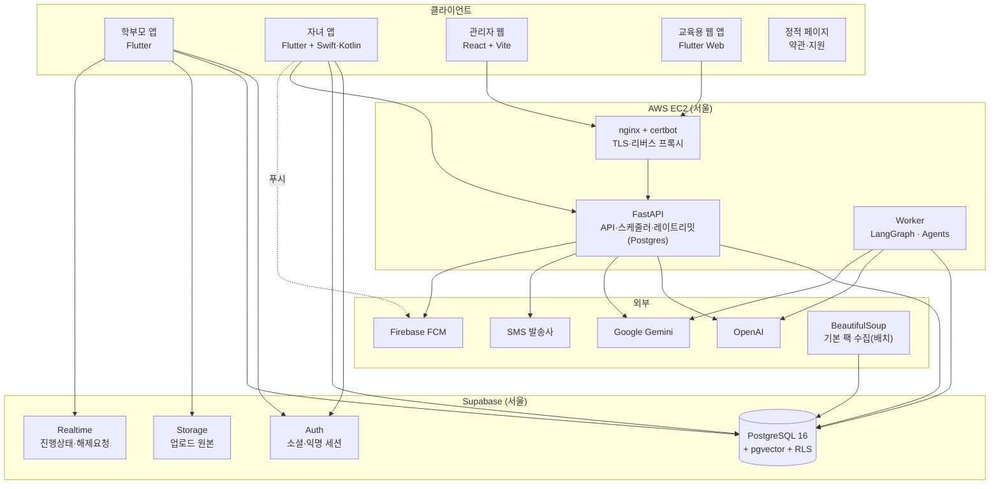
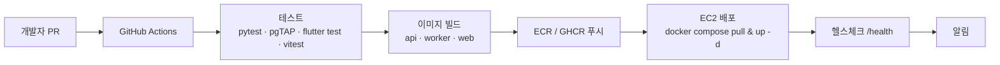

# ⚙️ 기술 명세서 (Technical Specification)

> **프로젝트** 하루(Haru) — 초중학생 학습·안전 관리 앱
> **기준 문서** `기획서 v0.4 보완본` (2026-11-16) / `WBS.md` v1.2 / `기능 명세서` v0.2
> **버전** v0.2 / **작성일** 2026-11-12 / **개정일** 2026-11-14
> **범위** MVP(**기능 구현 11/22 · 검증·배포 11/24**, 상한 11/29) + 1.0(12/18 제출) → **발표 2027-01-04**
> **팀** 리드 1 + 팀원 4 = **5명 공동 구현**
>
> **v0.2 개정 사유** ① 기획서 v0.4 정합 ② **Redis 제거**(작업 큐 = Postgres) ③ nginx 확정 ④ 에이전트 5종·교육용 웹 추가 ⑤ 평가 2트랙·자료 이용조건 ⑥ WBS 작업 ID 매핑(14장). 상세는 **15. 변경 이력**.

---

## 0. 요약

| 항목 | 내용 |
| --- | --- |
| 서비스 형태 | Flutter 앱 2종(학부모·자녀) + 관리자·정적 웹 |
| 핵심 아키텍처 | **Supabase(데이터·인증·저장·실시간) + FastAPI(AI·외부연동·스케줄)** |
| AI | LangGraph 오케스트레이션, OpenAI(생성) + Gemini(검수) 교차 검증 |
| 배포 | AWS EC2(서울) 1대 · Docker Compose · nginx · GitHub Actions |
| 원칙 1 | **RLS로 막을 수 있는 읽기·쓰기는 앱이 Supabase에 직접** |
| 원칙 2 | **비밀키·LLM·외부 발송이 필요한 일만 FastAPI 경유** |
| 원칙 3 | **잠금 해제 판정은 LLM이 아니라 기기 내 규칙 엔진** |

---

## 1. 초안 ↔ 기획서 정합 (v0.4에서 **전건 종결**)

| # | 항목 | 판단 | **v0.2 결정** |
| --- | --- | --- | --- |
| 1 | Redis·Celery | 기획서: **쓰지 않는다** | ✅ **Redis 제거 확정.** 작업 큐 = Postgres `FOR UPDATE SKIP LOCKED` + 워커 1개. 레이트리밋·TTL도 **Postgres 카운터**로 대체 |
| 2 | Caddy vs nginx | 대체 가능 | ✅ **nginx + certbot 확정** (기획서 7.5·WBS 2.2.6) |
| 3 | PostgreSQL 이중화 | 이중 DB 금지 | ✅ **"PostgreSQL = Supabase Postgres 16"** 단일로 표기. 별도 RDS·로컬 Postgres 추가 금지 |
| 4 | BeautifulSoup 수집 | 기본 팩 한정 | ✅ **기본 팩 공개 데이터만.** 자료별 **이용조건·AI 입력·변형·배포 4항목 확인** 후 채택 (4.6) |
| 5 | 웹 범위 | 관리자·정적·학부모 | ✅ **3종 분리**: 관리자(React, 윤기화) / 정적(site) / **교육용 웹 앱**(W-01~03, 차해든) |
| 6 | Streamlit 요건 | 스택에 없음 | 🔶 **미결정 유지** — 13.2 4번. 멘토 확인 필요 |
| **7** | **잠금 PoC** | (신규 지적) | ✅ **실기기 PoC(11/25~27) → 11/28 게이트** 후 iOS 범위 확정 (4.2) |
| **8** | **에이전트 산출물** | (신규 지적) | ✅ **4.5.1~4.5.5** 에 단일·협업·자기성찰·가드레일·Auto-Healing 정의 + `agent_runs` 테이블 |
| **9** | **평가 2트랙** | (신규 지적) | ✅ **내부 20건 / BFCL 30문항 분리** (7장) |
| **10** | **자료 이용조건** | (신규 지적) | ✅ **4.6.1 4항목 확인표** + 기획서 11.2 출처 표 |

---

## 2. 아키텍처 개요



> **v0.2 변경:** **Redis 노드 삭제**(기획서 6.2·7.4와 일치). 레이트리밋·TTL은 Postgres 테이블(`usage_counters`, `pairing_codes.expires_at`)로 처리한다. 관리자 웹과 교육용 웹 앱을 분리 표기.

**경계 원칙**

| 경계 | 규칙 |
| --- | --- |
| 앱 ↔ Supabase | RLS로 격리되는 단순 읽기·쓰기만 직접 |
| 앱 ↔ FastAPI | LLM, 문자 발송, 푸시, 사용량 한도, 연결 코드 |
| 서버 ↔ DB | FastAPI는 **service role** 키 사용 (서버에서만) |
| 좌표 | **기기 밖으로 나가지 않음**. 서버엔 장소ID·종류·시각만 |
| LLM | 자녀 이름·식별자·좌표 전송 금지 |

---

## 3. 기술 스택 총괄

### 3.1 클라이언트

| 계층 | 기술 | 역할 | 적용 | 선정 이유 / 대안 |
| --- | --- | --- | --- | --- |
| 모바일 공통 | **Flutter** | 학부모·자녀 앱 (코드베이스 1, 앱 2) | MVP | 권한·심사 부담을 자녀 앱에만 집중. 대안: 네이티브 2벌(비용 큼) |
| 자녀 앱 네이티브 | **Swift** (iOS) | FamilyControls·ManagedSettings·DeviceActivity, 지오펜스 | 1.0 | 플러그인이 0.0.x라 채널 직접 호출 |
| 자녀 앱 네이티브 | **Kotlin** (Android) | AccessibilityService 차단, Geofencing, 부팅 자동시작 | 1.0 | `QUERY_ALL_PACKAGES` 미사용 |
| 웹 | **React 19 + Vite** | **관리자 웹**(문제은행·회원·신고·통계) | MVP~1.0 | 담당 **윤기화**(WBS 4.4.2). 대안: Next.js(SSR 불필요) |
| 웹 | **Flutter Web 우선안** | **교육용 웹 앱**(학부모 학습 현황·리포트) | 1.0 | 담당 **차해든**(WBS 3.7.6). 앱 코드 재사용 가능. 수정안 제출 후 멘토 합의 예정 |
| 웹 스타일 | **Tailwind CSS** | 관리자 웹 디자인 시스템·반응형 | MVP~1.0 | 블랙앤화이트 톤 일관성 |
| 정적 페이지 | React 빌드 산출물 | 약관·개인정보처리방침·위치기반약관·지원 | 제출 전 | 스토어 제출 필수 URL |

### 3.2 서버

| 계층 | 기술 | 역할 | 적용 | 비고 |
| --- | --- | --- | --- | --- |
| API | **FastAPI** (Python 3.12) | REST `/v1`, 스케줄러, 외부 발송 | MVP | Pydantic 스키마 강제 = LLM 출력 검증에 유리 |
| 워커 | FastAPI 프로세스 분리 | LangGraph 파이프라인 실행 | MVP | 작업 큐는 **Postgres** `FOR UPDATE SKIP LOCKED` |
| 오케스트레이션 | **LangGraph** | 파싱→계획→생성→검수→저장 상태 그래프 | MVP | 재생성 최대 2회 |
| 에이전트 | **LangGraph 노드 + 어댑터** | 단일 에이전트·협업·자기 성찰·가드레일·Auto-Healing | MVP | 4.5.1~4.5.5, 실행 기록 `agent_runs` |
| 레이트리밋·TTL | **Postgres 테이블** | 사용량 카운터, 연결코드 만료, 중복 요청 차단 | MVP | **Redis 미사용**(기획서 6.2) |
| 리버스 프록시 | **nginx** | TLS 종료, 정적 서빙, 업로드 크기 제한 | MVP | **certbot** 자동 갱신 |
| 수집 | **BeautifulSoup4 + httpx** | 기본 팩 공개 데이터 수집(배치) | 1.0 | **이용조건 4항목 기록 필수** |

### 3.3 데이터

| 계층 | 기술 | 역할 | 적용 | 비고 |
| --- | --- | --- | --- | --- |
| 주 DB | **PostgreSQL** (= Supabase Postgres 16) | 모든 도메인 데이터 | MVP | **별도 DB 추가 금지** |
| 벡터 검색 | **pgvector** | 문항 임베딩·유사문항 중복 방지·원문 근거 검색 | 1.0 | `vector(1536)`, HNSW 인덱스 |
| 인증 | **Supabase Auth** | Google·Apple 로그인, 자녀 익명 세션 | MVP | |
| 파일 | **Supabase Storage** | PDF·CSV 업로드 원본(비공개 버킷) | MVP | 서명 URL만 허용. **사진 원본 저장 금지** |
| 실시간 | **Supabase Realtime** | 생성 진행률, 해제 요청 | MVP | |
| 접근 제어 | **RLS + pgTAP** | 가족·자녀 단위 격리 | MVP | 테스트로 교차접근 0건 검증 |
| 레이트리밋·멱등성 | **Postgres** (`usage_counters`·`idempotency_keys`) | 호출 한도·중복 요청 차단 | MVP | **Redis 미사용** |

### 3.4 외부·인프라

| 계층 | 기술 | 역할 | 적용 |
| --- | --- | --- | --- |
| LLM 생성 | **OpenAI** (구조화 출력) | 문항 생성 | MVP |
| LLM 검수 | **Google AI Studio(Gemini)** | 원문 대조 검수, PDF 파싱. **사진 원본 입력 금지·온디바이스 OCR 텍스트만 허용** | MVP |
| 푸시 | **Firebase FCM** | 두 앱 알림 | 1.0 (MVP는 앱 진입 시 갱신) |
| 문자 | SMS 발송사 | 법정대리인 동의 확인, 인증번호 | MVP |
| 서버 | **AWS EC2 (서울, t4g.small)** | FastAPI·워커·nginx (**Redis 없음**) | MVP |
| CI/CD | **GitHub Actions** | 테스트·이미지 빌드·EC2 배포 | MVP |
| 컨테이너 | **Docker Compose** | **api · worker · nginx** (3개) | MVP |

---

## 4. 컴포넌트 상세

### 4.1 학부모 앱 (Flutter)

| 기능 | 기술 포인트 |
| --- | --- |
| 소셜 로그인 | Supabase Auth (Google·Apple) + 휴대전화 문자 확인 |
| 자료 업로드 | PDF·CSV는 Supabase Storage 비공개 버킷. 사진은 1.0에서 **온디바이스 OCR** 후 텍스트만 전송하며 원본은 기기에만 보관. **30쪽/10장/20MB** 제한 |
| 검수 화면 | 문항별 승인·수정·삭제, 원문 근거(쪽·인용문) 표시 |
| 커리큘럼 | 기간·하루 분량 설정, 배분은 **서버 규칙 엔진** |
| 오늘 현황 | Supabase 직접 조회(RLS) |
| 푸시 수신 | FCM (1.0) |

> 네이티브 권한 없음 → **심사 리스크 최소**. 어떤 경우에도 가장 먼저 제출.

### 4.2 자녀 앱 (Flutter + Swift/Kotlin)

| 기능 | 기술 포인트 | 시점 |
| --- | --- | --- |
| 연결 코드 입력 | 익명 세션 → `/pairing/claim` (6자리·10분·1회용·5회 실패 폐기) | MVP |
| 미션 풀이 | **오프라인 우선**. 7일치 미션 로컬 저장 | MVP |
| 규칙 엔진 | 잠금 판정을 **기기 내**에서 수행, 나중에 서버 동기화 | 1.0 |
| iOS 차단 | FamilyControls·ManagedSettings·DeviceActivity + 확장 3개 | 1.0 |
| Android 차단 | AccessibilityService + 전체화면 차단 | 1.0 |
| 지오펜스·체크인 | iOS 지역모니터링(20곳)·Android Geofencing(100곳), 판정은 기기 | 1.0 |

**빌드 분리**: `차단`·`위치`를 **빌드 플래그로 분리**한다. 권한은 선언만으로 심사 대상이므로, 반려 시 **해당 권한을 뺀 빌드를 즉시 낼 수 있어야** 한다.

**잠금 PoC 게이트 (v0.2 신규)**
- **11/25~27 실기기 PoC**: Android 접근성 차단 / iOS FamilyControls 권한·차단 (WBS **4.0.1**)
- **11/28 게이트**: 결과를 보고 **iOS 차단 포함/제외 확정** (WBS **4.0.2**)
- 판정 기준: 차단 대상 앱 실행 시 **2초 내 차단 화면**, 전화·문자 통과, 오프라인 동작
- Screen Time API는 **시뮬레이터에서 동작하지 않는다.** 반드시 실기기
- **PoC 실패 시**: iOS는 차단 없이 1.0 출시 → 승인 후 업데이트 (기획서 10.3)

```
com.shs5029.haru.parent          학부모 앱
com.shs5029.haru.child           자녀 앱
com.shs5029.haru.child.monitor   Device Activity Monitor
com.shs5029.haru.child.shield    Shield Configuration
com.shs5029.haru.child.shieldaction Shield Action
```

### 4.3 웹 (3종 분리)

| 대상 | 기술 | 페이지 | 담당 | 시점 |
| --- | --- | --- | --- | --- |
| **관리자 웹** | React + Vite + Tailwind | 문제은행·회원·신고·통계 조회 (A-01~04) | **윤기화** (WBS 4.4.2) | 1.0 |
| **교육용 웹 앱** | Flutter Web | 로그인·현황·주간 리포트 (W-01~03) | **차해든** (WBS 3.7.6) | 1.0 |
| **정적 페이지** | React 빌드 산출물 | 개인정보처리방침·이용약관·위치기반서비스 약관·지원 | 차해든 (WBS 4.6.2) | 제출 전 |

**원칙**
- 관리자 웹은 **service 키를 절대 브라우저로 보내지 않는다.** 관리자 전용 FastAPI 엔드포인트(`/v1/admin/*`) + 별도 인증으로 처리한다.
- 교육용 웹 앱은 **열람 전용**이다. 업로드·검수·정책 변경은 앱에서만 한다.
- 인증은 **Supabase JWT를 재사용**하고, 데이터 접근은 RLS로 제한한다(별도 권한 체계를 만들지 않는다).

### 4.4 API 서버 (FastAPI) 구조

```
server/
  api/         라우터 (v1)
  pipeline/    LangGraph 그래프 정의
  agents/      단일 에이전트·협업·자기 성찰·가드레일·Auto-Healing
  providers/   OpenAI · Gemini · SMS · FCM 어댑터
  jobs/        스케줄러·작업 큐 워커
  notify/      푸시·문자 발송
  core/        설정·인증·로깅·레이트리밋(Postgres)·멱등성
```

| 원칙 | 내용 |
| --- | --- |
| 공급자 격리 | LLM은 **어댑터 계층** 뒤에 두고 모델 ID는 설정값 |
| 출력 강제 | 모든 LLM 출력은 **Pydantic 스키마** 검증, 불일치 시 재시도 |
| 프롬프트 주입 방어 | 업로드 자료 내 지시문은 **데이터로만** 취급 |
| 멱등성 | **모든 쓰기 API**가 `Idempotency-Key` 를 받는다 (기획서 8.3, v0.2 강화) |
| 실행 기록 | 에이전트 1회 실행 = `agent_runs` 1행. 제공자·모델·토큰·소요·폴백 여부 저장 |

### 4.5 AI 파이프라인 (LangGraph)

| 단계 | 담당 | 모델 | 비고 |
| --- | --- | --- | --- |
| 1. 파싱 | PDF: Gemini / 사진: 온디바이스 OCR | PDF 또는 OCR 텍스트 입력 | 사진 원본은 서버·DB·외부 LLM 입력 금지 |
| 2. 커리큘럼 설계 | 소형 모델 | 단원 순서·묶음 제안 | 날짜 배분은 **규칙** |
| 3. 문항 생성 | OpenAI | 구조화 출력 | 문항마다 원문 근거(쪽·인용문) |
| 4. 검수 | Gemini | **생성과 다른 제공자** | 정답·보기 중복·학년 수준·부적절 표현 |
| 5. 적응 | 규칙 + 소형 모델 | 오답 패턴 | **승인된 문항만** 재출제·순서 조정 |
| 6. 리포트 | 소형 모델 | 주간 요약 | 집계 수치만 전달 |

**그래프**: `파싱 → 단원계획 → 생성 → 검수 → (불합격 시 재생성 최대 2회) → 저장(부모 검수 대기)`. 2회 불합격 문항은 **폐기**.

**pgvector 사용처**
- 문항 임베딩으로 **유사 문항 중복 방지** (같은 문제 반복 출제 차단)
- 원문 청크 임베딩으로 **검수 시 근거 문단 검색**(RAG)
- 취약 단원 판정 보조

#### 4.5.1 단일 에이전트 (WBS 3.7.1)

| 항목 | 정의 |
| --- | --- |
| 역할 | "주어진 원문 발췌로 유형별 문항을 만든다" — **1개 책임**만 가진다 |
| 도구 | `source_chunks` 조회 1개 |
| 출력 스키마 | `{type, question, answer, choices, evidence:{page, quote}}` (Pydantic 강제) |
| 구현 | LangGraph 노드 1개. 입력=단원·발췌, 출력=문항 배열 |
| 기록 | 실행마다 `agent_runs`(stage=`generate`) |

#### 4.5.2 협업 구조 (WBS 3.7.2)

```
[파싱] → [단원계획] → [생성 에이전트] ⇄ [검수 에이전트] → [저장/부모검수 대기]
                              ↑______________|
                          불합격 사유 반환
```

| 원칙 | 내용 |
| --- | --- |
| 역할 분리 | 생성=OpenAI, 검수=Gemini. **같은 제공자로 자기 검수 금지** |
| 계약 | 검수 반환 `{grounded, policy_ok, issues[]}` 고정 |
| 반환 경로 | 불합격 사유를 생성 입력에 포함해 재호출 |
| 기록 | 핸드오프 횟수·불합격 사유를 `agent_runs` 에 남긴다 |

#### 4.5.3 자기 성찰 (WBS 3.7.3)

| 항목 | 내용 |
| --- | --- |
| 루프 | 불합격 → **자기 수정 프롬프트** → 재생성 → 재검수. **최대 2회** |
| 종료 | 2회 불합격 = **폐기**. 부모 검수 목록에 노출하지 않는다 |
| 기록 | 회차별 사유·결과를 남겨 **개선 근거**로 쓴다 |
| 지표 | 재생성률, 2회 폐기율 |

#### 4.5.4 가드레일 (WBS 3.7.4)

| 대상 | 검사 위치 | 예 |
| --- | --- | --- |
| 금지 표현 | **코드 + 검수 프롬프트** | 복용·투약 단정, 의료 판단 |
| 개인정보 | **코드**(정규식) | 전화번호·이메일·실명 |
| 프롬프트 주입 | **코드 + 문맥 분리** | 자료 안의 "이전 지시 무시" |
| 출처 없는 단정 | 검수(LLM) + `evidence` 필수 | 근거 없는 정답 |

> **LLM 판정에만 맡기지 않는다.** 근거·정책은 검수 LLM, **금지 문장·패턴은 코드**가 한 번 더 본다(과거 사례: LLM이 거짓 이관 약속을 통과시킴).
> 테스트: 3종 × **각 3케이스 이상**.

#### 4.5.5 Auto-Healing (WBS 3.7.5)

| 단계 | 동작 |
| --- | --- |
| 1차 | 기본 모델 호출 |
| 2차 | **대체 모델** 호출(설정값) |
| 3차 | **규칙·템플릿 폴백** |
| 기록 | `agent_runs.fallback = true`, 복구율 집계 |
| 고지 | 폴백 결과는 **"간이 생성"으로 표시**. 정상 생성과 같은 품질로 보이지 않게 |

#### 4.5.6 평가 — 두 트랙 분리 (WBS 3.2.5 / 3.2.6)

| 트랙 | 목적 | 자료 | 결과 문서 |
| --- | --- | --- | --- |
| **A 내부** | 문항 정답률·검수 품질 | 팀 샘플 **20건** | `docs/eval/internal-20.md` |
| **B BFCL** | 도구 호출·에이전트 능력 | **BFCL 원본 30문항** | `docs/eval/bfcl-30.md` |

> 두 평가의 **목적·자료·결과를 합치지 않는다.**


### 4.6 수집 (BeautifulSoup)

| 항목 | 규칙 |
| --- | --- |
| 대상 | 기본 팩(필수 영단어·한자·국어어휘·영문법)의 **공개 데이터만** |
| 금지 | 학부모 업로드 자료, 유료 교재, 로그인 필요 사이트 |
| 기록 | `source_url`, `license`, `collected_at` 을 DB에 저장 |
| 실행 | 배치(수동 트리거), 서버 런타임과 분리 |
| 리스크 | robots.txt·이용약관 준수. **저작권 확인 전 배포 금지** |

#### 4.6.1 자료 이용조건 확인표 (WBS 4.5.2 · 기획서 11.2)

> 자료를 파이프라인에 넣기 전에 **4항목을 모두 확인**한다. 하나라도 미확인이면 **채택 보류**.

| 자료 | 이용조건 | AI 입력 | 변형(문항 생성) | 배포 범위 | 판정 |
| --- | --- | --- | --- | --- | --- |
| 팀 제작 예시 | 자유 | 가능 | 가능 | 팀 내·시연 | ✅ |
| 공개 라이선스 기본 팩 | 라이선스 원문 확인 | 확인 | 확인 | 확인 | 🔶 확인 후 |
| 학부모 업로드 | 약관 동의 | 가족 내 처리 | 가능 | 배포 안 함 | 🔶 약관 명시 |
| 자녀 단원평가 사진 | 정당한 이용 권한 고지 필요 | **사진 입력 금지·OCR 텍스트만** | 개인 학습용 | 가족 내 | 🔶 약관·기술 검증 후 |
| 사용자 보유 PDF | 정당한 이용 권한 고지 필요 | 약관 동의 후 | 개인 학습용 | 가족 내 | 🔶 약관 확정 후 |
| 족보닷컴 등 유료 기출 | **공식 이용조건 확인 필요** | 미확인 | 미확인 | 미확인 | ❌ **보류** |
| 문제집 스캔 | **미확인** | 미확인 | 미확인 | 미확인 | ❌ **보류** |

> ⚠️ **"가족 안에서 사용"만으로는 이용 조건 확인이 끝나지 않는다.**

---

## 5. 데이터 모델

### 5.1 테이블 (기획서 8.1)

| 영역 | 테이블 |
| --- | --- |
| 가족 | `families`, `guardians`, `children`, `child_devices`, `pairing_codes`, `phone_verifications`, `consents` |
| 학습 | `study_sets`, `items`, `generation_jobs`, `curricula`, `curriculum_items`, `daily_missions`, `mission_items`, `attempts`, `review_states` |
| 차단 | `block_policies`, `unlock_requests` |
| 장소 | `places`, `schedules`, `place_events`, `location_disclosure_logs` |
| 알림 | `push_tokens` |
| 통계 | `weekly_reports`, `usage_counters`, `usage_limits` |
| **관리자** | `admin_users`, `audit_logs` |
| **에이전트** | `agent_runs` |

### 5.2 추가 제안 (신규 스택 대응)

| 테이블 | 목적 |
| --- | --- |
| `item_embeddings` | pgvector 문항 임베딩 (`item_id`, `vector(1536)`, HNSW) |
| `source_chunks` | 업로드 원문 청크 + 임베딩(검수 근거 검색) |
| `idempotency_keys` | 중복 요청 방지 (모든 쓰기 API) |
| `audit_logs` | 관리자 조작·개인정보 접근 기록 |
| **`agent_runs`** | 에이전트 실행 기록(단계·제공자·모델·토큰·소요·폐기·**폴백 여부**) — Auto-Healing 증거 |

### 5.3 주요 컬럼 규칙

| 테이블 | 규칙 |
| --- | --- |
| `items` | 유형, 문제, 정답, 보기, **원문 근거**, AI 검수 상태, **부모 승인 상태** |
| `children` | 별명, 출생 연월, 학년, 관리 방식(보호자/본인) — **이메일·전화 저장 안 함** |
| `place_events` | 장소ID, 종류(진입·이탈·체크인), 출처, 정확도, 시각 — **좌표 저장 안 함** |
| `location_disclosure_logs` | 누구에게·언제·무슨 목적으로 알렸는지 (법정 기록) |

### 5.4 RLS 정책

| 주체 | 권한 |
| --- | --- |
| 보호자 | 자기 가족 전체 |
| 자녀 기기 | 연결된 자녀의 미션·문항 **읽기**, 풀이·이벤트 **쓰기** |
| 자녀 기기 금지 | 정책·장소·커리큘럼 변경 (만 14세 미만) |
| 검증 | **pgTAP으로 "다른 가족 데이터 접근 0건"** 테스트 |

---

## 6. API 명세

### 6.1 엔드포인트

| 메서드·경로 | 호출 | 역할 | 시점 |
| --- | --- | --- | --- |
| `POST /v1/guardian/register` | 학부모 | 가족·보호자 생성 | MVP |
| `POST /v1/guardian/phone/send`·`/verify` | 학부모 | 문자 인증 | MVP |
| `POST /v1/children` | 학부모 | 자녀+동의 저장, 확인 문자 | MVP |
| `POST /v1/pairing/codes` | 학부모 | 연결 코드 발급 | MVP |
| `POST /v1/pairing/claim` | 자녀 | 기기 연결 | MVP |
| `POST /v1/sets/{id}/generate` | 학부모 | 생성 작업 시작(한도 확인) | MVP |
| `POST /v1/curricula` | 학부모 | 커리큘럼 생성·배분 | MVP |
| `POST /v1/missions/today` · `/missions/{id}/complete` | 자녀 | 오늘 미션·완료 | MVP |
| `POST /v1/agreements`·`/confirm`·`/revoke` | 자녀·학부모 | 가족 약속 동의·철회 | 1.0 |
| `POST /v1/unlock-requests`·`/{id}/decision` | 자녀·학부모 | 해제 요청·승인 | 1.0 |
| `POST /v1/events/place` | 자녀 | 진입·이탈·체크인 | 1.0 |
| `POST /v1/devices/heartbeat` | 자녀 | 권한 상태·최종 접속 | 1.0 |
| `GET /v1/admin/*` | 관리자 | 문제은행·통계·신고 | 1.0 |

### 6.2 예시 계약

```http
POST /v1/sets/{id}/generate
Authorization: Bearer <supabase_jwt>
Idempotency-Key: 8f14e45f-ea2b-4b6f-9a0c-3d5f7c1a2b34

202 Accepted
{
  "job_id": "gen_01H...",
  "status": "queued",
  "usage": { "used_month": 3, "limit_month": 20 }
}
```

```http
POST /v1/missions/01H.../complete
{
  "answers": [
    { "item_id": "itm_01", "response": "apple", "elapsed_ms": 4200 },
    { "item_id": "itm_02", "response": "banana", "elapsed_ms": 6100 }
  ],
  "client_completed_at": "2026-11-20T08:12:00+09:00"
}

200 OK
{
  "mission_id": "01H...",
  "correct": 2,
  "total": 2,
  "unlock_granted": true,
  "next_review_at": "2026-11-21"
}
```

**에러 규약** — `code`는 고정 문자열, `message`는 사용자 노출용.

| HTTP | code | 의미 |
| --- | --- | --- |
| 400 | `INVALID_INPUT` | 스키마 위반 |
| 401 | `UNAUTHORIZED` | 토큰 무효 |
| 403 | `FORBIDDEN_FAMILY` | 다른 가족 데이터 접근 |
| 409 | `PAIRING_ALREADY_USED` | 사용된 연결 코드 |
| 429 | `USAGE_LIMIT_EXCEEDED` | 사용량 한도 |
| 503 | `LLM_PROVIDER_DOWN` | 생성 제공자 장애 |

---

## 7. 비기능 요구사항

| NFR ID | 구분 | 지표 | 목표값(MVP) | 검증 |
| --- | --- | --- | --- | --- |
| NFR-PERF-001 | 응답 성능 | 읽기 API p95 | **300ms 이하** | k6 부하 테스트 |
| NFR-PERF-002 | 응답 성능 | 쓰기 API p95 | **500ms 이하** | 〃 |
| NFR-PERF-003 | 생성 처리 | 업로드 → 검수 대기 | **3분 이내**(30쪽 기준) | 실측 10건 |
| NFR-SCALE-001 | 동시성 | 동시 생성 작업 | **5건** | 큐 대기시간 측정 |
| NFR-AVAIL-001 | 가용성 | 월 가동률 | **99.5%** | 업타임 모니터 |
| NFR-RECOV-001 | 데이터 | RPO / RTO | **24h / 4h** | Supabase 백업·복구 리허설 |
| NFR-SEC-001 | 보안 | 교차 가족 접근 | **0건** | pgTAP |
| NFR-SEC-002 | 보안 | 비밀키 노출 | **0건** | 저장소 스캔(secret scanning) |
| NFR-SEC-003 | 보안 | 민감정보 로그·파일 공개 | **0건** | 로그·Storage 정책 점검 |
| NFR-SEC-004 | 보안 | 자녀 식별자·좌표의 LLM 전송 | **0건** | 요청 로그 표본 점검 |
| NFR-QUAL-001 | 품질 | 검수 통과 문항 정답률 | **95% 이상** | 내부 평가셋 20건 |
| NFR-QUAL-002 | 품질(BFCL) | BFCL 원본 30문항 통과율 | 별도 기록(내부 20건과 분리) | `docs/eval/bfcl-30.md` |
| NFR-LOCK-001 | 잠금 PoC | 실기기 차단 판정 | **2초 내 차단 화면**, 전화·문자 통과 | 4.0.1 실기기 |
| NFR-OFFLINE-001 | 오프라인 | 미션 완료→잠금 해제 | **네트워크 없이 동작** | 실기기 |
| NFR-LOC-001 | 위치 | 진입 알림 수신 | **5분 이내** | 실제 장소 3곳 |
| NFR-SIZE-001 | 앱 크기 | 자녀 앱 APK | **80MB 이하** | 빌드 측정 |

---

## 8. 보안·개인정보

| 항목 | 구현 |
| --- | --- |
| 키 관리 | Supabase **anon** 키는 앱에, **service role** 은 서버 `.env` 에만. 저장소엔 `.env.example` 만 |
| 토큰 | 앱은 Supabase JWT, FastAPI는 JWT 검증 후 `guardian_id`/`child_id` 매핑 |
| 관리자 | `/v1/admin/*` 별도 인증, **service 키 브라우저 노출 금지** |
| 로그 마스킹 | 자녀 이름·전화번호·좌표는 로그에 남기지 않음 |
| 파일 | 비공개 버킷 + **서명 URL(단기)** |
| LLM 전송 | 자녀 식별자·좌표 전송 금지. 집계 수치만 |
| Rate limit | **Postgres 카운터**(`usage_counters`). 업로드·생성·문자 발송에 각각 한도. **Redis 미사용** |
| 감사 | 관리자 조작·위치 제공 사실은 `audit_logs`·`location_disclosure_logs` 에 기록 |
| 시크릿 | `.env` **값 뒤에 인라인 `#` 주석 금지**(Compose가 주석을 제거하지 않아 값이 오염됨) |

---

## 9. 배포·CI/CD



| 항목 | 내용 |
| --- | --- |
| 브랜치 | `main`(배포), `develop`(통합), PR 필수·본인 병합 금지 |
| 서버 | EC2 t4g.small, Docker Compose(**api·worker·nginx**), 고정 IP + 도메인 |
| TLS | nginx + **certbot(Let's Encrypt)** 자동 갱신 |
| 비밀 | EC2 `.env` + GitHub Secrets. **IAM 배포 전용 사용자**, 루트 자격 증명 금지 |
| 앱 배포 | iOS `flutter build ipa` → App Store Connect API → TestFlight / Android 내부 테스트 |
| 롤백 | 이미지 태그 고정 + 이전 태그로 재기동 (1분 내) |
| 마이그레이션 | Supabase CLI, 배포 전 별도 단계, **되돌림 스크립트 필수** |

---

## 10. 모니터링·운영

| 대상 | 도구 | 지표 |
| --- | --- | --- |
| 서버 | CloudWatch + `/health` | CPU·메모리·디스크·5xx |
| API | 구조화 로그(JSON) | p50/p95, 에러 코드 분포 |
| 파이프라인 | `generation_jobs` 테이블 | 대기시간·실패율·재생성 횟수 |
| LLM 비용 | `usage_counters` | 가정당 월 호출·토큰·원가 |
| 앱 | Sentry(권장) | 크래시·ANR |
| 알림 | FCM 실패율 | 도달률 |

**대시보드 필수 항목**: 생성 성공률, 검수 불합격률, 가정당 비용, 교차접근 시도 0건, 위치 알림 지연.

---

## 11. 비용 산정 (초안)

| 항목 | 사양 | 월 예상 |
| --- | --- | --- |
| EC2 | t4g.small (서울) | 약 $12 |
| Supabase | Free → Pro | $0 → $25 |
| ~~Redis~~ | **미사용 (0)** | **$0** |
| OpenAI | 생성 1건 ≈ 30쪽 | 실측 필요 (2주차) |
| Gemini | 파싱·검수 | 유료 등급 필요 |
| SMS | 인증·동의 문자 | 건당 과금 |
| FCM | 무료 | $0 |
| 도메인·인증서 | Let's Encrypt | 약 $1 |

> **가정당 월 20건** 한도면 LLM 원가가 최대 비용. **2주차에 1건당 실측** 후 `usage_limits` 확정.

---

## 12. 단계별 적용 (MVP / 1.0)

| 기술 | MVP (**기능 11/22 · 배포 11/24**) | 1.0 (12/18) |
| --- | --- | --- |
| Flutter 학부모·자녀 앱 | ✅ | ✅ |
| Supabase Auth·Postgres·Storage·Realtime | ✅ | ✅ |
| FastAPI + LangGraph + OpenAI·Gemini | ✅ | ✅ |
| **에이전트 5종**(단일·협업·자기성찰·가드레일·Auto-Healing) | ✅ (3.7.1~3.7.5) | ✅ |
| 레이트리밋(Postgres) | ✅ | ✅ |
| ~~Redis~~ | **미사용** | **미사용** |
| nginx + certbot | ✅ | ✅ |
| GitHub Actions | ✅ | ✅ |
| React 웹 — 정적(약관·지원) | △ | ✅ |
| React 웹 — 관리자 | — | ✅ (4.4.2 윤기화) |
| **Flutter Web — 교육용 웹 앱** | — | ✅ (3.7.6 차해든) |
| pgvector | — | ✅ |
| Firebase FCM | — | ✅ |
| BeautifulSoup 기본 팩 수집 | — | △ |
| Swift/Kotlin 차단·지오펜스 | — | ✅ (**4.0.2 게이트 후**) |
| PostgreSQL(별도 인스턴스) | **미사용** | **미사용** |

---

## 13. 미결정·확인 필요 (v0.2 갱신)

### 13.1 종결

| # | 항목 | 결정 |
| --- | --- | --- |
| 1 | ~~Redis 용도~~ | **미사용 확정.** 큐 = Postgres, 레이트리밋 = Postgres 카운터 |
| 2 | ~~nginx vs Caddy~~ | **nginx + certbot 확정** |
| 3 | ~~PostgreSQL 이중화~~ | **Supabase Postgres 단일** |
| 4 | ~~React 웹 범위~~ | **관리자(React) / 교육용 웹(Flutter Web 우선안) / 정적** 3분리. 교육용 웹은 멘토 합의 예정 |
| 5 | ~~BeautifulSoup 범위~~ | **기본 팩 공개 데이터만**, 이용조건 4항목 확인 후 |
| 6 | 작업 방식 | **5명 공동 구현** |
| 7 | 발표일 | **2027-01-04** |

### 13.2 남은 확인

| # | 항목 | 기한 | 담당 | 막히면 |
| --- | --- | --- | --- | --- |
| 1 | **Streamlit 정규 요건 충족 방식** (멘토 확인) | 11/15 | 오병훈 | 관리자 웹 일부를 Streamlit으로 |
| 2 | pgvector 임베딩 모델·차원 (1536 고정?) | 11/22 | 심환석 | `text-embedding-3-small` 1536 |
| 3 | iOS 권한 모드(`.child`/`.individual`) 최종 | **11/28 게이트** | 최강현 | `.individual` + 꺼짐 감지 |
| 4 | LLM 1건당 원가 실측 | 2주차 | 심환석 | 보수적 한도(월 20건) 유지 |
| 5 | 관리자 웹 인증 방식 | 11/29 | 윤기화 | IP 제한 + 세션 |
| 6 | **위치기반서비스업 신고 범위** | 확인 대기 | 오병훈 | 위치 뺀 빌드 |
| 7 | **Apple Family Controls 권한** | 확인 대기 | 최강현 | 차단 없이 1.0 |
| 8 | SMS 발송사·발신번호 | 이번 주 | 최강현 | 기본 발송사 1곳 |
| 9 | 모바일·교육용 웹 기술안과 교육 요건 충족 여부 **멘토 합의** | 수정안 제출 후 | 오병훈·차해든·윤기화 | 현재 기술안을 유지하고 협의 결과 기록 |

> 6·7번은 **팀 결정이 아니라 외부 확인 대기**다. 기획서 **11.1 확인 상태 표**에서 근거 원문과 함께 관리한다.

---

## 14. WBS 작업 ID 매핑 (v0.2 신규)

> 교강사 지적: "산출물의 **작업 위치**가 WBS에서 보여야 한다." 아래 표로 기술 문서 ↔ WBS를 연결한다.

| 기술 문서 항목 | WBS 작업 ID | 담당 | 시점 |
| --- | --- | --- | --- |
| 3.2 레이트리밋(Postgres) | 2.2.4 · 2.2.5 | 최강현 | MVP |
| 3.4 nginx + certbot | 2.2.6 | 최강현 | MVP |
| 4.4 `server/agents/` 구조 | 2.2.2 | 윤기화 | MVP |
| 4.5.1 단일 에이전트 | **3.7.1** | 심환석 | MVP |
| 4.5.2 협업 구조 | **3.7.2** | 심환석 | MVP |
| 4.5.3 자기 성찰 | **3.7.3** | 심환석 | MVP |
| 4.5.4 가드레일 | **3.7.4** | 오병훈 | MVP |
| 4.5.5 Auto-Healing | **3.7.5** | 심환석 | MVP |
| 4.5.6 평가 A(내부 20건) | **3.2.5** | 심환석 | MVP |
| 4.5.6 평가 B(BFCL 30문항) | **3.2.6** | 심환석 | MVP |
| 4.3 관리자 웹 | **4.4.2** | 윤기화 | 1.0 |
| 4.3 교육용 웹 앱 | **3.7.6** | 차해든 | 1.0 |
| 4.2 잠금 PoC·게이트 | **4.0.1 · 4.0.2** | 최강현·오병훈 | 11/27–28 |
| 4.6.1 이용조건 확인표 | **4.5.2 · 7.2.5** | 오병훈 | 1.0·상시 |
| 7장 BFCL 지표 | **3.2.6** | 심환석 | MVP |
| 8장 시크릿 규칙 | 2.2.4 · 5.2.6 | 최강현 | MVP |

---

## 15. 변경 이력

| 버전   | 날짜         | 변경                                                                                                       |
| ---- | ---------- | -------------------------------------------------------------------------------------------------------- |
| v0.1 | 2026-11-12 | 최초 작성. 기획서 v0.3 기반 + 요청 스택(React·Vite·Tailwind·Redis·pgvector·BeautifulSoup·nginx·Firebase) 반영. 충돌 6건 도출 |
| **v0.2** | **2026-11-14** | **교강사 검토 반영.** ① 기준을 **기획서 v0.4 / WBS v1.1**로 갱신 ② **Redis 전면 제거**(큐=Postgres, 레이트리밋=Postgres) ③ nginx 확정 ④ **4.5.1~4.5.6** 에이전트 5종 + 평가 2트랙 신설 ⑤ **4.6.1 자료 이용조건 확인표** ⑥ 관리자 웹(윤기화)·교육용 웹(차해든) 분리 ⑦ **4.2 잠금 PoC 게이트** ⑧ `agent_runs` 테이블 ⑨ 모든 쓰기 API 멱등성 ⑩ **14장 WBS 작업 ID 매핑** 신설 ⑪ MVP를 **기능 11/22 · 배포 11/24**로 표기 ⑫ `.env` 인라인 주석 금지 규칙 |
