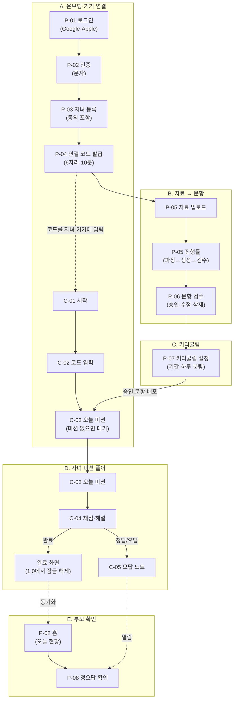
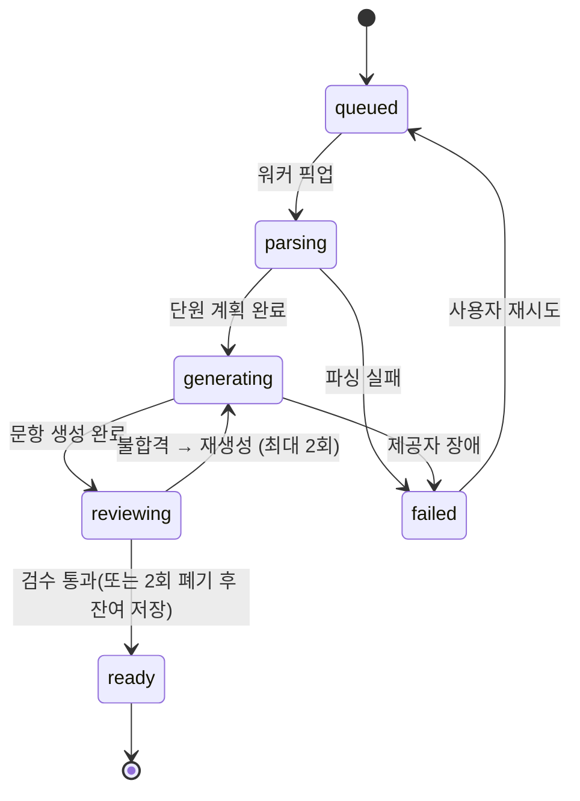
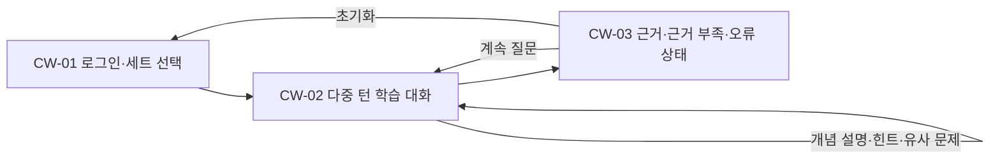

# 🧭 학습 MVP 화면 흐름

> **프로젝트** 하루(Haru) — 초1~고1 학습·안전 관리 앱
> **버전** v1.1.1 · **작성일** 2026-11-14 · **개정일** 2026-11-17
> **기준 문서** `기획서 v0.5.1` 4.6·4.7 · `기능 명세서 v0.3.1` 7장 · `WBS.md` v1.2.1 3장 · `기술 명세서 v0.3.1` 4.3·4.7·6장
> **범위** **학습 MVP 앱 흐름만** — 잠금·위치·통계와 열람형·대화형 웹 화면은 별도 범위이므로 이 문서의 MVP 화면 수에서 제외한다
> **목적** 교강사 요구 제출물 「학습 MVP 화면 흐름」. 화면 → 행동 → API → 다음 화면을 한 줄씩 연결한다

---

## 1. 한눈에 보는 흐름



> **실선** = 사용자 행동, **점선** = 시스템 반영·기기 간 이동.
> MVP에는 **차단·위치·푸시가 없다.** 완료 알림은 앱을 열 때 갱신된다.

---

## 2. 화면 목록 (MVP 13화면)

| ID        | 화면         | 액터  | 진입 경로        | 다음 화면        | 대응 FR                    | WBS   |
| --------- | ---------- | --- | ------------ | ------------ | ------------------------ | ----- |
| **P-01**  | 로그인        | 학부모 | 앱 실행         | P-02 인증      | FR-ACC-001               | 2.3.1 |
| **P-02a** | 휴대전화 인증    | 학부모 | P-01         | P-03         | FR-COM-001               | 2.3.2 |
| **P-03**  | 자녀 등록·동의   | 학부모 | P-02a        | P-04         | FR-ACC-002               | 2.3.3 |
| **P-04**  | 연결 코드 발급   | 학부모 | P-03         | P-05         | FR-PAIR-001              | 2.3.4 |
| **P-05a** | 자료 업로드     | 학부모 | P-04 / P-02b | P-05b        | FR-SET-001               | 3.1.2 |
| **P-05b** | 업로드·생성 진행률 | 학부모 | P-05a        | P-06         | FR-SET-002               | 3.3.3 |
| **P-06**  | 문항 검수      | 학부모 | P-05b        | P-07         | FR-SET-003               | 3.3.2 |
| **P-07**  | 커리큘럼 설정    | 학부모 | P-06         | P-02b 홈      | FR-CUR-001               | 3.4.3 |
| **P-02b** | 홈(오늘 현황)   | 학부모 | 로그인 후        | P-05a / P-08 | FR-PAR-001               | 3.5.2 |
| **P-08**  | 정오답 확인     | 학부모 | P-02b        | —            | FR-QUIZ-002              | 3.5.1 |
| **C-01**  | 시작         | 자녀  | 앱 실행         | C-02         | FR-ACC-001               | 2.3.1 |
| **C-02**  | 연결 코드 입력   | 자녀  | C-01         | C-03         | FR-PAIR-001              | 2.3.5 |
| **C-03**  | 오늘 미션      | 자녀  | C-02 / 재실행   | C-04         | FR-CUR-001 · FR-QUIZ-001 | 3.4.4 |
| **C-04**  | 채점·해설      | 자녀  | C-03         | C-05 / 완료    | FR-QUIZ-001              | 3.4.5 |
| **C-05**  | 오답 노트      | 자녀  | C-04         | C-03         | FR-QUIZ-002              | 3.5.1 |

> **화면 수 기준 확정:** 위 표는 실제 화면 상태로는 **15행**이다. `P-02`를 P-02a(인증)/P-02b(홈), `P-05`를 P-05a(업로드)/P-05b(진행률)로 나눈 결과다. 논리 ID는 **P-01~P-08 8개 + C-01~C-05 5개 = 13개**로 센다. 이후 문서에는 `MVP 논리 화면 13개 / 실제 화면 상태 15개`를 함께 표기한다.

---

## 3. 구간별 상세 흐름

### A. 온보딩 · 기기 연결

| # | 화면 | 사용자 행동 | 시스템 처리 (API) | 결과 · 다음 | 예외 |
| ---: | --- | --- | --- | --- | --- |
| A1 | **P-01 로그인** | Google/Apple 선택 | `Supabase Auth` 세션 발급 | P-02a 이동 | 로그인 취소 → P-01 유지 |
| A2 | **P-02a 문자 인증** | 휴대전화 번호 입력 → 인증번호 6자리 | `POST /v1/guardian/phone/send` → `/verify` | 인증 성공 → P-03 | 5회 실패 → 10분 잠금(`AUTH_LOCKED`) · 유효 3분 |
| A3 | **P-03 자녀 등록** | 별명·출생연월·학년 입력 + 법정대리인 동의 체크 | `POST /v1/children` (프로필+동의 동시 저장) → **확인 문자 발송** | P-04 이동 | 동의 미체크 → 저장 버튼 비활성 · 이메일·전화 입력란 **없음** |
| A4 | **P-04 코드 발급** | 화면에 표시된 6자리 코드를 자녀 기기에 입력 | `POST /v1/pairing/codes` (6자리·10분·1회용·5회 실패 폐기) | 자녀 C-02 완료 시 **양쪽 화면 갱신** | 만료 → 재발급 · 사용됨 → `PAIRING_ALREADY_USED` |
| A5 | **C-01 시작** | "시작하기" | 익명 세션 생성 | C-02 | — |
| A6 | **C-02 코드 입력** | 부모 화면의 6자리 입력 | `POST /v1/pairing/claim` → 세션을 자녀 프로필에 귀속 | C-03 | `PAIRING_EXPIRED` · `PAIRING_ALREADY_USED` · `PAIRING_LOCKED` |
| A7 | **C-03 오늘 미션** | (미션이 없으면 대기 화면) | `POST /v1/missions/today` | 미션 있으면 풀이 시작 | 미션 없음 → "부모님이 준비 중" 안내 |

**A구간 완료 기준 (M2)**: 두 실기기에서 **가입 → 연결 → 로그인 유지**가 3분 내 완료.

---

### B. 자료 → 문항 (부모)

| # | 화면 | 사용자 행동 | 시스템 처리 | 결과 · 다음 | 예외 |
| ---: | --- | --- | --- | --- | --- |
| B1 | **P-05a 업로드** | **PDF·사진 OCR 중심**, CSV 호환 입력. 사진 원본 저장 여부 선택 | 비공개 버킷 업로드 → OCR/파싱 → `POST /v1/sets/{id}/generate` | P-05b로 이동 | 한도 초과 `USAGE_LIMIT_EXCEEDED` · 형식 오류 `INVALID_INPUT` · PDF 30쪽/사진 10장/20MB 초과 |
| B2 | **P-05b 진행률** | 대기 | `generation_jobs` 상태 구독(Supabase Realtime) | `ready` → P-06 자동 이동 | `failed` → 사유 표시 + 재시도 1회 |
| B3 | **P-06 검수** | 문항별 **승인 / 수정 / 삭제** | 승인분만 `items.approved = true` | P-07 | 승인 0건이면 P-07 진입 차단 |

**생성 상태 전이**



| 상태 | 화면 표시 | 사용자 행동 |
| --- | --- | --- |
| `queued` | "대기 중 (앞에 N건)" | 대기 |
| `parsing` | "자료를 읽는 중" | 대기 |
| `generating` | "문항을 만드는 중 (n/m)" | 대기 |
| `reviewing` | "검수 중" | 대기 |
| `ready` | "n개 문항 준비 완료" | **검수하러 가기** |
| `failed` | 사유 + "다시 시도" | 재시도 1회 |

> **가드레일:** 2회 불합격 문항은 `discarded` 로 저장되어 **P-06 목록에 나오지 않는다**(FR-AI-003).
> **Auto-Healing:** 제공자 장애 시 대체 모델·규칙 폴백으로 `ready` 도달 가능. 폴백이면 P-05b에 **"간이 생성"** 배지 표시(FR-AI-005).

---

### C. 커리큘럼 (부모)

| # | 화면 | 사용자 행동 | 시스템 처리 | 다음 | 예외 |
| ---: | --- | --- | --- | --- | --- |
| C1 | **P-07 설정** | 기간 · 하루 최대 분량 · 쉬는 요일 선택 | `POST /v1/curricula` → **규칙 기반** 균등 배분 → 간격반복 5단계 | 홈(P-02b) | 승인 문항 0건 → 안내 |
| C2 | **P-07 미리보기** | 날짜별 배분 확인 | 배분 결과 표시 (LLM 아님, 규칙) | 홈 | 기간 내 소화 불가 → "분량을 줄이세요" 경고 |

**배분 규칙 (MVP)**

```
1일 분량 = min(하루 최대, ceil(승인 문항 수 ÷ 가능 일수))
쉬는 요일 제외. 요일 가중치는 1.0에서.
간격 반복 상자 = 1·2·4·7·15일. 틀리면 1단계로 복귀.
```

---

### D. 자녀 미션 풀이

| # | 화면 | 사용자 행동 | 시스템 처리 | 다음 | 예외 |
| ---: | --- | --- | --- | --- | --- |
| D1 | **C-03 오늘 미션** | 문항 풀이 (카드·객관식·빈칸·철자) | **로컬 채점**(오프라인 우선) · 7일치 미션 캐시 | C-04 | 서버 미응답 → 로컬 판정 유지 |
| D2 | **C-04 채점·해설** | 정답 확인 · 해설 읽기 | 틀린 문항은 재풀이 1회 요구 | C-05 | 재풀이 미완료 → 완료 처리 안 됨 |
| D3 | **C-05 오답 노트** | 틀린 문항 복습 | 오답률 상위 단원 집계 · 재출제 후보 | C-03 | 같은 문항 3일 연속 출제 금지 |
| D4 | **완료 화면** | 미션 완료 | `POST /v1/missions/{id}/complete` (답안·소요시간·멱등성 키) | 홈 복귀 | 중복 제출 → **1회만 반영** |

**미션 상태 전이**

```
not_started → in_progress → completed
                    ↑            │
                    └── 재풀이 ───┘ (틀린 문항 1회)
오프라인: 로컬 completed → 온라인 복구 시 1회 동기화
```

> **MVP에는 잠금 해제가 없다.** `unlock_granted` 필드는 응답에 있지만 MVP에서는 항상 `false`(1.0에서 사용).

---

### E. 부모 확인

| # | 화면 | 사용자 행동 | 시스템 처리 | 다음 |
| ---: | --- | --- | --- | --- |
| E1 | **P-02b 홈** | 앱 열기 | 오늘 푼 수·정답률·소요·완료 여부 조회(RLS 직접) | P-08 |
| E2 | **P-08 정오답 확인** | 자녀의 문항별 정오답 열람 | `items` + `attempts` 조회 · **원문 근거 표시** | — |

**P-02b 표시 항목 (MVP)**

| 항목 | 값 | 비고 |
| --- | --- | --- |
| 오늘 푼 문항 | `n / total` | |
| 정답률 | `%` | |
| 총 소요 시간 | `분` | |
| 완료 여부 | 완료 / 진행 중 / 시작 전 | |
| AI 판단 근거 1줄 | 예: "분수 덧셈 약점" | FR-PAR-001 · **집계 수치만 LLM 전달** |

---

## 4. 화면별 요소 (와이어 수준)

### P-01 로그인
```
[로고] 하루
 ( G ) Google로 계속
 (  ) Apple로 계속
 ────────────────
 처음이신가요?  자녀 기기로 시작
```

### P-02a 문자 인증
```
휴대전화 번호  [ 010 - ____ - ____ ]
[ 인증번호 받기 ]
인증번호  [ _ _ _ _ _ _ ]   남은 시간 02:59
[ 확인 ]            실패 0/5
```

### P-03 자녀 등록
```
자녀 별명      [        ]
출생 연월      [ 2018 ▼ ] [ 03 ▼ ]
학년           [ 초1 ~ 고1 ▼ ]
[ ] (필수) 개인정보 수집·이용 및 생성형 AI 이용에 동의합니다
[ 다음 ]                       ※ 이메일·전화 입력란 없음
```

### P-04 연결 코드
```
자녀 기기에 이 코드를 입력하세요
   ┌─────────────┐
   │  4 8 2 9 1 7  │      10분 남음 · 1회용
   └─────────────┘
[ 코드 다시 발급 ]        연결되면 자동으로 넘어갑니다
```

### P-05a 업로드
```
학습 세트 만들기
[ PDF 선택 ]  [ 사진 선택 ]  [ CSV 선택 ]
사진 원본 저장 [ 아니요 ▼ ]  (미저장 시 OCR·문항 생성 후 삭제)
파일: 3단원_분수.pdf (2.1MB / 12쪽)
[ 업로드하고 문항 만들기 ]
   이번 달 3 / 20건
```

### P-05b 진행률
```
문항을 만들고 있어요
 ① 자료 읽기  ✓
 ② 단원 나누기 ✓
 ③ 문항 만들기 ●●●○○○  12 / 30
 ④ 검수 중
[ 화면 닫아도 계속 진행됩니다 ]
```

### P-06 검수
```
문항 12개 중 검수 필요 12개
┌──────────────────────────┐
│ 1. 1/2 + 1/4 = ?          │
│   ① 2/6  ② 3/4  ③ 1/6      │
│   정답 ②                  │
│   근거 p.14 "분모를 통일"   │
│   [승인] [수정] [삭제]      │
└──────────────────────────┘
[ 모두 승인 ]   승인 0 / 12
```

### P-07 커리큘럼
```
기간      [ 11/17 ~ 11/30 ]  (14일)
하루 분량  [ 10문항 ▼ ]
쉬는 요일  [일] [토]
미리보기: 11/17 10문항 · 11/18 10문항 · ...
[ 이대로 시작 ]
```

### P-02b 홈
```
오늘의 하루
  푼 문항   18 / 20
  정답률    85%
  소요      24분
  상태      진행 중
 ─────────────────
  AI 한 줄   "분수 덧셈에서 자주 틀려요"
 [ 정오답 보기 ]      [ 새 자료 올리기 ]
```

### C-01 / C-02
```
C-01  하루
      [ 시작하기 ]

C-02  부모님 화면의 6자리 코드
      [ _ _ _ _ _ _ ]
      [ 연결하기 ]
```

### C-03 오늘 미션
```
오늘 미션  3 / 10
┌──────────────────────┐
│ 1/2 + 1/4 = ?        │
│  ① 2/6  ② 3/4         │
│  ③ 1/6  ④ 1/8         │
└──────────────────────┘
[ 다음 ]              ⓘ 오프라인에서도 풀 수 있어요
```

### C-04 채점·해설
```
✓ 정답입니다
  근거  p.14 "분모를 통일한 뒤 더합니다"

✗ 틀렸습니다
  정답 ③ 1/6
  [ 한 번 더 풀기 ]
```

### C-05 오답 노트
```
틀린 문항 4개
 · 1/2 + 1/4  (분수 덧셈)
 · 3/8 - 1/8  (분수 뺄셈)
[ 다시 풀기 ]
```

---

## 5. 5분 데모 경로 (잠금·위치 없이)

> 승인 지연·PoC 실패와 무관하게 **항상 시연 가능한 경로**. WBS **5.2.6** 대응.

| 순서 | 화면 | 보여줄 것 | 시간 |
| ---: | --- | --- | --- |
| 1 | P-01 → P-04 | 소셜 로그인 → 문자 인증 → 자녀 등록 → 코드 발급 | 60초 |
| 2 | C-01 → C-02 | 코드 입력 → 기기 연결 | 30초 |
| 3 | P-05a → P-05b | PDF 또는 사진 업로드 → 진행률(OCR/파싱→생성→검수) | 90초 |
| 4 | P-06 | 문항 승인 1건 + 삭제 1건 + 원문 근거 표시 | 60초 |
| 5 | P-07 | 14일 배분 미리보기 | 30초 |
| 6 | C-03 → C-04 | 미션 2문항 풀이 → 채점·해설 | 60초 |
| 7 | P-02b → P-08 | 부모 홈 수치 반영 → 정오답 확인 | 40초 |

**데모 전 체크**
- [ ] 생성 작업 1건을 **미리 `ready` 상태로** 만들어 둔다(시연 중 3분 대기 방지)
- [ ] 승인 문항 **최소 10개** 확보
- [ ] 자녀 기기 **7일치 미션 캐시** 완료(비행기 모드 시연용)
- [ ] `ops --reset` 후 계정 1개만 남긴다

---

## 6. 예외·실패 흐름

| 상황 | 화면 | 사용자에게 보이는 것 | 시스템 |
| --- | --- | --- | --- |
| 한도 초과 | P-05a | "이번 달 20건을 모두 썼어요" | `429 USAGE_LIMIT_EXCEEDED` |
| 업로드 형식 오류 | P-05a | "PDF·사진·CSV 파일만 올릴 수 있어요" | `400 INVALID_INPUT` |
| 파싱 실패 | P-05b | "자료를 읽지 못했어요" + 재시도 | `failed` |
| 생성 제공자 장애 | P-05b | "간이 생성으로 만들었어요" 배지 | Auto-Healing 폴백 |
| 검수 2회 불합격 | P-06 | **표시되지 않음** | `discarded` |
| 승인 0건 | P-07 | "승인한 문항이 없어 시작할 수 없어요" | 진입 차단 |
| 오프라인 | C-03 | "오프라인에서도 풀 수 있어요" | 로컬 채점 |
| 중복 완료 제출 | C-04 | 정상 완료로 표시 | 멱등성 키로 **1회만** 반영 |
| 다른 가족 데이터 접근 | 전 화면 | "권한이 없어요" | `403 FORBIDDEN_FAMILY` · pgTAP 0건 |
| 세션 만료 | 전 화면 | 로그인 화면으로 | `401 UNAUTHORIZED` |

---

## 7. API ↔ 화면 매핑

| API | 호출 화면 | 시점 |
| --- | --- | --- |
| `POST /v1/guardian/register` | P-01 | MVP |
| `POST /v1/guardian/phone/send` · `/verify` | P-02a | MVP |
| `POST /v1/children` | P-03 | MVP |
| `POST /v1/pairing/codes` | P-04 | MVP |
| `POST /v1/pairing/claim` | C-02 | MVP |
| `POST /v1/sets/{id}/generate` | P-05a | MVP |
| `GET  /v1/sets/{id}/jobs/{job_id}` (또는 Realtime) | P-05b | MVP |
| `PATCH /v1/items/{id}` (승인·수정·삭제) | P-06 | MVP |
| `POST /v1/curricula` | P-07 | MVP |
| `POST /v1/missions/today` | C-03 | MVP |
| `POST /v1/missions/{id}/complete` | C-04 | MVP |
| `GET  /v1/children/{id}/today` | P-02b | MVP |
| `GET  /v1/children/{id}/attempts` | P-08 | MVP |

> **모든 쓰기 요청에 `Idempotency-Key`** 를 붙인다(기술 명세서 4.4).

---

## 8. 인수 조건 체크리스트 (검증용)

| # | 확인 | 기준 | 대응 |
| ---: | --- | --- | --- |
| 1 | 가입~연결 | 두 실기기 **3분 내** | M2 |
| 2 | 문자 인증 | 발송 **5초 내** 접수, 5회 실패 시 10분 잠금 | FR-COM-001 |
| 3 | 자녀 등록 | 이메일·전화 입력란 **없음**, 동의 확인 문자 발송 | FR-ACC-002 |
| 4 | 코드 | 6자리·10분·1회용, 재사용 거부 | FR-PAIR-001 |
| 5 | 업로드 | 30쪽 PDF 또는 사진 10장 업로드, 한도 초과 사유와 사진 저장 선택 표시 | FR-SET-001·FR-DOC-001 |
| 6 | 생성 | 30쪽 기준 **3분 내** 검수 대기 | FR-SET-002 |
| 7 | 근거 | 모든 문항에 `page`·`quote` 표시 | FR-AI-001 |
| 8 | 검수 | 승인 안 한 문항은 자녀 조회 **불가** | FR-SET-003 |
| 9 | 요약 | 문항 20개 검수 **5분 내** | FR-SET-003 |
| 10 | 배분 | 하루 분량 초과 없음, 틀린 문항 1단계 복귀 | FR-CUR-001 |
| 11 | 오프라인 | 네트워크 없이 미션 완료 | FR-QUIZ-001 |
| 12 | 채점 | 응답 **0.5초 이내** | FR-QUIZ-001 |
| 13 | 반영 | 자녀 완료 후 부모 홈 **5초 내** | FR-PAR-001 |
| 14 | 멱등성 | 같은 완료 요청 2번 → 기록 **1건** | 7장 |
| 15 | 권한 | 타 가족 접근 **0건** | pgTAP |

---

## 9. 화면 · 기능 · 작업 3중 매핑

| 화면 | 기능 ID | WBS | 담당 | 산출물 |
| --- | --- | --- | --- | --- |
| P-01 | FR-ACC-001 | 2.3.1 | 차해든 | 로그인 화면 |
| P-02a | FR-COM-001 | 2.3.2 | 윤기화 | 인증 API |
| P-03 | FR-ACC-002 | 2.3.3 | 윤기화 | 동의 저장 로직 |
| P-04 | FR-PAIR-001 | 2.3.4 | 윤기화 | 연결 API |
| P-05a | FR-SET-001 | 3.1.2 | 윤기화 | 업로드 API |
| P-05b | FR-SET-002 | 3.3.3 | 차해든 | 실시간 진행률 |
| P-06 | FR-SET-003 | 3.3.2 | 차해든 | P-06 화면 |
| P-07 | FR-CUR-001 | 3.4.3 | 차해든 | P-07 화면 |
| P-02b | FR-PAR-001 | 3.5.2 | 차해든 | P-02 화면 |
| P-08 | FR-QUIZ-002 | 3.5.1 | 차해든 | C-05·P-08 |
| C-01 | FR-ACC-001 | 2.3.1 | 차해든 | 로그인 화면 |
| C-02 | FR-PAIR-001 | 2.3.5 | 차해든 | C-02 화면 |
| C-03 | FR-CUR-001·QUIZ-001 | 3.4.4 | 차해든 | C-03 화면 |
| C-04 | FR-QUIZ-001 | 3.4.5 | 윤기화 | 동기화 로직 |
| C-05 | FR-QUIZ-002 | 3.5.1 | 차해든 | C-05 화면 |

> **차해든 님 부담 확인:** MVP 화면 15행 중 **9행**이 화면 작업이다. 공통 컴포넌트(입력·카드·버튼)를 먼저 만들고 재사용할 것.

---

## 10. 이 문서가 답하는 교강사 지적

| 지적 | 이 문서의 대응 |
| --- | --- |
| "학습 MVP 화면 흐름을 보여 달라" | **1·3·4장** (전체 흐름도 + 구간별 표 + 와이어) |
| "기능 구현 완료와 검증·배포 완료를 구분" | **8장** 인수 조건 15개 (검증 기준) |
| "잠금·위치 없는 시연 경로 유지" | **5장** 5분 데모 경로 |
| "작업 위치가 WBS에서 보여야" | **9장** 화면·기능·WBS·담당 3중 매핑 |
| "평가 20건 / BFCL 분리" | 해당 없음(화면 문서) — 기획서 10.3 참조 |

---

## 11. 팀 협의 반영 및 남은 확인

| # | 항목 | 기한 | 담당 | 막히면 |
| ---: | --- | --- | --- | --- |
| 1 | 학습 대상 | **초1~고1 확정**, 최초 과목·문항 유형은 미기록 | 오병훈 | 현재 지원 유형 유지 후 별도 기록 |
| 2 | 대화형 튜터 범위의 교육 요건 | **학부모용 학습자료 기반 튜터로 확인 완료** | 강사·매니저 | 자녀용 AI 학습은 선택적 후속 범위 |
| 3 | iOS 차단 | 기능 구현 완료, Apple 배포 권한 회신 대기 | 심환석 | 미승인 시 차단 없는 빌드 |
| 4 | 위치 | 학습 MVP에는 제외. 1.0은 학원 반경 10분 체류 도착 알림만 | 팀 전체 | 실시간 추적 금지 |

> 화면 수, P-05a/b 분리, C-05 포함 여부는 v1.1에서 확정했다. 대화형 웹의 확인 결과는 기획서 2.1과 WBS 3.7.7에 근거와 함께 기록한다.

---

## 12. 열람형·대화형 웹과 MVP 화면의 경계

| 화면군 | 목적 | MVP 앱 화면 수 포함 | 기능·WBS | 일정 |
| --- | --- | --- | --- | --- |
| P-01~08 · C-01~05 | 학습 MVP 앱 흐름 | **포함** — 논리 13개/상태 15개 | MVP FR·WBS 2~3장 | 기능 11/22·검증 11/24 |
| W-01~03 | 학부모 현황·주간 리포트 **열람형 웹** | 제외 | FR-WEB-001·WBS 3.7.6a/b | 12/08~11 구현 |
| CW-01~03 | **학부모용** 승인 학습 자료 기반 **대화형 AI 웹** | 제외 | FR-WEB-002·WBS 3.7.7~3.7.12 | **12/24 제출** |

**대화형 웹 연결 흐름(별도 교육 산출물)**



- 앱의 P-05/P-06에서 부모가 승인한 자료만 대화 근거로 사용한다.
- 대화형 웹의 사용자는 학부모로 확정한다. 자녀용 AI 학습 기능은 이번 필수 범위에 넣지 않는 선택적 후속 기능이다.
- 대화형 웹은 `/v1/chat/sessions`, `/messages`, 세션 초기화 API를 사용하며 기존 MVP API 목록과 분리한다.
- 일반 검색·진단·상담·잠금/위치 제어는 제공하지 않는다. 자녀 실명·연락처·좌표를 LLM이나 로그에 넣지 않는다.
- 정상 10건, 다중 턴 5건, 근거 없음 5건, 가드레일 3종×3 이상을 시험한다.
- AWS가 늦으면 익명 샘플을 사용한 로컬 FastAPI·Streamlit 실행본, README, 테스트 결과, 3분 영상으로 제출한다. 스토어 승인과 무관하게 진행한다.

**단계 제출과 최종 취합**

| 11/20 | 11/27 | 12/04 | 12/11 | 12/18 | 12/24 | 12/31 | 01/04 |
| --- | --- | --- | --- | --- | --- | --- | --- |
| API·DB | 상태 전이 | 자기 성찰 | 협업 설계 | 가드레일·복구 | 대화형 웹 | 통합·배포 설계 | 최종 취합·발표 |

> 각 날짜는 독립된 단계 제출 마감이며, 1/4는 앞선 제출을 대신하지 않는다.

---

## 13. 관련 문서

- `기획서 v0.5.md` 4.6·4.7·9.1.1
- `기능 명세서.md` v0.3.1 6·7·11장
- `기술 명세서.md` v0.3.1 4.3·4.7·6·12.1장
- `WBS.md` v1.2.1 3.7·7.4장
- `[[2026-11-12]]` (화면 명세서 작성 방침: HTML로 목업 → 기능 명세서는 AI 정리)

---

## 14. 변경 이력

| 버전 | 날짜 | 변경 |
| --- | --- | --- |
| v1.0 | 2026-11-14 | 학습 MVP 앱 흐름·화면·API·인수 조건 최초 작성 |
| **v1.1** | **2026-11-17** | 기획서 v0.5·WBS v1.2 반영. 화면 수를 논리 13/상태 15로 확정하고, 열람형 W-01~03과 대화형 CW-01~03을 MVP 앱 화면에서 분리. 12/24 대화형 웹 범위·시험·대체 제출과 단계 제출 일정을 추가 |
| **v1.1.1** | **2026-11-17** | 팀 협의 결과 반영. 초1~고1, PDF·사진 OCR 중심 업로드와 원본 저장 선택, 학부모용 대화형 웹, iOS 승인 대기와 위치 10분 체류 범위를 동기화 |
