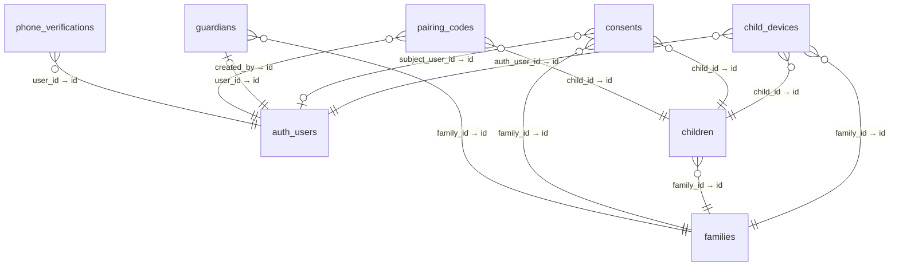
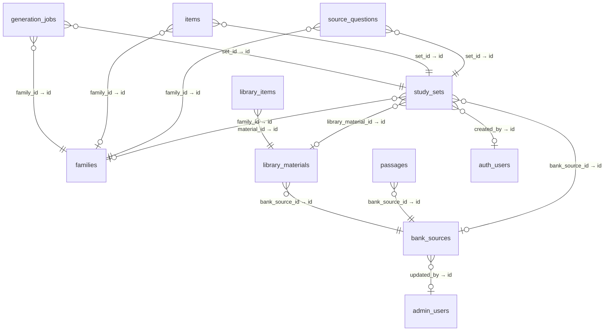
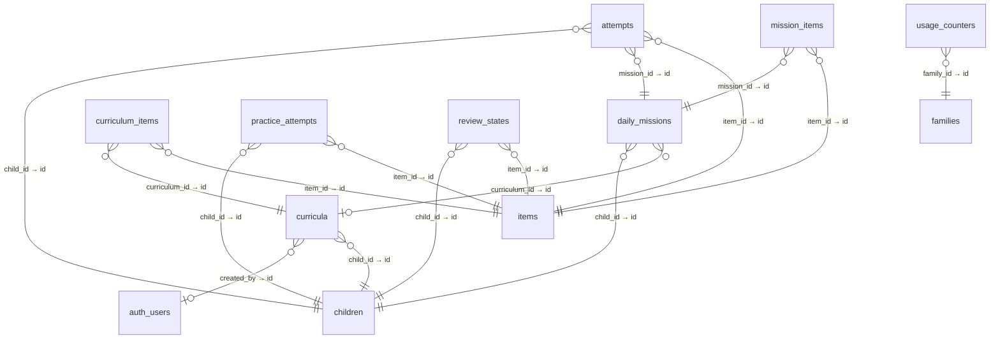
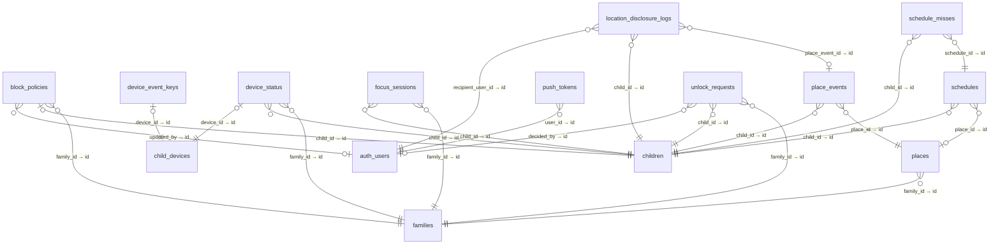
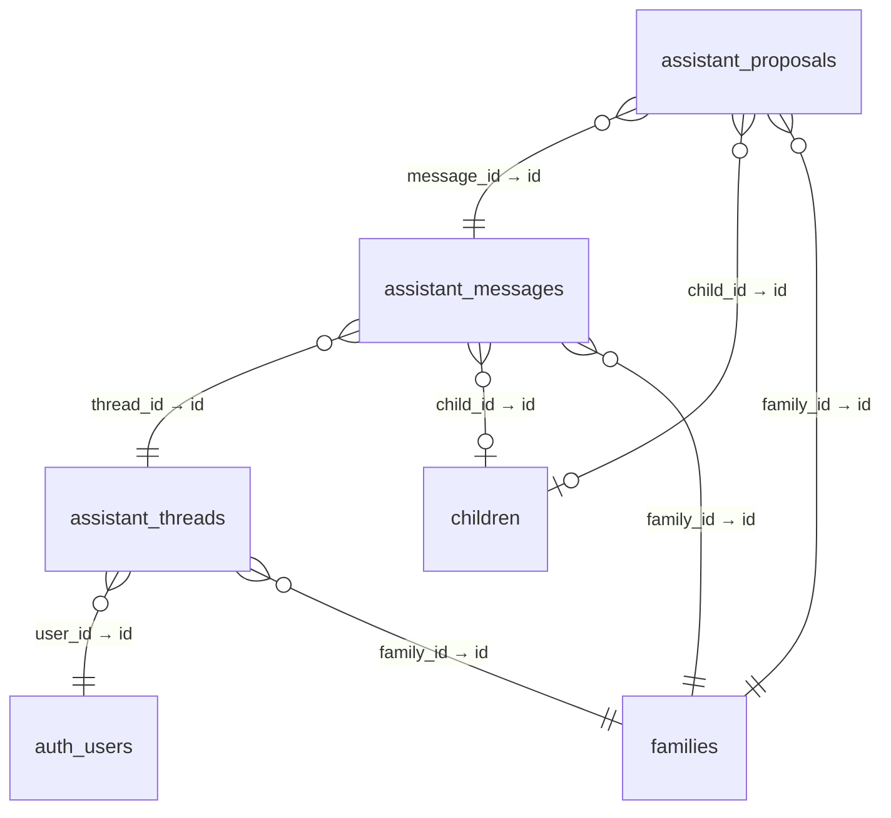
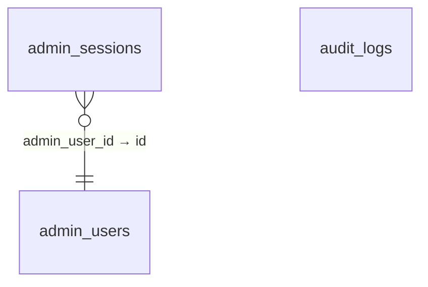

# 데이터베이스 스키마 설계서

**프로젝트** 대치루틴 — 초1~고1 학습·안전 관리 앱
**문서** DB 스키마 설계서 (Database Schema Specification)
**버전** v1.3 · **작성일** 2026-11-18 · **개정일** 2026-11-20
**DB 제출 기준 커밋** [`9af07b8e75bfd34b63591488581f1ce40fad52da`](https://github.com/SHS5029/Daechi_team4_sorry/tree/9af07b8e75bfd34b63591488581f1ce40fad52da) (`origin/main`). **추출** 2026-11-19 08:27:44 UTC (17:27:44 KST). PostgreSQL 17.11, Supabase CLI 3.1.0, 격리 시험 DB.
**API 비교 기준** [API 설계서](./API%20설계서.md)의 59개 동작 스냅샷은 `53cdf85`다. DB 검증 기준 `9af07b8`와 같은 커밋이 아니므로 API 수·DB 수를 서로 대신 쓰지 않는다.
**작성** 윤기화 (WBS 2.1.2·2.1.3) · **검토** 오병훈 (WBS 7.4.1)
**제출** 11/20 단계 산출물 (S1)

**제품 일정** 12/9 전후 앱 출시 목표 · 기능 동결·스토어 제출일 재확정 대기 · 12/18 Auto-Healing·12/24 대화형 웹 교육 제출 · 1/4 최종 발표.

**2026-11-19 변경** C-13 곱셈 화면 제거 범위에는 스키마 변경이 없다. `assistant_messages.usage.reply_to` → `assistant_proposals.message_id/result.job_id` → `generation_jobs.id`로 흐름을 추적한다. 이번 범위에 팀 자료 수락 실행과 상점·포인트·장비 스키마를 추가하지 않는다. [API 설계서](./API%20설계서.md) §1.5·8 참조.

> **재현 근거.** 별도 시험 DB에 기준 커밋의 마이그레이션 25건과 저장소 기본 시드를 적용했다. 카탈로그·시험 로그·조회 계획은 [DB 재현 검증 기록](./DB%20재현%20검증%20기록.md) 참조.

---

## 목차

1. 개요 · 2. 설계 원칙 · 3. ERD · 4. 테이블 정의 · 5. 제약 · 6. 인덱스 · 7. 접근 제어(RLS) · 8. 뷰·Realtime·Storage · 9. 마이그레이션 이력 · 10. 시드와 기본팩 · 11. 검증 · 12. 운영 규칙 · 13. 5개 기획 문서와 다른 지점 · 부록 재현 방법

---

## 0. 기준 커밋과 환경별 집계

| 격리 DB의 코드·적용 시점 | 마이그레이션 | 테이블 컬럼 | 뷰 컬럼 | 공개 전체 | CHECK |
| --- | ---: | ---: | ---: | ---: | ---: |
| 이전 API 기준 `53cdf85` | 22 | 360 | 45 | 405 | 85 |
| 다중 PDF와 과목·그림 추가 | 24 | 365 | 45 | 410 | 88 |
| 제출 기준 `9af07b8` 클린 재현 | 25 | **366** | 45 | **411** | **89** |

- `20261127000100_multi_pdf`는 `study_sets.source_files`·`source_questions.file`과 CHECK 2개를 추가한다. `20261128000100_subject_figures`는 `study_sets.subject`·`items.figure_path`·`source_questions.figure_path`와 CHECK 1개를 추가한다. 두 파일 모두 제출 커밋에 이미 병합돼 있다.
- `20261129000100_source_hash`는 `study_sets.source_hashes`와 배열 CHECK 1개를 추가한다. 이 파일까지 포함해 25건을 제출 기준으로 삼았다.
- 이전의 **407**은 22건 클린 재현에서 확인되지 않았다. **410**은 24건 적용 시 뷰 45컬럼을 포함한 값이다. 문서의 기본 테이블 정의는 **366컬럼**을 센다.
- 공유 개발 DB는 조회·쓰기·초기화하지 않았다. 이전 문항 311/313과 감사 로그 2,399/2,458은 서로 다른 과거 집계로만 남긴다. 운영 건수가 필요하면 승인된 공유 DB 읽기 경로에서 적용 버전과 추출 시각을 함께 기록한다. §4·10의 현재 값은 격리 DB에서 다시 센 시드 데이터다.
- [API 설계서](./API%20설계서.md)의 `53cdf85` REST 스냅샷은 별도 비교 자료다. 현재 DB 기준 커밋의 API 수로 재사용하지 않는다. 제출 문서에서 API와 DB를 함께 말할 때는 **DB `9af07b8` / API 스냅샷 `53cdf85`**를 명시한다.
- `9af07b8` 코드에는 `53cdf85` 이후 `GET /children/{id}/report`, `GET /usage/uploads`, `GET /items/{id}/figure` 라우트가 추가되어 있다. API 설계서의 59개 스냅샷은 이를 포함하지 않으므로, API 계약을 다시 낼 때는 `9af07b8`에서 재추출한다. 이 DB 문서의 40테이블·366컬럼 수치는 API 라우트 수와 무관하다.
- 이 문서의 표 수치는 **9af07b8 + 25 마이그레이션 + 저장소 시드**를 별도 격리 DB에서 다시 센 값이다. 공유 개발 DB의 실제 적재량을 뜻하지 않는다.

---

## 1. 개요

### 1.1 목적

1. **가족 단위 격리를 DB에서 강제한다.** API를 우회해 앱이 Supabase에 직접 붙어도 남의 데이터가 보이지 않아야 한다.
2. **아동 개인정보를 최소로 보관한다.** 저장 자체를 금지한 컬럼(이메일·전화·좌표)을 문서로 못 박는다.
3. **상태와 이력을 남긴다.** 문항 생성·검수·풀이·동의·감사가 재현 가능해야 한다.

### 1.2 범위

`public` 기본 테이블은 40개다. 도메인 분류는 §3 관계도에 표시한다. `auth.users`와 뷰는 기본 테이블 수에서 제외한다.

### 1.3 요약

| 항목 | 값 | 비고 |
| --- | --- | --- |
| 스키마 | `public` 단일 | `app` 스키마는 RLS 보조 함수 전용 |
| PK | 40개 전부 | UUID(`gen_random_uuid()`) 또는 복합키 |
| FK | 74 | 62개는 앱 테이블, **12개는 Supabase `auth.users` 참조**(`user_id`·`created_by` 등) |
| UNIQUE | 8개 제약 + 부분 유니크 인덱스 | 예: `unlock_requests_one_pending` |
| CHECK | 89 | 상태값·길이·정규화 강제 |
| 인덱스 | 76 | 큐 조회용 부분 인덱스 포함 |
| RLS | 52 정책 / **26 테이블** | 나머지 **14개**는 정책 없이 차단(서버 전용) |
| 뷰 | 4 | 진행률·오답·동의 상태 |
| 마이그레이션 | **25건** | 제출 커밋의 클린 재현 |
| 시드 적재 | **326행** | 격리 DB 문항 310건, 감사 로그 0건 포함 |

---

## 2. 설계 원칙

| # | 원칙 | 구현 방식 | 확인 |
| --- | --- | --- | --- |
| 1 | **격리는 가족/자녀로 한다** | `family_id`(가족 범위) · `child_id`(자녀 범위) 컬럼 + RLS 정책 | `app.my_family_ids()` / `app.my_child_id()` |
| 1-1 | **로그인 사용자와 앱 데이터를 잇는다** | 12개 테이블이 `user_id`·`created_by` 등으로 **`auth.users`를 FK 참조**한다 | Supabase Auth가 사용자 원장 |
| 2 | **아동 개인정보는 저장하지 않는다** | `children`에 이메일·전화 컬럼 **없음**. `place_events`에 좌표 **없음** | 컬럼 목록에 존재하지 않음 |
| 3 | **금액·권한이 걸린 판정은 서버·RLS에서** | 앱은 `items` 승인, `children` 별명·학년 등 **허용 열만** 직접 수정 | 정책 52개 |
| 4 | **서버 전용 테이블은 읽기도 막는다** | `phone_verifications`·`pairing_codes`·`assistant_*`·`library_*`·`passages` | 정책 없음 + `revoke` |
| 5 | **상태는 CHECK로 제한한다** | `status in ('queued','running','succeeded','failed')` 등 89개 | CHECK 목록 5.2 |
| 6 | **시각은 UTC, 날짜는 KST** | `timestamptz` 저장 + "오늘"은 서버 계산 | API 2.3 |
| 7 | **동작의 흔적을 남긴다** | `attempts`·`audit_logs`·`location_disclosure_logs`·`consents` | append-only 트리거(`audit_logs_append_only`) |
| 8 | **정규화는 함수로 강제한다** | `app.nfc_text` · `nfc_name` · `nfc_nickname` · `nfc_title` | NFC 정규화(한글 자모 분리 방지) |

### 2.1 RLS 보조 함수 (`app` 스키마)

| 함수 | 반환 | 쓰임 |
| --- | --- | --- |
| `app.my_family_ids()` | 내가 보호자인 가족 ID 집합 | 가족 범위 테이블 SELECT |
| `app.my_children_ids()` | 내 가족 자녀 ID 집합 | 자녀 범위 테이블 SELECT |
| `app.my_child_id()` | 이 기기에 연결된 자녀 1명 | 기기 쓰기·조회 |
| `app.my_child_family_id()` | 그 자녀의 가족 | 교차 검증 |
| `app.is_guardian()` | 보호자 여부 | 학부모 전용 쓰기 |
| `app.places_limit()` | 가정당 장소 상한 | INSERT 정책 |
| `app.audit_logs_append_only()` | 트리거 | 감사 로그 UPDATE/DELETE 차단 |

> `security definer`로 두어 RLS 재귀를 피한다. 앱은 이 함수를 직접 호출하지 않는다.

---

## 3. ERD (도메인별)

전체 40개를 한 장에 그리면 읽을 수 없어 **6개 도메인으로 나눴다.** 선 이름은 `자식 FK → 부모 키`이며 선택 관계와 1:0..1을 카탈로그 기준으로 표시했다.

#### A. 가족·기기



#### B. 학습 자료·문항



#### C. 커리큘럼·미션·풀이



#### D. 잠금·위치·알림



#### E. AI 도우미



#### F. 관리자




### 3.1 FK 연결 키 전체

기준 카탈로그에서 읽은 74개 FK다. 부모 한 행 기준의 관계이며, FK가 null 가능하면 자식과 부모의 연결은 선택이다. 활성 행에만 적용되는 부분 유니크는 §5·6 참조.

| 부모 테이블 | 자식 테이블 | 관계 | 키(부모 → 자식) | 자식 키 null | 부모 삭제 시 |
| --- | --- | --- | --- | --- | --- |
| `public.admin_users` | `public.admin_sessions` | 1:N | `id` → `admin_user_id` | 불가 | CASCADE |
| `public.assistant_threads` | `public.assistant_messages` | 1:N | `id` → `thread_id` | 불가 | CASCADE |
| `public.children` | `public.assistant_messages` | 1:N | `id` → `child_id` | 허용 | SET NULL |
| `public.families` | `public.assistant_messages` | 1:N | `id` → `family_id` | 불가 | CASCADE |
| `public.assistant_messages` | `public.assistant_proposals` | 1:N | `id` → `message_id` | 불가 | CASCADE |
| `public.children` | `public.assistant_proposals` | 1:N | `id` → `child_id` | 허용 | CASCADE |
| `public.families` | `public.assistant_proposals` | 1:N | `id` → `family_id` | 불가 | CASCADE |
| `auth.users` | `public.assistant_threads` | 1:N | `id` → `user_id` | 불가 | CASCADE |
| `public.families` | `public.assistant_threads` | 1:N | `id` → `family_id` | 불가 | CASCADE |
| `public.children` | `public.attempts` | 1:N | `id` → `child_id` | 불가 | CASCADE |
| `public.daily_missions` | `public.attempts` | 1:N | `id` → `mission_id` | 불가 | CASCADE |
| `public.items` | `public.attempts` | 1:N | `id` → `item_id` | 불가 | CASCADE |
| `public.admin_users` | `public.bank_sources` | 1:N | `id` → `updated_by` | 허용 | SET NULL |
| `auth.users` | `public.block_policies` | 1:N | `id` → `updated_by` | 허용 | NO ACTION |
| `public.children` | `public.block_policies` | 1:0..1 | `id` → `child_id` | 불가 | CASCADE |
| `public.families` | `public.block_policies` | 1:N | `id` → `family_id` | 불가 | CASCADE |
| `auth.users` | `public.child_devices` | 1:N | `id` → `auth_user_id` | 불가 | CASCADE |
| `public.children` | `public.child_devices` | 1:N | `id` → `child_id` | 불가 | CASCADE |
| `public.families` | `public.child_devices` | 1:N | `id` → `family_id` | 불가 | CASCADE |
| `public.families` | `public.children` | 1:N | `id` → `family_id` | 불가 | CASCADE |
| `auth.users` | `public.consents` | 1:N | `id` → `subject_user_id` | 허용 | NO ACTION |
| `public.children` | `public.consents` | 1:N | `id` → `child_id` | 불가 | CASCADE |
| `public.families` | `public.consents` | 1:N | `id` → `family_id` | 불가 | CASCADE |
| `auth.users` | `public.curricula` | 1:N | `id` → `created_by` | 허용 | NO ACTION |
| `public.children` | `public.curricula` | 1:N | `id` → `child_id` | 불가 | CASCADE |
| `public.curricula` | `public.curriculum_items` | 1:N | `id` → `curriculum_id` | 불가 | CASCADE |
| `public.items` | `public.curriculum_items` | 1:N | `id` → `item_id` | 불가 | CASCADE |
| `public.children` | `public.daily_missions` | 1:N | `id` → `child_id` | 불가 | CASCADE |
| `public.curricula` | `public.daily_missions` | 1:N | `id` → `curriculum_id` | 허용 | CASCADE |
| `public.child_devices` | `public.device_event_keys` | 1:0..1 | `id` → `device_id` | 불가 | CASCADE |
| `public.child_devices` | `public.device_status` | 1:0..1 | `id` → `device_id` | 불가 | CASCADE |
| `public.children` | `public.device_status` | 1:N | `id` → `child_id` | 불가 | CASCADE |
| `public.families` | `public.device_status` | 1:N | `id` → `family_id` | 불가 | CASCADE |
| `public.children` | `public.focus_sessions` | 1:N | `id` → `child_id` | 불가 | CASCADE |
| `public.families` | `public.focus_sessions` | 1:N | `id` → `family_id` | 불가 | CASCADE |
| `public.families` | `public.generation_jobs` | 1:N | `id` → `family_id` | 불가 | CASCADE |
| `public.study_sets` | `public.generation_jobs` | 1:N | `id` → `set_id` | 불가 | CASCADE |
| `auth.users` | `public.guardians` | 1:0..1 | `id` → `user_id` | 불가 | CASCADE |
| `public.families` | `public.guardians` | 1:N | `id` → `family_id` | 불가 | CASCADE |
| `public.families` | `public.items` | 1:N | `id` → `family_id` | 허용 | CASCADE |
| `public.study_sets` | `public.items` | 1:N | `id` → `set_id` | 불가 | CASCADE |
| `public.library_materials` | `public.library_items` | 1:N | `id` → `material_id` | 불가 | CASCADE |
| `public.bank_sources` | `public.library_materials` | 1:N | `id` → `bank_source_id` | 불가 | NO ACTION |
| `auth.users` | `public.location_disclosure_logs` | 1:N | `id` → `recipient_user_id` | 불가 | NO ACTION |
| `public.children` | `public.location_disclosure_logs` | 1:N | `id` → `child_id` | 불가 | CASCADE |
| `public.place_events` | `public.location_disclosure_logs` | 1:N | `id` → `place_event_id` | 허용 | SET NULL |
| `public.daily_missions` | `public.mission_items` | 1:N | `id` → `mission_id` | 불가 | CASCADE |
| `public.items` | `public.mission_items` | 1:N | `id` → `item_id` | 불가 | CASCADE |
| `auth.users` | `public.pairing_codes` | 1:N | `id` → `created_by` | 불가 | NO ACTION |
| `public.children` | `public.pairing_codes` | 1:N | `id` → `child_id` | 불가 | CASCADE |
| `public.bank_sources` | `public.passages` | 1:N | `id` → `bank_source_id` | 불가 | NO ACTION |
| `auth.users` | `public.phone_verifications` | 1:N | `id` → `user_id` | 불가 | CASCADE |
| `public.children` | `public.place_events` | 1:N | `id` → `child_id` | 불가 | CASCADE |
| `public.places` | `public.place_events` | 1:N | `id` → `place_id` | 불가 | CASCADE |
| `public.families` | `public.places` | 1:N | `id` → `family_id` | 불가 | CASCADE |
| `public.children` | `public.practice_attempts` | 1:N | `id` → `child_id` | 불가 | CASCADE |
| `public.items` | `public.practice_attempts` | 1:N | `id` → `item_id` | 불가 | CASCADE |
| `auth.users` | `public.push_tokens` | 1:N | `id` → `user_id` | 불가 | CASCADE |
| `public.children` | `public.review_states` | 1:N | `id` → `child_id` | 불가 | CASCADE |
| `public.items` | `public.review_states` | 1:N | `id` → `item_id` | 불가 | CASCADE |
| `public.children` | `public.schedule_misses` | 1:N | `id` → `child_id` | 불가 | CASCADE |
| `public.schedules` | `public.schedule_misses` | 1:N | `id` → `schedule_id` | 불가 | CASCADE |
| `public.children` | `public.schedules` | 1:N | `id` → `child_id` | 불가 | CASCADE |
| `public.places` | `public.schedules` | 1:N | `id` → `place_id` | 허용 | SET NULL |
| `public.families` | `public.source_questions` | 1:N | `id` → `family_id` | 불가 | CASCADE |
| `public.study_sets` | `public.source_questions` | 1:N | `id` → `set_id` | 불가 | CASCADE |
| `auth.users` | `public.study_sets` | 1:N | `id` → `created_by` | 허용 | NO ACTION |
| `public.bank_sources` | `public.study_sets` | 1:N | `id` → `bank_source_id` | 허용 | SET NULL |
| `public.families` | `public.study_sets` | 1:N | `id` → `family_id` | 허용 | CASCADE |
| `public.library_materials` | `public.study_sets` | 1:N | `id` → `library_material_id` | 허용 | SET NULL |
| `auth.users` | `public.unlock_requests` | 1:N | `id` → `decided_by` | 허용 | NO ACTION |
| `public.children` | `public.unlock_requests` | 1:N | `id` → `child_id` | 불가 | CASCADE |
| `public.families` | `public.unlock_requests` | 1:N | `id` → `family_id` | 불가 | CASCADE |
| `public.families` | `public.usage_counters` | 1:N | `id` → `family_id` | 불가 | CASCADE |

---

## 4. 테이블 정의

각 표는 제출 커밋의 컬럼 순서다. `NULL`은 `Y/N`이며 제목의 `행`은 클린 재현 후 기본 시드 적재량이다.

> **읽는 법** — `N`은 NOT NULL. `PK`는 기본키. FK·UNIQUE·CHECK·INDEX·RLS는 표 아래에 요약했다.

#### `admin_sessions`  (9컬럼 · 0행)

> 관리자 로그인 세션(토큰 해시·만료·폐기 시각·접속 IP). 문서 미기재 — 코드 기준

| # | 컬럼 | 타입 | NULL | 기본값 |
| --- | --- | --- | --- | --- |
| 1 | `id` | uuid | N | gen_random_uuid() **PK** |
| 2 | `admin_user_id` | uuid | N |  |
| 3 | `token_hash` | text | N |  |
| 4 | `created_at` | timestamp with time zone | N | now() |
| 5 | `last_seen_at` | timestamp with time zone | N | now() |
| 6 | `expires_at` | timestamp with time zone | N |  |
| 7 | `revoked_at` | timestamp with time zone | Y |  |
| 8 | `ip` | text | Y |  |
| 9 | `user_agent` | text | Y |  |

**FK** `admin_user_id`→`admin_users.id`

**UNIQUE** UNIQUE (token_hash)

**INDEX** `admin_sessions_pkey`, `admin_sessions_token_hash_key`, `admin_sessions_admin_user_idx`

#### `admin_users`  (11컬럼 · 0행)

> RLS를 켜고 정책을 두지 않아 앱(anon, authenticated)에서는 보이지 않는다.

| # | 컬럼 | 타입 | NULL | 기본값 |
| --- | --- | --- | --- | --- |
| 1 | `id` | uuid | N | gen_random_uuid() **PK** |
| 2 | `email` | text | N |  |
| 3 | `name` | text | N |  |
| 4 | `password_hash` | text | N |  |
| 5 | `role` | text | N | 'admin' |
| 6 | `otp_secret` | text | Y |  |
| 7 | `failed_count` | smallint | N | 0 |
| 8 | `locked_until` | timestamp with time zone | Y |  |
| 9 | `is_active` | boolean | N | true |
| 10 | `last_login_at` | timestamp with time zone | Y |  |
| 11 | `created_at` | timestamp with time zone | N | now() |

**UNIQUE** UNIQUE (email)

**CHECK**

- `admin_users_email_check` — `CHECK ((email = lower(email)))`
- `admin_users_name_check` — `CHECK (((char_length(name) >= 1) AND (char_length(name) <= 40)))`
- `admin_users_role_check` — `CHECK ((role = ANY (ARRAY['admin'::text, 'viewer'::text])))`

**INDEX** `admin_users_pkey`, `admin_users_email_key`

#### `assistant_messages`  (10컬럼 · 0행)

> AI 도우미 대화 메시지(역할·종류·본문·토큰 사용량·피드백)

| # | 컬럼 | 타입 | NULL | 기본값 |
| --- | --- | --- | --- | --- |
| 1 | `id` | uuid | N | **PK** |
| 2 | `thread_id` | uuid | N |  |
| 3 | `family_id` | uuid | N |  |
| 4 | `role` | text | N |  |
| 5 | `kind` | text | N | 'chat' |
| 6 | `child_id` | uuid | Y |  |
| 7 | `content` | text | N |  |
| 8 | `usage` | jsonb | Y |  |
| 9 | `feedback` | text | Y |  |
| 10 | `created_at` | timestamp with time zone | N | now() |

**FK** `child_id`→`children.id`, `family_id`→`families.id`, `thread_id`→`assistant_threads.id`

**CHECK**

- `assistant_messages_feedback_check` — `CHECK ((feedback = ANY (ARRAY['bad'::text, 'wrong'::text, 'harmful'::text])))`
- `assistant_messages_kind_check` — `CHECK ((kind = ANY (ARRAY['chat'::text, 'proactive'::text, 'follow_up'::text])))`
- `assistant_messages_role_check` — `CHECK ((role = ANY (ARRAY['user'::text, 'assistant'::text])))`

**INDEX** `assistant_messages_pkey`, `assistant_messages_thread_idx`

#### `assistant_proposals`  (13컬럼 · 0행)

> 도우미가 제안한 변경안(수락/거절 대상). 승인 없이는 반영하지 않는다

| # | 컬럼 | 타입 | NULL | 기본값 |
| --- | --- | --- | --- | --- |
| 1 | `id` | uuid | N | gen_random_uuid() **PK** |
| 2 | `message_id` | uuid | N |  |
| 3 | `family_id` | uuid | N |  |
| 4 | `child_id` | uuid | Y |  |
| 5 | `type` | text | N |  |
| 6 | `source` | text | N |  |
| 7 | `trigger` | text | Y |  |
| 8 | `args` | jsonb | N |  |
| 9 | `reason` | text | N |  |
| 10 | `status` | text | N | 'open' |
| 11 | `result` | jsonb | Y |  |
| 12 | `created_at` | timestamp with time zone | N | now() |
| 13 | `decided_at` | timestamp with time zone | Y |  |

**FK** `child_id`→`children.id`, `family_id`→`families.id`, `message_id`→`assistant_messages.id`

**CHECK**

- `assistant_proposals_source_check` — `CHECK ((source = ANY (ARRAY['family'::text, 'library'::text])))`
- `assistant_proposals_status_check` — `CHECK ((status = ANY (ARRAY['open'::text, 'accepted'::text, 'done'::text, 'dismissed'::text, 'expired'::text, 'failed'::text])))`
- `assistant_proposals_type_check` — `CHECK ((type = ANY (ARRAY['generate_set'::text, 'library_set'::text, 'review'::text, 'curriculum'::text])))`

**INDEX** `assistant_proposals_pkey`, `assistant_proposals_message_idx`, `assistant_proposals_family_status_idx`, `assistant_proposals_accepted_idx`

#### `assistant_threads`  (5컬럼 · 0행)

> RLS를 켜고 정책을 두지 않으며 service_role의 권한도 거둔다(20261120000500_admin.sql과 같은 방식).

| # | 컬럼 | 타입 | NULL | 기본값 |
| --- | --- | --- | --- | --- |
| 1 | `id` | uuid | N | gen_random_uuid() **PK** |
| 2 | `family_id` | uuid | N |  |
| 3 | `user_id` | uuid | N |  |
| 4 | `created_at` | timestamp with time zone | N | now() |
| 5 | `last_message_at` | timestamp with time zone | Y |  |

**FK** `family_id`→`families.id`, `user_id`→`auth.users.id`

**INDEX** `assistant_threads_pkey`, `assistant_threads_user_idx`

#### `attempts`  (9컬럼 · 0행)

> 문항별 풀이 시도(정오답·소요 시간·제출 시각)

| # | 컬럼 | 타입 | NULL | 기본값 |
| --- | --- | --- | --- | --- |
| 1 | `id` | uuid | N | **PK** |
| 2 | `child_id` | uuid | N |  |
| 3 | `mission_id` | uuid | N |  |
| 4 | `item_id` | uuid | N |  |
| 5 | `is_correct` | boolean | N |  |
| 6 | `response` | text | Y |  |
| 7 | `is_retry` | boolean | N | false |
| 8 | `answered_at` | timestamp with time zone | N |  |
| 9 | `created_at` | timestamp with time zone | N | now() |

**FK** `child_id`→`children.id`, `item_id`→`items.id`, `mission_id`→`daily_missions.id`

**INDEX** `attempts_pkey`, `attempts_mission`, `attempts_child_item`

**RLS** 3개: `attempts_device_insert`, `attempts_device_select`, `attempts_guardian_select`

#### `audit_logs`  (10컬럼 · 0행)

> admin_user_id는 계정이 지워져도 기록이 남도록 외래 키를 두지 않는다. 로그인 실패는 null.

| # | 컬럼 | 타입 | NULL | 기본값 |
| --- | --- | --- | --- | --- |
| 1 | `id` | bigint | N | **PK** |
| 2 | `admin_user_id` | uuid | Y |  |
| 3 | `admin_email` | text | Y |  |
| 4 | `action` | text | N |  |
| 5 | `target_type` | text | Y |  |
| 6 | `target_id` | text | Y |  |
| 7 | `ip` | text | Y |  |
| 8 | `user_agent` | text | Y |  |
| 9 | `detail` | jsonb | N | '{}'::jsonb |
| 10 | `created_at` | timestamp with time zone | N | now() |

**CHECK**

- `audit_logs_action_check` — `CHECK ((action = ANY (ARRAY['login'::text, 'login_failed'::text, 'login_locked'::text, 'logout'::text, 'view'::text, 'create'::text, 'update'::text, 'resolve'::text])))`

**INDEX** `audit_logs_pkey`, `audit_logs_created_idx`, `audit_logs_admin_idx`

#### `bank_sources`  (13컬럼 · 0행)

> 이미 만든 커리큘럼·미션의 문항은 그대로 둔다(자녀가 풀던 미션이 깨지지 않게).

| # | 컬럼 | 타입 | NULL | 기본값 |
| --- | --- | --- | --- | --- |
| 1 | `id` | uuid | N | gen_random_uuid() **PK** |
| 2 | `title` | text | N |  |
| 3 | `source_url` | text | Y |  |
| 4 | `license` | text | Y |  |
| 5 | `collected_at` | date | Y |  |
| 6 | `terms_ok` | boolean | Y |  |
| 7 | `ai_input_ok` | boolean | Y |  |
| 8 | `derivative_ok` | boolean | Y |  |
| 9 | `distribution_scope` | text | Y |  |
| 10 | `note` | text | Y |  |
| 11 | `updated_by` | uuid | Y |  |
| 12 | `created_at` | timestamp with time zone | N | now() |
| 13 | `updated_at` | timestamp with time zone | N | now() |

**FK** `updated_by`→`admin_users.id`

**CHECK**

- `bank_sources_distribution_scope_check` — `CHECK ((distribution_scope = ANY (ARRAY['in_app'::text, 'public'::text])))`
- `bank_sources_title_check` — `CHECK (((char_length(title) >= 1) AND (char_length(title) <= 100)))`

**INDEX** `bank_sources_pkey`

#### `block_policies`  (8컬럼 · 0행)

> 쓰기는 모두 서버만 한다(API). 앱은 읽기만 한다. 막는 앱의 목록과 이름은 어디에도 두지 않는다(개수만).

| # | 컬럼 | 타입 | NULL | 기본값 |
| --- | --- | --- | --- | --- |
| 1 | `child_id` | uuid | N | **PK** |
| 2 | `family_id` | uuid | N |  |
| 3 | `mission_enabled` | boolean | N | false |
| 4 | `schedule_enabled` | boolean | N | false |
| 5 | `windows` | jsonb | N | '[]'::jsonb |
| 6 | `reselect_until` | timestamp with time zone | Y |  |
| 7 | `updated_by` | uuid | Y |  |
| 8 | `updated_at` | timestamp with time zone | N | now() |

**FK** `child_id`→`children.id`, `family_id`→`families.id`, `updated_by`→`auth.users.id`

**INDEX** `block_policies_pkey`

**RLS** 2개: `block_policies_device_select`, `block_policies_guardian_select`

#### `child_devices`  (9컬럼 · 1행)

> 자녀 기기 등록과 연결 상태(플랫폼·마지막 접속)

| # | 컬럼 | 타입 | NULL | 기본값 |
| --- | --- | --- | --- | --- |
| 1 | `id` | uuid | N | gen_random_uuid() **PK** |
| 2 | `family_id` | uuid | N |  |
| 3 | `child_id` | uuid | N |  |
| 4 | `auth_user_id` | uuid | N |  |
| 5 | `platform` | text | N |  |
| 6 | `device_name` | text | Y |  |
| 7 | `paired_at` | timestamp with time zone | N | now() |
| 8 | `revoked_at` | timestamp with time zone | Y |  |
| 9 | `last_seen_at` | timestamp with time zone | Y |  |

**FK** `auth_user_id`→`auth.users.id`, `child_id`→`children.id`, `family_id`→`families.id`

**CHECK**

- `child_devices_platform_check` — `CHECK ((platform = ANY (ARRAY['ios'::text, 'android'::text])))`

**INDEX** `child_devices_pkey`, `child_devices_active_user`, `child_devices_active_child`

**RLS** 2개: `child_devices_device_select`, `child_devices_guardian_select`

#### `children`  (7컬럼 · 2행)

> 자녀 프로필(별명·출생 연월·학년·관리 방식). 이메일·전화는 저장하지 않는다

| # | 컬럼 | 타입 | NULL | 기본값 |
| --- | --- | --- | --- | --- |
| 1 | `id` | uuid | N | gen_random_uuid() **PK** |
| 2 | `family_id` | uuid | N |  |
| 3 | `nickname` | text | N |  |
| 4 | `birth_ym` | date | N |  |
| 5 | `grade` | smallint | N |  |
| 6 | `management` | text | N | 'guardian' |
| 7 | `created_at` | timestamp with time zone | N | now() |

**FK** `family_id`→`families.id`

**CHECK**

- `children_grade_check` — `CHECK (((grade >= 1) AND (grade <= 9)))`
- `children_management_check` — `CHECK ((management = ANY (ARRAY['guardian'::text, 'self'::text])))`
- `children_nickname_check` — `CHECK (((char_length(nickname) >= 1) AND (char_length(nickname) <= 20)))`

**INDEX** `children_pkey`

**RLS** 3개: `children_device_select`, `children_guardian_select`, `children_guardian_update`

#### `consents`  (11컬럼 · 4행)

> 동의 기록(주체·문서 버전·시각). 법정대리인 동의 확인 근거

| # | 컬럼 | 타입 | NULL | 기본값 |
| --- | --- | --- | --- | --- |
| 1 | `id` | uuid | N | gen_random_uuid() **PK** |
| 2 | `family_id` | uuid | N |  |
| 3 | `child_id` | uuid | N |  |
| 4 | `subject` | text | N |  |
| 5 | `subject_user_id` | uuid | Y |  |
| 6 | `type` | text | N |  |
| 7 | `doc_version` | text | N |  |
| 8 | `agreed_at` | timestamp with time zone | N | now() |
| 9 | `revoked_at` | timestamp with time zone | Y |  |
| 10 | `confirm_sms_sent_at` | timestamp with time zone | Y |  |
| 11 | `revoked_by` | text | Y |  |

**FK** `child_id`→`children.id`, `family_id`→`families.id`, `subject_user_id`→`auth.users.id`

**CHECK**

- `consents_revoked_by_check` — `CHECK ((revoked_by = ANY (ARRAY['guardian'::text, 'child'::text])))`
- `consents_subject_check` — `CHECK ((subject = ANY (ARRAY['guardian'::text, 'child'::text])))`
- `consents_type_check` — `CHECK ((type = ANY (ARRAY['privacy'::text, 'ai_notice'::text, 'location'::text, 'app_block'::text])))`

**INDEX** `consents_pkey`, `consents_active_agreement`

**RLS** 2개: `consents_device_select`, `consents_guardian_select`

#### `curricula`  (10컬럼 · 0행)

> 3.3 커리큘럼과 미션

| # | 컬럼 | 타입 | NULL | 기본값 |
| --- | --- | --- | --- | --- |
| 1 | `id` | uuid | N | gen_random_uuid() **PK** |
| 2 | `child_id` | uuid | N |  |
| 3 | `title` | text | N |  |
| 4 | `start_date` | date | N |  |
| 5 | `end_date` | date | N |  |
| 6 | `daily_new_cap` | smallint | N |  |
| 7 | `rest_weekdays` | ARRAY | N | '{}'::smallint[] |
| 8 | `status` | text | N | 'active' |
| 9 | `created_by` | uuid | Y |  |
| 10 | `created_at` | timestamp with time zone | N | now() |

**FK** `child_id`→`children.id`, `created_by`→`auth.users.id`

**CHECK**

- `curricula_check` — `CHECK ((end_date >= start_date))`
- `curricula_daily_new_cap_check` — `CHECK (((daily_new_cap >= 1) AND (daily_new_cap <= 50)))`
- `curricula_status_check` — `CHECK ((status = ANY (ARRAY['active'::text, 'stopped'::text, 'finished'::text])))`

**INDEX** `curricula_pkey`

**RLS** 1개: `curricula_guardian_select`

#### `curriculum_items`  (4컬럼 · 0행)

> 커리큘럼에 배정된 문항(계획일·순서)

| # | 컬럼 | 타입 | NULL | 기본값 |
| --- | --- | --- | --- | --- |
| 1 | `curriculum_id` | uuid | N | **PK** |
| 2 | `item_id` | uuid | N | **PK** |
| 3 | `seq` | integer | N |  |
| 4 | `planned_date` | date | N |  |

**FK** `curriculum_id`→`curricula.id`, `item_id`→`items.id`

**INDEX** `curriculum_items_pkey`, `curriculum_items_plan`

**RLS** 1개: `curriculum_items_guardian_select`

#### `daily_missions`  (7컬럼 · 0행)

> 날짜별 미션(상태·완료 시각·문항 수)

| # | 컬럼 | 타입 | NULL | 기본값 |
| --- | --- | --- | --- | --- |
| 1 | `id` | uuid | N | gen_random_uuid() **PK** |
| 2 | `child_id` | uuid | N |  |
| 3 | `mission_date` | date | N |  |
| 4 | `status` | text | N | 'open' |
| 5 | `completed_at` | timestamp with time zone | Y |  |
| 6 | `created_at` | timestamp with time zone | N | now() |
| 7 | `curriculum_id` | uuid | Y |  |

**FK** `child_id`→`children.id`, `curriculum_id`→`curricula.id`

**UNIQUE** UNIQUE (child_id, mission_date, curriculum_id)

**CHECK**

- `daily_missions_status_check` — `CHECK ((status = ANY (ARRAY['open'::text, 'completed'::text])))`

**INDEX** `daily_missions_pkey`, `daily_missions_child_id_mission_date_curriculum_id_key`

**RLS** 2개: `daily_missions_device_select`, `daily_missions_guardian_select`

#### `device_event_keys`  (3컬럼 · 0행)

> 기기 이벤트 멱등 키(같은 이벤트 중복 수신 차단)

| # | 컬럼 | 타입 | NULL | 기본값 |
| --- | --- | --- | --- | --- |
| 1 | `device_id` | uuid | N | **PK** |
| 2 | `key_hash` | text | N |  |
| 3 | `created_at` | timestamp with time zone | N | now() |

**FK** `device_id`→`child_devices.id`

**UNIQUE** UNIQUE (key_hash)

**INDEX** `device_event_keys_pkey`, `device_event_keys_key_hash_key`

#### `device_status`  (11컬럼 · 0행)

> 기기 권한·배터리·마지막 신호. 우회 감지 근거

| # | 컬럼 | 타입 | NULL | 기본값 |
| --- | --- | --- | --- | --- |
| 1 | `device_id` | uuid | N | **PK** |
| 2 | `child_id` | uuid | N |  |
| 3 | `family_id` | uuid | N |  |
| 4 | `location_permission` | text | Y |  |
| 5 | `notifications_enabled` | boolean | Y |  |
| 6 | `reported_at` | timestamp with time zone | N | now() |
| 7 | `block_permission` | text | Y |  |
| 8 | `block_auth` | text | Y |  |
| 9 | `blocked_apps_count` | smallint | Y |  |
| 10 | `app_version` | text | Y |  |
| 11 | `silent_alerted_at` | timestamp with time zone | Y |  |

**FK** `child_id`→`children.id`, `device_id`→`child_devices.id`, `family_id`→`families.id`

**CHECK**

- `device_status_block_auth_check` — `CHECK ((block_auth = ANY (ARRAY['accessibility'::text, 'child'::text, 'individual'::text])))`
- `device_status_block_permission_check` — `CHECK ((block_permission = ANY (ARRAY['none'::text, 'granted'::text])))`
- `device_status_location_permission_check` — `CHECK ((location_permission = ANY (ARRAY['none'::text, 'when_in_use'::text, 'always'::text])))`

**INDEX** `device_status_pkey`

**RLS** 2개: `device_status_device_select`, `device_status_guardian_select`

#### `families`  (2컬럼 · 2행)

> 3.1 가족과 기기

| # | 컬럼 | 타입 | NULL | 기본값 |
| --- | --- | --- | --- | --- |
| 1 | `id` | uuid | N | gen_random_uuid() **PK** |
| 2 | `created_at` | timestamp with time zone | N | now() |

**INDEX** `families_pkey`

**RLS** 1개: `families_guardian_select`

#### `focus_sessions`  (8컬럼 · 0행)

> 집중 모드 세션 기록(시작·종료·목표 달성 여부)

| # | 컬럼 | 타입 | NULL | 기본값 |
| --- | --- | --- | --- | --- |
| 1 | `id` | uuid | N | **PK** |
| 2 | `child_id` | uuid | N |  |
| 3 | `family_id` | uuid | N |  |
| 4 | `minutes` | smallint | N |  |
| 5 | `started_at` | timestamp with time zone | N |  |
| 6 | `ended_at` | timestamp with time zone | Y |  |
| 7 | `result` | text | Y |  |
| 8 | `created_at` | timestamp with time zone | N | now() |

**FK** `child_id`→`children.id`, `family_id`→`families.id`

**CHECK**

- `focus_sessions_minutes_check` — `CHECK ((minutes = ANY (ARRAY[5, 10, 15])))`
- `focus_sessions_result_check` — `CHECK ((result = ANY (ARRAY['completed'::text, 'stopped'::text])))`

**INDEX** `focus_sessions_pkey`, `focus_sessions_child_time`

**RLS** 2개: `focus_sessions_device_select`, `focus_sessions_guardian_select`

#### `generation_jobs`  (14컬럼 · 2행)

> 문항 생성 작업 큐(상태·단계·진행률·토큰 사용·잠금)

| # | 컬럼 | 타입 | NULL | 기본값 |
| --- | --- | --- | --- | --- |
| 1 | `id` | uuid | N | gen_random_uuid() **PK** |
| 2 | `set_id` | uuid | N |  |
| 3 | `family_id` | uuid | N |  |
| 4 | `status` | text | N | 'queued' |
| 5 | `step` | text | Y |  |
| 6 | `progress` | jsonb | N | '{}'::jsonb |
| 7 | `error_code` | text | Y |  |
| 8 | `error_message` | text | Y |  |
| 9 | `run_count` | smallint | N | 0 |
| 10 | `locked_at` | timestamp with time zone | Y |  |
| 11 | `usage` | jsonb | N | '{}'::jsonb |
| 12 | `created_at` | timestamp with time zone | N | now() |
| 13 | `started_at` | timestamp with time zone | Y |  |
| 14 | `finished_at` | timestamp with time zone | Y |  |

**FK** `family_id`→`families.id`, `set_id`→`study_sets.id`

**CHECK**

- `generation_jobs_status_check` — `CHECK ((status = ANY (ARRAY['queued'::text, 'running'::text, 'succeeded'::text, 'failed'::text])))`
- `generation_jobs_step_check` — `CHECK ((step = ANY (ARRAY['parse'::text, 'plan'::text, 'generate'::text, 'verify'::text, 'save'::text])))`

**INDEX** `generation_jobs_pkey`, `generation_jobs_queue`

**RLS** 1개: `generation_jobs_guardian_select`

#### `guardians`  (5컬럼 · 2행)

> 보호자 계정(전화 인증 상태·가족 소속)

| # | 컬럼 | 타입 | NULL | 기본값 |
| --- | --- | --- | --- | --- |
| 1 | `user_id` | uuid | N | **PK** |
| 2 | `family_id` | uuid | N |  |
| 3 | `phone` | text | Y |  |
| 4 | `phone_verified_at` | timestamp with time zone | Y |  |
| 5 | `created_at` | timestamp with time zone | N | now() |

**FK** `family_id`→`families.id`, `user_id`→`auth.users.id`

**INDEX** `guardians_pkey`

**RLS** 1개: `guardians_guardian_select`

#### `items`  (17컬럼 · 310행)

> 문항(유형·문제·정답·보기·원문 근거·AI 검수/부모 승인 상태)

| # | 컬럼 | 타입 | NULL | 기본값 |
| --- | --- | --- | --- | --- |
| 1 | `id` | uuid | N | gen_random_uuid() **PK** |
| 2 | `set_id` | uuid | N |  |
| 3 | `family_id` | uuid | Y |  |
| 4 | `seq` | integer | N |  |
| 5 | `unit` | text | Y |  |
| 6 | `type` | text | N |  |
| 7 | `prompt` | text | N |  |
| 8 | `answer` | text | N |  |
| 9 | `accepted_answers` | ARRAY | N | '{}'[] |
| 10 | `choices` | jsonb | Y |  |
| 11 | `explanation` | text | Y |  |
| 12 | `source` | jsonb | Y |  |
| 13 | `verify_status` | text | N | 'passed' |
| 14 | `review_status` | text | N | 'pending' |
| 15 | `edited_at` | timestamp with time zone | Y |  |
| 16 | `created_at` | timestamp with time zone | N | now() |
| 17 | `figure_path` | text | Y |  |

**FK** `family_id`→`families.id`, `set_id`→`study_sets.id`

**UNIQUE** UNIQUE (set_id, seq)

**CHECK**

- `items_review_status_check` — `CHECK ((review_status = ANY (ARRAY['pending'::text, 'approved'::text, 'rejected'::text])))`
- `items_type_check` — `CHECK ((type = ANY (ARRAY['flashcard'::text, 'multiple_choice'::text, 'fill_blank'::text, 'spelling'::text])))`
- `items_verify_status_check` — `CHECK ((verify_status = ANY (ARRAY['passed'::text, 'flagged'::text, 'manual'::text])))`

**INDEX** `items_pkey`, `items_set_id_seq_key`, `items_library_item_idx`

**RLS** 2개: `items_guardian_update`, `items_select`

#### `library_items`  (14컬럼 · 0행)

> 팀 자료 창고 문항(기본팩 후보). 서버 전용

| # | 컬럼 | 타입 | NULL | 기본값 |
| --- | --- | --- | --- | --- |
| 1 | `id` | uuid | N | gen_random_uuid() **PK** |
| 2 | `material_id` | uuid | N |  |
| 3 | `seq` | integer | N |  |
| 4 | `unit` | text | Y |  |
| 5 | `type` | text | N |  |
| 6 | `prompt` | text | N |  |
| 7 | `answer` | text | N |  |
| 8 | `accepted_answers` | ARRAY | N | '{}'[] |
| 9 | `choices` | jsonb | Y |  |
| 10 | `explanation` | text | Y |  |
| 11 | `source` | jsonb | Y |  |
| 12 | `verify_status` | text | N |  |
| 13 | `check_status` | text | N | 'pending' |
| 14 | `created_at` | timestamp with time zone | N | now() |

**FK** `material_id`→`library_materials.id`

**UNIQUE** UNIQUE (material_id, seq)

**CHECK**

- `library_items_check_status_check` — `CHECK ((check_status = ANY (ARRAY['pending'::text, 'approved'::text, 'rejected'::text])))`
- `library_items_type_check` — `CHECK ((type = ANY (ARRAY['flashcard'::text, 'multiple_choice'::text, 'fill_blank'::text, 'spelling'::text])))`
- `library_items_verify_status_check` — `CHECK ((verify_status = ANY (ARRAY['passed'::text, 'flagged'::text, 'manual'::text])))`

**INDEX** `library_items_pkey`, `library_items_material_id_seq_key`, `library_items_material_check_idx`

#### `library_materials`  (12컬럼 · 0행)

> 출처와 이용조건은 bank_sources를 그대로 쓴다. 두 테이블 모두 서버만 읽고 쓴다.

| # | 컬럼 | 타입 | NULL | 기본값 |
| --- | --- | --- | --- | --- |
| 1 | `id` | uuid | N | gen_random_uuid() **PK** |
| 2 | `bank_source_id` | uuid | N |  |
| 3 | `title` | text | N |  |
| 4 | `subject` | text | N |  |
| 5 | `grade_min` | smallint | N |  |
| 6 | `grade_max` | smallint | N |  |
| 7 | `units` | ARRAY | N | '{}'[] |
| 8 | `kind` | text | N |  |
| 9 | `source_path` | text | Y |  |
| 10 | `status` | text | N | 'draft' |
| 11 | `created_at` | timestamp with time zone | N | now() |
| 12 | `updated_at` | timestamp with time zone | N | now() |

**FK** `bank_source_id`→`bank_sources.id`

**CHECK**

- `library_materials_check` — `CHECK (((grade_max >= grade_min) AND (grade_max <= 9)))`
- `library_materials_grade_min_check` — `CHECK (((grade_min >= 1) AND (grade_min <= 9)))`
- `library_materials_kind_check` — `CHECK ((kind = ANY (ARRAY['study_material'::text, 'question_sheet'::text])))`
- `library_materials_status_check` — `CHECK ((status = ANY (ARRAY['draft'::text, 'published'::text, 'suspended'::text])))`
- `library_materials_subject_check` — `CHECK ((subject = ANY (ARRAY['korean'::text, 'math'::text, 'english'::text, 'science'::text, 'social'::text, 'etc'::text])))`
- `library_materials_title_check` — `CHECK (((char_length(title) >= 1) AND (char_length(title) <= 100)))`

**INDEX** `library_materials_pkey`, `library_materials_find_idx`

#### `location_disclosure_logs`  (7컬럼 · 0행)

> 제공 사실 확인자료. 앱은 지우지 못한다. 학부모에게는 보이지 않고 자녀 기기만 읽는다(C-31).

| # | 컬럼 | 타입 | NULL | 기본값 |
| --- | --- | --- | --- | --- |
| 1 | `id` | uuid | N | gen_random_uuid() **PK** |
| 2 | `child_id` | uuid | N |  |
| 3 | `recipient_user_id` | uuid | N |  |
| 4 | `purpose` | text | N |  |
| 5 | `place_name` | text | N |  |
| 6 | `place_event_id` | uuid | Y |  |
| 7 | `provided_at` | timestamp with time zone | N | now() |

**FK** `child_id`→`children.id`, `place_event_id`→`place_events.id`, `recipient_user_id`→`auth.users.id`

**CHECK**

- `location_disclosure_logs_purpose_check` — `CHECK ((purpose = ANY (ARRAY['place_enter'::text, 'place_exit'::text, 'place_checkin'::text, 'place_missed'::text])))`

**INDEX** `location_disclosure_logs_pkey`, `location_disclosure_logs_child_time`

**RLS** 1개: `location_disclosure_logs_device_select`

#### `mission_items`  (4컬럼 · 0행)

> 미션에 포함된 문항(순서·신규/복습 구분)

| # | 컬럼 | 타입 | NULL | 기본값 |
| --- | --- | --- | --- | --- |
| 1 | `mission_id` | uuid | N | **PK** |
| 2 | `item_id` | uuid | N | **PK** |
| 3 | `kind` | text | N |  |
| 4 | `seq` | integer | N |  |

**FK** `item_id`→`items.id`, `mission_id`→`daily_missions.id`

**CHECK**

- `mission_items_kind_check` — `CHECK ((kind = ANY (ARRAY['new'::text, 'review'::text, 'slide'::text])))`

**INDEX** `mission_items_pkey`

**RLS** 2개: `mission_items_device_select`, `mission_items_guardian_select`

#### `pairing_codes`  (7컬럼 · 0행)

> 연결 코드(해시·만료·사용 시각·실패 횟수)

| # | 컬럼 | 타입 | NULL | 기본값 |
| --- | --- | --- | --- | --- |
| 1 | `id` | uuid | N | gen_random_uuid() **PK** |
| 2 | `child_id` | uuid | N |  |
| 3 | `code_hash` | text | N |  |
| 4 | `expires_at` | timestamp with time zone | N |  |
| 5 | `used_at` | timestamp with time zone | Y |  |
| 6 | `created_by` | uuid | N |  |
| 7 | `created_at` | timestamp with time zone | N | now() |

**FK** `child_id`→`children.id`, `created_by`→`auth.users.id`

**INDEX** `pairing_codes_pkey`, `pairing_codes_open`

#### `passages`  (24컬럼 · 0행)

> 출처와 이용조건은 bank_sources를 그대로 쓴다(출처 사이트마다 한 행).

| # | 컬럼 | 타입 | NULL | 기본값 |
| --- | --- | --- | --- | --- |
| 1 | `id` | uuid | N | gen_random_uuid() **PK** |
| 2 | `bank_source_id` | uuid | N |  |
| 3 | `slug` | text | N |  |
| 4 | `lang` | text | N |  |
| 5 | `subject` | text | N |  |
| 6 | `title` | text | N |  |
| 7 | `work_title` | text | Y |  |
| 8 | `author` | text | Y |  |
| 9 | `author_died` | smallint | Y |  |
| 10 | `translator` | text | Y |  |
| 11 | `translator_died` | smallint | Y |  |
| 12 | `basis` | text | N |  |
| 13 | `source_url` | text | Y |  |
| 14 | `genre` | text | N |  |
| 15 | `grade_min` | smallint | N |  |
| 16 | `grade_max` | smallint | N |  |
| 17 | `original` | text | Y |  |
| 18 | `body` | text | N |  |
| 19 | `adapted` | text | N |  |
| 20 | `length` | integer | N |  |
| 21 | `status` | text | N | 'draft' |
| 22 | `note` | text | Y |  |
| 23 | `created_at` | timestamp with time zone | N | now() |
| 24 | `updated_at` | timestamp with time zone | N | now() |

**FK** `bank_source_id`→`bank_sources.id`

**UNIQUE** UNIQUE (slug)

**CHECK**

- `passages_adapted_check` — `CHECK ((adapted = ANY (ARRAY['none'::text, 'spelling'::text, 'simplified'::text, 'retold'::text])))`
- `passages_basis_check` — `CHECK ((basis = ANY (ARRAY['expired'::text, 'folk'::text])))`
- `passages_body_check` — `CHECK ((btrim(body) <> ''::text))`
- `passages_check` — `CHECK (((grade_max >= grade_min) AND (grade_max <= 9)))`
- `passages_expired` — `CHECK (((basis <> 'expired'::text) OR ((original IS NOT NULL) AND ((author_died IS NULL) OR (author_died <= 1962)) AND ((translator_died IS NULL) OR (translator_died <= 1962)))))`
- `passages_folk` — `CHECK (((basis <> 'folk'::text) OR ((author IS NULL) AND (author_died IS NULL) AND (adapted = 'retold'::text))))`
- `passages_genre_check` — `CHECK ((genre = ANY (ARRAY['poem'::text, 'story'::text, 'fable'::text, 'folk_tale'::text, 'nursery_rhyme'::text, 'essay'::text, 'other'::text])))`
- `passages_grade_min_check` — `CHECK (((grade_min >= 1) AND (grade_min <= 9)))`
- `passages_lang_check` — `CHECK ((lang = ANY (ARRAY['ko'::text, 'en'::text])))`
- `passages_lang_subject` — `CHECK ((((lang = 'ko'::text) AND (subject = 'korean'::text)) OR ((lang = 'en'::text) AND (subject = 'english'::text))))`
- `passages_length_check` — `CHECK ((length > 0))`
- `passages_slug_check` — `CHECK (((slug ~ '^(ko|en)-[a-z0-9-]+$'::text) AND (char_length(slug) <= 60)))`
- `passages_slug_lang` — `CHECK (("left"(slug, 3) = (lang || '-'::text)))`
- `passages_status_check` — `CHECK ((status = ANY (ARRAY['draft'::text, 'published'::text, 'suspended'::text])))`
- `passages_subject_check` — `CHECK ((subject = ANY (ARRAY['korean'::text, 'english'::text])))`
- `passages_title_check` — `CHECK (((char_length(title) >= 1) AND (char_length(title) <= 100)))`

**INDEX** `passages_pkey`, `passages_slug_key`, `passages_find_idx`

#### `phone_verifications`  (8컬럼 · 0행)

> 휴대전화 인증번호(해시·만료·시도 횟수)

| # | 컬럼 | 타입 | NULL | 기본값 |
| --- | --- | --- | --- | --- |
| 1 | `id` | uuid | N | gen_random_uuid() **PK** |
| 2 | `user_id` | uuid | N |  |
| 3 | `phone` | text | N |  |
| 4 | `code_hash` | text | N |  |
| 5 | `expires_at` | timestamp with time zone | N |  |
| 6 | `failed_count` | smallint | N | 0 |
| 7 | `consumed_at` | timestamp with time zone | Y |  |
| 8 | `created_at` | timestamp with time zone | N | now() |

**FK** `user_id`→`auth.users.id`

**INDEX** `phone_verifications_pkey`

#### `place_events`  (9컬럼 · 0행)

> 쓰기는 모두 서버만 한다. 앱에는 읽기 정책만 둔다.

| # | 컬럼 | 타입 | NULL | 기본값 |
| --- | --- | --- | --- | --- |
| 1 | `id` | uuid | N | **PK** |
| 2 | `child_id` | uuid | N |  |
| 3 | `place_id` | uuid | N |  |
| 4 | `kind` | text | N |  |
| 5 | `source` | text | N |  |
| 6 | `accuracy_m` | real | Y |  |
| 7 | `occurred_at` | timestamp with time zone | N |  |
| 8 | `notified` | boolean | N | false |
| 9 | `created_at` | timestamp with time zone | N | now() |

**FK** `child_id`→`children.id`, `place_id`→`places.id`

**CHECK**

- `place_events_kind_check` — `CHECK ((kind = ANY (ARRAY['enter'::text, 'exit'::text, 'checkin'::text])))`
- `place_events_source_check` — `CHECK ((source = ANY (ARRAY['geofence'::text, 'manual'::text])))`

**INDEX** `place_events_pkey`, `place_events_child_time`

**RLS** 2개: `place_events_device_select`, `place_events_guardian_select`

#### `places`  (8컬럼 · 0행)

> 장소의 좌표는 부모가 등록한 곳의 위치다. 자녀의 위치가 아니다.

| # | 컬럼 | 타입 | NULL | 기본값 |
| --- | --- | --- | --- | --- |
| 1 | `id` | uuid | N | gen_random_uuid() **PK** |
| 2 | `family_id` | uuid | N |  |
| 3 | `name` | text | N |  |
| 4 | `address` | text | Y |  |
| 5 | `lat` | double precision | N |  |
| 6 | `lng` | double precision | N |  |
| 7 | `radius_m` | smallint | N | 150 |
| 8 | `created_at` | timestamp with time zone | N | now() |

**FK** `family_id`→`families.id`

**CHECK**

- `places_lat_check` — `CHECK (((lat >= ('-90'::integer)::double precision) AND (lat <= (90)::double precision)))`
- `places_lng_check` — `CHECK (((lng >= ('-180'::integer)::double precision) AND (lng <= (180)::double precision)))`
- `places_name_check` — `CHECK (((char_length(name) >= 1) AND (char_length(name) <= 30)))`
- `places_radius_m_check` — `CHECK (((radius_m >= 100) AND (radius_m <= 300)))`

**INDEX** `places_pkey`

**RLS** 5개: `places_device_select`, `places_guardian_delete`, `places_guardian_insert`, `places_guardian_select`, `places_guardian_update`

#### `practice_attempts`  (7컬럼 · 0행)

> 복습 상태, 미션 완료, 오답노트의 해결 판정에는 쓰지 않는다.

| # | 컬럼 | 타입 | NULL | 기본값 |
| --- | --- | --- | --- | --- |
| 1 | `id` | uuid | N | **PK** |
| 2 | `child_id` | uuid | N |  |
| 3 | `item_id` | uuid | N |  |
| 4 | `is_correct` | boolean | N |  |
| 5 | `response` | text | Y |  |
| 6 | `answered_at` | timestamp with time zone | N |  |
| 7 | `created_at` | timestamp with time zone | N | now() |

**FK** `child_id`→`children.id`, `item_id`→`items.id`

**INDEX** `practice_attempts_pkey`, `practice_attempts_child_item`

**RLS** 3개: `practice_attempts_device_insert`, `practice_attempts_device_select`, `practice_attempts_guardian_select`

#### `push_tokens`  (5컬럼 · 0행)

> 서버만 읽고 쓴다. 같은 토큰을 다른 사용자가 올리면 서버가 upsert로 옮긴다.

| # | 컬럼 | 타입 | NULL | 기본값 |
| --- | --- | --- | --- | --- |
| 1 | `token` | text | N | **PK** |
| 2 | `user_id` | uuid | N |  |
| 3 | `app` | text | N |  |
| 4 | `platform` | text | N |  |
| 5 | `updated_at` | timestamp with time zone | N | now() |

**FK** `user_id`→`auth.users.id`

**CHECK**

- `push_tokens_app_check` — `CHECK ((app = ANY (ARRAY['parent'::text, 'child'::text])))`
- `push_tokens_platform_check` — `CHECK ((platform = ANY (ARRAY['ios'::text, 'android'::text])))`

**INDEX** `push_tokens_pkey`, `push_tokens_user`

#### `review_states`  (6컬럼 · 0행)

> 간격 반복 상태(1·2·4·7·15일 5단계 상자·다음 복습일)

| # | 컬럼 | 타입 | NULL | 기본값 |
| --- | --- | --- | --- | --- |
| 1 | `child_id` | uuid | N | **PK** |
| 2 | `item_id` | uuid | N | **PK** |
| 3 | `box` | smallint | N |  |
| 4 | `due_date` | date | Y |  |
| 5 | `mastered` | boolean | N | false |
| 6 | `updated_at` | timestamp with time zone | N | now() |

**FK** `child_id`→`children.id`, `item_id`→`items.id`

**CHECK**

- `review_states_box_check` — `CHECK (((box >= 1) AND (box <= 5)))`

**INDEX** `review_states_pkey`, `review_states_due`

**RLS** 2개: `review_states_device_select`, `review_states_guardian_select`

#### `schedule_misses`  (4컬럼 · 0행)

> 학원 일정 대비 미도착 기록

| # | 컬럼 | 타입 | NULL | 기본값 |
| --- | --- | --- | --- | --- |
| 1 | `schedule_id` | uuid | N | **PK** |
| 2 | `day` | date | N | **PK** |
| 3 | `child_id` | uuid | N |  |
| 4 | `notified_at` | timestamp with time zone | N | now() |

**FK** `child_id`→`children.id`, `schedule_id`→`schedules.id`

**INDEX** `schedule_misses_pkey`

**RLS** 1개: `schedule_misses_guardian_select`

#### `schedules`  (8컬럼 · 0행)

> 주간 학원 일정(요일·시각·장소)

| # | 컬럼 | 타입 | NULL | 기본값 |
| --- | --- | --- | --- | --- |
| 1 | `id` | uuid | N | gen_random_uuid() **PK** |
| 2 | `child_id` | uuid | N |  |
| 3 | `title` | text | N |  |
| 4 | `weekday` | smallint | N |  |
| 5 | `start_time` | time without time zone | N |  |
| 6 | `end_time` | time without time zone | N |  |
| 7 | `place_id` | uuid | Y |  |
| 8 | `created_at` | timestamp with time zone | N | now() |

**FK** `child_id`→`children.id`, `place_id`→`places.id`

**CHECK**

- `schedules_check` — `CHECK ((end_time > start_time))`
- `schedules_title_check` — `CHECK (((char_length(title) >= 1) AND (char_length(title) <= 30)))`
- `schedules_weekday_check` — `CHECK (((weekday >= 0) AND (weekday <= 6)))`

**INDEX** `schedules_pkey`

**RLS** 5개: `schedules_device_select`, `schedules_guardian_delete`, `schedules_guardian_insert`, `schedules_guardian_select`, `schedules_guardian_update`

#### `source_questions`  (16컬럼 · 0행)

> 서버만 쓴다. 학부모 앱은 검수에서 새 문제의 source.variant_of로 원 문항을 읽는다.

| # | 컬럼 | 타입 | NULL | 기본값 |
| --- | --- | --- | --- | --- |
| 1 | `id` | uuid | N | gen_random_uuid() **PK** |
| 2 | `set_id` | uuid | N |  |
| 3 | `family_id` | uuid | N |  |
| 4 | `seq` | integer | N |  |
| 5 | `number` | text | Y |  |
| 6 | `page` | integer | Y |  |
| 7 | `prompt` | text | N |  |
| 8 | `choices` | jsonb | Y |  |
| 9 | `answer` | text | Y |  |
| 10 | `explanation` | text | Y |  |
| 11 | `answer_from` | text | Y |  |
| 12 | `status` | text | N |  |
| 13 | `reason` | text | Y |  |
| 14 | `created_at` | timestamp with time zone | N | now() |
| 15 | `file` | smallint | Y |  |
| 16 | `figure_path` | text | Y |  |

**FK** `family_id`→`families.id`, `set_id`→`study_sets.id`

**UNIQUE** UNIQUE (set_id, seq)

**CHECK**

- `source_questions_answer_from_check` — `CHECK ((answer_from = ANY (ARRAY['answer_key'::text, 'model'::text, 'computed'::text, 'agreed'::text])))`
- `source_questions_file_check` — `CHECK (((file >= 1) AND (file <= 10)))`
- `source_questions_prompt_check` — `CHECK ((btrim(prompt) <> ''::text))`
- `source_questions_status_check` — `CHECK ((status = ANY (ARRAY['used'::text, 'unverified'::text, 'skipped'::text, 'failed'::text])))`

**INDEX** `source_questions_pkey`, `source_questions_set_id_seq_key`

**RLS** 1개: `source_questions_guardian_select`

#### `study_sets`  (16컬럼 · 3행)

> 3.2 학습 자료

| # | 컬럼 | 타입 | NULL | 기본값 |
| --- | --- | --- | --- | --- |
| 1 | `id` | uuid | N | gen_random_uuid() **PK** |
| 2 | `family_id` | uuid | Y |  |
| 3 | `title` | text | N |  |
| 4 | `source_type` | text | N |  |
| 5 | `source_path` | text | Y |  |
| 6 | `page_count` | integer | Y |  |
| 7 | `grade` | smallint | Y |  |
| 8 | `status` | text | N | 'uploaded' |
| 9 | `created_by` | uuid | Y |  |
| 10 | `created_at` | timestamp with time zone | N | now() |
| 11 | `bank_source_id` | uuid | Y |  |
| 12 | `bank_status` | text | N | 'active' |
| 13 | `library_material_id` | uuid | Y |  |
| 14 | `source_files` | jsonb | Y |  |
| 15 | `subject` | text | Y |  |
| 16 | `source_hashes` | jsonb | Y |  |

**FK** `bank_source_id`→`bank_sources.id`, `created_by`→`auth.users.id`, `family_id`→`families.id`, `library_material_id`→`library_materials.id`

**CHECK**

- `study_sets_bank_fields_builtin_only` — `CHECK (((family_id IS NULL) OR ((bank_status = 'active'::text) AND (bank_source_id IS NULL))))`
- `study_sets_bank_status_check` — `CHECK ((bank_status = ANY (ARRAY['active'::text, 'suspended'::text])))`
- `study_sets_check` — `CHECK (((source_files IS NULL) OR ((source_type = 'pdf'::text) AND CASE WHEN (jsonb_typeof(source_files) = 'array'::text) THEN ((jsonb_array_length(source_files) >= 1) AND (jsonb_array_length(source_f…`
- `study_sets_grade_check` — `CHECK (((grade >= 1) AND (grade <= 9)))`
- `study_sets_library_material_library_only` — `CHECK (((library_material_id IS NULL) OR (source_type = 'library'::text)))`
- `study_sets_source_hashes_check` — `CHECK (source_hashes IS NULL OR jsonb_typeof(source_hashes) = 'array')`
- `study_sets_source_type_check` — `CHECK ((source_type = ANY (ARRAY['pdf'::text, 'csv'::text, 'image'::text, 'builtin'::text, 'library'::text])))`
- `study_sets_status_check` — `CHECK ((status = ANY (ARRAY['uploaded'::text, 'generating'::text, 'ready'::text, 'failed'::text])))`
- `study_sets_subject_check` — `CHECK ((subject = ANY (ARRAY['korean'::text, 'math'::text, 'english'::text, 'science'::text, 'social'::text, 'etc'::text])))`
- `study_sets_title_check` — `CHECK (((char_length(title) >= 1) AND (char_length(title) <= 60)))`

**INDEX** `study_sets_pkey`

**RLS** 2개: `study_sets_insert`, `study_sets_select`

#### `unlock_requests`  (10컬럼 · 0행)

> 잠금 해제 요청(사유·요청 시간·승인 상태)

| # | 컬럼 | 타입 | NULL | 기본값 |
| --- | --- | --- | --- | --- |
| 1 | `id` | uuid | N | gen_random_uuid() **PK** |
| 2 | `child_id` | uuid | N |  |
| 3 | `family_id` | uuid | N |  |
| 4 | `origin` | text | N |  |
| 5 | `status` | text | N |  |
| 6 | `requested_at` | timestamp with time zone | N | now() |
| 7 | `decided_by` | uuid | Y |  |
| 8 | `decided_at` | timestamp with time zone | Y |  |
| 9 | `minutes` | smallint | Y |  |
| 10 | `unlock_until` | timestamp with time zone | Y |  |

**FK** `child_id`→`children.id`, `decided_by`→`auth.users.id`, `family_id`→`families.id`

**CHECK**

- `unlock_requests_minutes_check` — `CHECK ((minutes = ANY (ARRAY[15, 30, 60])))`
- `unlock_requests_origin_check` — `CHECK ((origin = ANY (ARRAY['child'::text, 'guardian'::text])))`
- `unlock_requests_status_check` — `CHECK ((status = ANY (ARRAY['pending'::text, 'approved'::text, 'denied'::text, 'expired'::text])))`

**INDEX** `unlock_requests_pkey`, `unlock_requests_one_pending`, `unlock_requests_child_time`

**RLS** 2개: `unlock_requests_device_select`, `unlock_requests_guardian_select`

#### `usage_counters`  (5컬럼 · 0행)

> 가정별 일일 사용량(업로드·페이지·도우미 메시지)

| # | 컬럼 | 타입 | NULL | 기본값 |
| --- | --- | --- | --- | --- |
| 1 | `family_id` | uuid | N | **PK** |
| 2 | `usage_date` | date | N | **PK** |
| 3 | `uploads` | integer | N | 0 |
| 4 | `pages` | integer | N | 0 |
| 5 | `messages` | integer | N | 0 |

**FK** `family_id`→`families.id`

**INDEX** `usage_counters_pkey`

**RLS** 1개: `usage_counters_guardian_select`

---

## 5. 제약

### 5.1 요약

| 종류 | 개수 | 예 |
| --- | --- | --- |
| PRIMARY KEY | 40 | `items (id)` · `mission_items (mission_id, item_id)` |
| FOREIGN KEY | 74 | `items.set_id → study_sets.id on delete cascade`, `guardians.user_id → auth.users.id` |
| UNIQUE 제약 | 8 | `admin_users (email)` · `items (set_id, seq)` |
| 부분 유니크 인덱스 | 4 | `unlock_requests_one_pending` · `pairing_codes_open` · `child_devices_active_*` · `consents_active_agreement` |
| CHECK | 89 | 상태값·길이·이메일 소문자·NFC |

### 5.2 CHECK 전체 (89개)

| 테이블 | 제약 이름 | 정의 |
| --- | --- | --- |
| `places` | `places_lat_check` | `CHECK (((lat >= ('-90'::integer)::double precision) AND (lat <= (90)::double precision)))` |
| `places` | `places_lng_check` | `CHECK (((lng >= ('-180'::integer)::double precision) AND (lng <= (180)::double precision)))` |
| `places` | `places_name_check` | `CHECK (((char_length(name) >= 1) AND (char_length(name) <= 30)))` |
| `places` | `places_radius_m_check` | `CHECK (((radius_m >= 100) AND (radius_m <= 300)))` |
| `schedules` | `schedules_check` | `CHECK ((end_time > start_time))` |
| `schedules` | `schedules_title_check` | `CHECK (((char_length(title) >= 1) AND (char_length(title) <= 30)))` |
| `schedules` | `schedules_weekday_check` | `CHECK (((weekday >= 0) AND (weekday <= 6)))` |
| `push_tokens` | `push_tokens_app_check` | `CHECK ((app = ANY (ARRAY['parent'::text, 'child'::text])))` |
| `push_tokens` | `push_tokens_platform_check` | `CHECK ((platform = ANY (ARRAY['ios'::text, 'android'::text])))` |
| `assistant_messages` | `assistant_messages_feedback_check` | `CHECK ((feedback = ANY (ARRAY['bad'::text, 'wrong'::text, 'harmful'::text])))` |
| `assistant_messages` | `assistant_messages_kind_check` | `CHECK ((kind = ANY (ARRAY['chat'::text, 'proactive'::text, 'follow_up'::text])))` |
| `assistant_messages` | `assistant_messages_role_check` | `CHECK ((role = ANY (ARRAY['user'::text, 'assistant'::text])))` |
| `assistant_proposals` | `assistant_proposals_source_check` | `CHECK ((source = ANY (ARRAY['family'::text, 'library'::text])))` |
| `assistant_proposals` | `assistant_proposals_status_check` | `CHECK ((status = ANY (ARRAY['open'::text, 'accepted'::text, 'done'::text, 'dismissed'::text, 'expired'::text, 'failed'::text])))` |
| `assistant_proposals` | `assistant_proposals_type_check` | `CHECK ((type = ANY (ARRAY['generate_set'::text, 'library_set'::text, 'review'::text, 'curriculum'::text])))` |
| `place_events` | `place_events_kind_check` | `CHECK ((kind = ANY (ARRAY['enter'::text, 'exit'::text, 'checkin'::text])))` |
| `place_events` | `place_events_source_check` | `CHECK ((source = ANY (ARRAY['geofence'::text, 'manual'::text])))` |
| `location_disclosure_logs` | `location_disclosure_logs_purpose_check` | `CHECK ((purpose = ANY (ARRAY['place_enter'::text, 'place_exit'::text, 'place_checkin'::text, 'place_missed'::text])))` |
| `library_materials` | `library_materials_check` | `CHECK (((grade_max >= grade_min) AND (grade_max <= 9)))` |
| `library_materials` | `library_materials_grade_min_check` | `CHECK (((grade_min >= 1) AND (grade_min <= 9)))` |
| `library_materials` | `library_materials_kind_check` | `CHECK ((kind = ANY (ARRAY['study_material'::text, 'question_sheet'::text])))` |
| `library_materials` | `library_materials_status_check` | `CHECK ((status = ANY (ARRAY['draft'::text, 'published'::text, 'suspended'::text])))` |
| `library_materials` | `library_materials_subject_check` | `CHECK ((subject = ANY (ARRAY['korean'::text, 'math'::text, 'english'::text, 'science'::text, 'social'::text, 'etc'::text])))` |
| `library_materials` | `library_materials_title_check` | `CHECK (((char_length(title) >= 1) AND (char_length(title) <= 100)))` |
| `library_items` | `library_items_check_status_check` | `CHECK ((check_status = ANY (ARRAY['pending'::text, 'approved'::text, 'rejected'::text])))` |
| `library_items` | `library_items_type_check` | `CHECK ((type = ANY (ARRAY['flashcard'::text, 'multiple_choice'::text, 'fill_blank'::text, 'spelling'::text])))` |
| `library_items` | `library_items_verify_status_check` | `CHECK ((verify_status = ANY (ARRAY['passed'::text, 'flagged'::text, 'manual'::text])))` |
| `device_status` | `device_status_block_auth_check` | `CHECK ((block_auth = ANY (ARRAY['accessibility'::text, 'child'::text, 'individual'::text])))` |
| `device_status` | `device_status_block_permission_check` | `CHECK ((block_permission = ANY (ARRAY['none'::text, 'granted'::text])))` |
| `device_status` | `device_status_location_permission_check` | `CHECK ((location_permission = ANY (ARRAY['none'::text, 'when_in_use'::text, 'always'::text])))` |
| `unlock_requests` | `unlock_requests_minutes_check` | `CHECK ((minutes = ANY (ARRAY[15, 30, 60])))` |
| `unlock_requests` | `unlock_requests_origin_check` | `CHECK ((origin = ANY (ARRAY['child'::text, 'guardian'::text])))` |
| `unlock_requests` | `unlock_requests_status_check` | `CHECK ((status = ANY (ARRAY['pending'::text, 'approved'::text, 'denied'::text, 'expired'::text])))` |
| `passages` | `passages_adapted_check` | `CHECK ((adapted = ANY (ARRAY['none'::text, 'spelling'::text, 'simplified'::text, 'retold'::text])))` |
| `passages` | `passages_basis_check` | `CHECK ((basis = ANY (ARRAY['expired'::text, 'folk'::text])))` |
| `passages` | `passages_body_check` | `CHECK ((btrim(body) <> ''::text))` |
| `passages` | `passages_check` | `CHECK (((grade_max >= grade_min) AND (grade_max <= 9)))` |
| `passages` | `passages_expired` | `CHECK (((basis <> 'expired'::text) OR ((original IS NOT NULL) AND ((author_died IS NULL) OR (author_died <= 1962)) AND ((translator_died IS NULL) OR (translator_died <= 1962)))))` |
| `passages` | `passages_folk` | `CHECK (((basis <> 'folk'::text) OR ((author IS NULL) AND (author_died IS NULL) AND (adapted = 'retold'::text))))` |
| `passages` | `passages_genre_check` | `CHECK ((genre = ANY (ARRAY['poem'::text, 'story'::text, 'fable'::text, 'folk_tale'::text, 'nursery_rhyme'::text, 'essay'::text, 'other'::text])))` |
| `passages` | `passages_grade_min_check` | `CHECK (((grade_min >= 1) AND (grade_min <= 9)))` |
| `passages` | `passages_lang_check` | `CHECK ((lang = ANY (ARRAY['ko'::text, 'en'::text])))` |
| `passages` | `passages_lang_subject` | `CHECK ((((lang = 'ko'::text) AND (subject = 'korean'::text)) OR ((lang = 'en'::text) AND (subject = 'english'::text))))` |
| `passages` | `passages_length_check` | `CHECK ((length > 0))` |
| `passages` | `passages_slug_check` | `CHECK (((slug ~ '^(ko\|en)-[a-z0-9-]+$'::text) AND (char_length(slug) <= 60)))` |
| `passages` | `passages_slug_lang` | `CHECK (("left"(slug, 3) = (lang \|\| '-'::text)))` |
| `passages` | `passages_status_check` | `CHECK ((status = ANY (ARRAY['draft'::text, 'published'::text, 'suspended'::text])))` |
| `passages` | `passages_subject_check` | `CHECK ((subject = ANY (ARRAY['korean'::text, 'english'::text])))` |
| `passages` | `passages_title_check` | `CHECK (((char_length(title) >= 1) AND (char_length(title) <= 100)))` |
| `focus_sessions` | `focus_sessions_minutes_check` | `CHECK ((minutes = ANY (ARRAY[5, 10, 15])))` |
| `focus_sessions` | `focus_sessions_result_check` | `CHECK ((result = ANY (ARRAY['completed'::text, 'stopped'::text])))` |
| `consents` | `consents_revoked_by_check` | `CHECK ((revoked_by = ANY (ARRAY['guardian'::text, 'child'::text])))` |
| `consents` | `consents_subject_check` | `CHECK ((subject = ANY (ARRAY['guardian'::text, 'child'::text])))` |
| `consents` | `consents_type_check` | `CHECK ((type = ANY (ARRAY['privacy'::text, 'ai_notice'::text, 'location'::text, 'app_block'::text])))` |
| `child_devices` | `child_devices_platform_check` | `CHECK ((platform = ANY (ARRAY['ios'::text, 'android'::text])))` |
| `source_questions` | `source_questions_answer_from_check` | `CHECK ((answer_from = ANY (ARRAY['answer_key'::text, 'model'::text, 'computed'::text, 'agreed'::text])))` |
| `source_questions` | `source_questions_file_check` | `CHECK (((file >= 1) AND (file <= 10)))` |
| `source_questions` | `source_questions_prompt_check` | `CHECK ((btrim(prompt) <> ''::text))` |
| `source_questions` | `source_questions_status_check` | `CHECK ((status = ANY (ARRAY['used'::text, 'unverified'::text, 'skipped'::text, 'failed'::text])))` |
| `children` | `children_grade_check` | `CHECK (((grade >= 1) AND (grade <= 9)))` |
| `children` | `children_management_check` | `CHECK ((management = ANY (ARRAY['guardian'::text, 'self'::text])))` |
| `children` | `children_nickname_check` | `CHECK (((char_length(nickname) >= 1) AND (char_length(nickname) <= 20)))` |
| `generation_jobs` | `generation_jobs_status_check` | `CHECK ((status = ANY (ARRAY['queued'::text, 'running'::text, 'succeeded'::text, 'failed'::text])))` |
| `generation_jobs` | `generation_jobs_step_check` | `CHECK ((step = ANY (ARRAY['parse'::text, 'plan'::text, 'generate'::text, 'verify'::text, 'save'::text])))` |
| `items` | `items_review_status_check` | `CHECK ((review_status = ANY (ARRAY['pending'::text, 'approved'::text, 'rejected'::text])))` |
| `items` | `items_type_check` | `CHECK ((type = ANY (ARRAY['flashcard'::text, 'multiple_choice'::text, 'fill_blank'::text, 'spelling'::text])))` |
| `items` | `items_verify_status_check` | `CHECK ((verify_status = ANY (ARRAY['passed'::text, 'flagged'::text, 'manual'::text])))` |
| `curricula` | `curricula_check` | `CHECK ((end_date >= start_date))` |
| `curricula` | `curricula_daily_new_cap_check` | `CHECK (((daily_new_cap >= 1) AND (daily_new_cap <= 50)))` |
| `curricula` | `curricula_status_check` | `CHECK ((status = ANY (ARRAY['active'::text, 'stopped'::text, 'finished'::text])))` |
| `mission_items` | `mission_items_kind_check` | `CHECK ((kind = ANY (ARRAY['new'::text, 'review'::text, 'slide'::text])))` |
| `review_states` | `review_states_box_check` | `CHECK (((box >= 1) AND (box <= 5)))` |
| `daily_missions` | `daily_missions_status_check` | `CHECK ((status = ANY (ARRAY['open'::text, 'completed'::text])))` |
| `study_sets` | `study_sets_bank_fields_builtin_only` | `CHECK (((family_id IS NULL) OR ((bank_status = 'active'::text) AND (bank_source_id IS NULL))))` |
| `study_sets` | `study_sets_bank_status_check` | `CHECK ((bank_status = ANY (ARRAY['active'::text, 'suspended'::text])))` |
| `study_sets` | `study_sets_check` | `CHECK (((source_files IS NULL) OR ((source_type = 'pdf'::text) AND CASE WHEN (jsonb_typeof(source_files) = 'array'::text) THEN ((jsonb_array_length(source_files) >= 1) AND (jsonb_array_length(source_files) <= 10)) ELSE false END)))` |
| `study_sets` | `study_sets_grade_check` | `CHECK (((grade >= 1) AND (grade <= 9)))` |
| `study_sets` | `study_sets_library_material_library_only` | `CHECK (((library_material_id IS NULL) OR (source_type = 'library'::text)))` |
| `study_sets` | `study_sets_source_hashes_check` | `CHECK (source_hashes IS NULL OR jsonb_typeof(source_hashes) = 'array')` |
| `study_sets` | `study_sets_source_type_check` | `CHECK ((source_type = ANY (ARRAY['pdf'::text, 'csv'::text, 'image'::text, 'builtin'::text, 'library'::text])))` |
| `study_sets` | `study_sets_status_check` | `CHECK ((status = ANY (ARRAY['uploaded'::text, 'generating'::text, 'ready'::text, 'failed'::text])))` |
| `study_sets` | `study_sets_subject_check` | `CHECK ((subject = ANY (ARRAY['korean'::text, 'math'::text, 'english'::text, 'science'::text, 'social'::text, 'etc'::text])))` |
| `study_sets` | `study_sets_title_check` | `CHECK (((char_length(title) >= 1) AND (char_length(title) <= 60)))` |
| `bank_sources` | `bank_sources_distribution_scope_check` | `CHECK ((distribution_scope = ANY (ARRAY['in_app'::text, 'public'::text])))` |
| `bank_sources` | `bank_sources_title_check` | `CHECK (((char_length(title) >= 1) AND (char_length(title) <= 100)))` |
| `admin_users` | `admin_users_email_check` | `CHECK ((email = lower(email)))` |
| `admin_users` | `admin_users_name_check` | `CHECK (((char_length(name) >= 1) AND (char_length(name) <= 40)))` |
| `admin_users` | `admin_users_role_check` | `CHECK ((role = ANY (ARRAY['admin'::text, 'viewer'::text])))` |
| `audit_logs` | `audit_logs_action_check` | `CHECK ((action = ANY (ARRAY['login'::text, 'login_failed'::text, 'login_locked'::text, 'logout'::text, 'view'::text, 'create'::text, 'update'::text, 'resolve'::text])))` |

---

## 6. 인덱스 (76개)

| 대표 조회 | 조건·정렬 | 인덱스 및 근거 |
| --- | --- | --- |
| 오늘 미션 | `child_id + mission_date` | `daily_missions_child_id_mission_date_curriculum_id_key`의 선두 필드. 날짜가 같아도 커리큘럼별 미션 허용 |
| 오답 조회 | 자녀의 첫 시도 오답, 승인 문항만 표시 | `attempts_child_item`의 자녀 범위, `items_pkey`·`review_states_pkey` 후속 조인. 첫 시도 순서를 위한 정렬은 남음 |
| 복습 예정 | 자녀별 미졸업·기한 도래 | `review_states_due`의 `WHERE NOT mastered` 부분 인덱스 |
| 큐 후보 | queued, 생성 순서 | `generation_jobs_queue` 부분 인덱스. 워커는 `FOR UPDATE SKIP LOCKED`로 선점 |
| 감사 로그 | 최근순 전체 또는 관리자별 | `audit_logs_created_idx`, `audit_logs_admin_idx`. 관리자가 삭제돼도 보존하도록 의도적으로 FK 없음 |

**인덱스 목적 연결.** 76개 정의 전체는 아래 표에 있고, 주요 조회별 사용 인덱스는 다음과 같다.

| 조회·요구사항 | 사용 인덱스 | 확인할 것 |
|---|---|---|
| 오늘 미션 | `daily_missions_child_id_mission_date_curriculum_id_key`, `daily_missions_pkey`, `mission_items_pkey` | 자녀·날짜·커리큘럼 복합 조건, 미션 문항 조인 |
| 오답·복습 | `attempts_child_item`, `attempts_mission`, `review_states_due`, `review_states_pkey`, `items_pkey` | 자녀 범위 첫 시도, 승인 문항, 복습 예정 |
| 생성 큐 | `generation_jobs_queue`, `generation_jobs_pkey` | queued 최신순, `FOR UPDATE SKIP LOCKED` |
| 세트·검수 | `study_sets_pkey`, `items_set_id_seq_key`, `items_library_item_idx`, `library_items_material_check_idx` | 가족 세트, 승인·검토 대기, 팀 자료 복사 |
| AI 도우미 | `assistant_threads_user_idx`, `assistant_messages_thread_idx`, `assistant_proposals_message_idx`, `assistant_proposals_family_status_idx`, `assistant_proposals_accepted_idx` | 사용자 대화, 메시지·제안 추적, 가족별 미처리 제안 |
| 잠금·집중 | `unlock_requests_child_time`, `unlock_requests_one_pending`, `focus_sessions_child_time`, `block_policies_pkey` | 자녀별 요청 이력, 한 건의 pending, 집중 세션 |
| 위치·일정 | `place_events_child_time`, `location_disclosure_logs_child_time`, `schedules_pkey`, `schedule_misses_pkey` | 도착 기록, 제공 사실, 주간 일정, 미도착 중복 방지 |
| 관리자·감사 | `admin_sessions_admin_user_idx`, `admin_sessions_token_hash_key`, `admin_users_email_key`, `audit_logs_created_idx`, `audit_logs_admin_idx` | 세션 조회, 로그인, 최근 감사 로그 |
| 연결·기기 | `pairing_codes_open`, `child_devices_active_child`, `child_devices_active_user`, `device_event_keys_key_hash_key` | 유효 코드, 활성 기기 1대, 기기 이벤트 키 |
| 나머지 PK·UNIQUE | 40개 PK·8개 UNIQUE와 나머지 정의 | 관계 무결성·행 식별. 개별 정의는 아래 표 |

> 이 표는 **대표 조회와 인덱스의 연결**이다. 인덱스 76개 전체의 정의·종류는 아래 표에 있으며, PK/UNIQUE는 관계·무결성용이고 나머지 일반·부분 인덱스는 위 조회 경로를 위한 것이다.

| 종류 | 개수 | 설계 의도 |
| --- | --- | --- |
| PK | 40 | 테이블당 1개(복합키 포함) |
| UNIQUE | 8 | 무결성(이메일·토큰 해시·`(set_id, seq)` 등) |
| 일반 | 19 | 조회 패턴(자녀·가족·날짜) |
| **부분 UNIQUE** | 4 | **활성 행만** 유일: `unlock_requests_one_pending`, `pairing_codes_open`, `child_devices_active_*`, `consents_active_agreement` |
| **부분** | 5 | 큐·마감 조회만: `generation_jobs_queue`, `review_states_due`, `assistant_proposals_accepted_idx` 등 |

> 부분 인덱스는 **작업 큐와 대기 행만** 담는다. 전체 행에 인덱스를 걸면 쓰기 비용이 커지기 때문이다.

| 테이블 | 인덱스 | 정의 |
| --- | --- | --- |
| `admin_sessions` | `admin_sessions_admin_user_idx` | 일반 · `CREATE INDEX admin_sessions_admin_user_idx ON public.admin_sessions USING btree (admin_user_id)` |
| `admin_sessions` | `admin_sessions_pkey` | UNIQUE · `CREATE UNIQUE INDEX admin_sessions_pkey ON public.admin_sessions USING btree (id)` |
| `admin_sessions` | `admin_sessions_token_hash_key` | UNIQUE · `CREATE UNIQUE INDEX admin_sessions_token_hash_key ON public.admin_sessions USING btree (token_hash)` |
| `admin_users` | `admin_users_email_key` | UNIQUE · `CREATE UNIQUE INDEX admin_users_email_key ON public.admin_users USING btree (email)` |
| `admin_users` | `admin_users_pkey` | UNIQUE · `CREATE UNIQUE INDEX admin_users_pkey ON public.admin_users USING btree (id)` |
| `assistant_messages` | `assistant_messages_pkey` | UNIQUE · `CREATE UNIQUE INDEX assistant_messages_pkey ON public.assistant_messages USING btree (id)` |
| `assistant_messages` | `assistant_messages_thread_idx` | 일반 · `CREATE INDEX assistant_messages_thread_idx ON public.assistant_messages USING btree (thread_id, created_at)` |
| `assistant_proposals` | `assistant_proposals_accepted_idx` | 부분 · `CREATE INDEX assistant_proposals_accepted_idx ON public.assistant_proposals USING btree (decided_at) WHERE (st…` |
| `assistant_proposals` | `assistant_proposals_family_status_idx` | 일반 · `CREATE INDEX assistant_proposals_family_status_idx ON public.assistant_proposals USING btree (family_id, statu…` |
| `assistant_proposals` | `assistant_proposals_message_idx` | 일반 · `CREATE INDEX assistant_proposals_message_idx ON public.assistant_proposals USING btree (message_id)` |
| `assistant_proposals` | `assistant_proposals_pkey` | UNIQUE · `CREATE UNIQUE INDEX assistant_proposals_pkey ON public.assistant_proposals USING btree (id)` |
| `assistant_threads` | `assistant_threads_pkey` | UNIQUE · `CREATE UNIQUE INDEX assistant_threads_pkey ON public.assistant_threads USING btree (id)` |
| `assistant_threads` | `assistant_threads_user_idx` | 일반 · `CREATE INDEX assistant_threads_user_idx ON public.assistant_threads USING btree (user_id, created_at DESC)` |
| `attempts` | `attempts_child_item` | 일반 · `CREATE INDEX attempts_child_item ON public.attempts USING btree (child_id, item_id, answered_at)` |
| `attempts` | `attempts_mission` | 일반 · `CREATE INDEX attempts_mission ON public.attempts USING btree (mission_id, item_id, answered_at)` |
| `attempts` | `attempts_pkey` | UNIQUE · `CREATE UNIQUE INDEX attempts_pkey ON public.attempts USING btree (id)` |
| `audit_logs` | `audit_logs_admin_idx` | 일반 · `CREATE INDEX audit_logs_admin_idx ON public.audit_logs USING btree (admin_user_id, created_at DESC)` |
| `audit_logs` | `audit_logs_created_idx` | 일반 · `CREATE INDEX audit_logs_created_idx ON public.audit_logs USING btree (created_at DESC)` |
| `audit_logs` | `audit_logs_pkey` | UNIQUE · `CREATE UNIQUE INDEX audit_logs_pkey ON public.audit_logs USING btree (id)` |
| `bank_sources` | `bank_sources_pkey` | UNIQUE · `CREATE UNIQUE INDEX bank_sources_pkey ON public.bank_sources USING btree (id)` |
| `block_policies` | `block_policies_pkey` | UNIQUE · `CREATE UNIQUE INDEX block_policies_pkey ON public.block_policies USING btree (child_id)` |
| `child_devices` | `child_devices_active_child` | UNIQUE · `CREATE UNIQUE INDEX child_devices_active_child ON public.child_devices USING btree (child_id) WHERE (revoked_a…` |
| `child_devices` | `child_devices_active_user` | UNIQUE · `CREATE UNIQUE INDEX child_devices_active_user ON public.child_devices USING btree (auth_user_id) WHERE (revoke…` |
| `child_devices` | `child_devices_pkey` | UNIQUE · `CREATE UNIQUE INDEX child_devices_pkey ON public.child_devices USING btree (id)` |
| `children` | `children_pkey` | UNIQUE · `CREATE UNIQUE INDEX children_pkey ON public.children USING btree (id)` |
| `consents` | `consents_active_agreement` | UNIQUE · `CREATE UNIQUE INDEX consents_active_agreement ON public.consents USING btree (child_id, type, subject) WHERE (…` |
| `consents` | `consents_pkey` | UNIQUE · `CREATE UNIQUE INDEX consents_pkey ON public.consents USING btree (id)` |
| `curricula` | `curricula_pkey` | UNIQUE · `CREATE UNIQUE INDEX curricula_pkey ON public.curricula USING btree (id)` |
| `curriculum_items` | `curriculum_items_pkey` | UNIQUE · `CREATE UNIQUE INDEX curriculum_items_pkey ON public.curriculum_items USING btree (curriculum_id, item_id)` |
| `curriculum_items` | `curriculum_items_plan` | 일반 · `CREATE INDEX curriculum_items_plan ON public.curriculum_items USING btree (curriculum_id, planned_date, seq)` |
| `daily_missions` | `daily_missions_child_id_mission_date_curriculum_id_key` | UNIQUE · `CREATE UNIQUE INDEX daily_missions_child_id_mission_date_curriculum_id_key ON public.daily_missions USING btre…` |
| `daily_missions` | `daily_missions_pkey` | UNIQUE · `CREATE UNIQUE INDEX daily_missions_pkey ON public.daily_missions USING btree (id)` |
| `device_event_keys` | `device_event_keys_key_hash_key` | UNIQUE · `CREATE UNIQUE INDEX device_event_keys_key_hash_key ON public.device_event_keys USING btree (key_hash)` |
| `device_event_keys` | `device_event_keys_pkey` | UNIQUE · `CREATE UNIQUE INDEX device_event_keys_pkey ON public.device_event_keys USING btree (device_id)` |
| `device_status` | `device_status_pkey` | UNIQUE · `CREATE UNIQUE INDEX device_status_pkey ON public.device_status USING btree (device_id)` |
| `families` | `families_pkey` | UNIQUE · `CREATE UNIQUE INDEX families_pkey ON public.families USING btree (id)` |
| `focus_sessions` | `focus_sessions_child_time` | 일반 · `CREATE INDEX focus_sessions_child_time ON public.focus_sessions USING btree (child_id, started_at DESC)` |
| `focus_sessions` | `focus_sessions_pkey` | UNIQUE · `CREATE UNIQUE INDEX focus_sessions_pkey ON public.focus_sessions USING btree (id)` |
| `generation_jobs` | `generation_jobs_pkey` | UNIQUE · `CREATE UNIQUE INDEX generation_jobs_pkey ON public.generation_jobs USING btree (id)` |
| `generation_jobs` | `generation_jobs_queue` | 부분 · `CREATE INDEX generation_jobs_queue ON public.generation_jobs USING btree (created_at) WHERE (status = 'queued'…` |
| `guardians` | `guardians_pkey` | UNIQUE · `CREATE UNIQUE INDEX guardians_pkey ON public.guardians USING btree (user_id)` |
| `items` | `items_library_item_idx` | 부분 · `CREATE INDEX items_library_item_idx ON public.items USING btree (family_id, ((source ->> 'library_item_id'::te…` |
| `items` | `items_pkey` | UNIQUE · `CREATE UNIQUE INDEX items_pkey ON public.items USING btree (id)` |
| `items` | `items_set_id_seq_key` | UNIQUE · `CREATE UNIQUE INDEX items_set_id_seq_key ON public.items USING btree (set_id, seq)` |
| `library_items` | `library_items_material_check_idx` | 일반 · `CREATE INDEX library_items_material_check_idx ON public.library_items USING btree (material_id, check_status)` |
| `library_items` | `library_items_material_id_seq_key` | UNIQUE · `CREATE UNIQUE INDEX library_items_material_id_seq_key ON public.library_items USING btree (material_id, seq)` |
| `library_items` | `library_items_pkey` | UNIQUE · `CREATE UNIQUE INDEX library_items_pkey ON public.library_items USING btree (id)` |
| `library_materials` | `library_materials_find_idx` | 일반 · `CREATE INDEX library_materials_find_idx ON public.library_materials USING btree (status, subject, grade_min, g…` |
| `library_materials` | `library_materials_pkey` | UNIQUE · `CREATE UNIQUE INDEX library_materials_pkey ON public.library_materials USING btree (id)` |
| `location_disclosure_logs` | `location_disclosure_logs_child_time` | 일반 · `CREATE INDEX location_disclosure_logs_child_time ON public.location_disclosure_logs USING btree (child_id, pro…` |
| `location_disclosure_logs` | `location_disclosure_logs_pkey` | UNIQUE · `CREATE UNIQUE INDEX location_disclosure_logs_pkey ON public.location_disclosure_logs USING btree (id)` |
| `mission_items` | `mission_items_pkey` | UNIQUE · `CREATE UNIQUE INDEX mission_items_pkey ON public.mission_items USING btree (mission_id, item_id)` |
| `pairing_codes` | `pairing_codes_open` | 부분 · `CREATE INDEX pairing_codes_open ON public.pairing_codes USING btree (code_hash) WHERE (used_at IS NULL)` |
| `pairing_codes` | `pairing_codes_pkey` | UNIQUE · `CREATE UNIQUE INDEX pairing_codes_pkey ON public.pairing_codes USING btree (id)` |
| `passages` | `passages_find_idx` | 일반 · `CREATE INDEX passages_find_idx ON public.passages USING btree (status, subject, grade_min, grade_max)` |
| `passages` | `passages_pkey` | UNIQUE · `CREATE UNIQUE INDEX passages_pkey ON public.passages USING btree (id)` |
| `passages` | `passages_slug_key` | UNIQUE · `CREATE UNIQUE INDEX passages_slug_key ON public.passages USING btree (slug)` |
| `phone_verifications` | `phone_verifications_pkey` | UNIQUE · `CREATE UNIQUE INDEX phone_verifications_pkey ON public.phone_verifications USING btree (id)` |
| `place_events` | `place_events_child_time` | 일반 · `CREATE INDEX place_events_child_time ON public.place_events USING btree (child_id, occurred_at DESC)` |
| `place_events` | `place_events_pkey` | UNIQUE · `CREATE UNIQUE INDEX place_events_pkey ON public.place_events USING btree (id)` |
| `places` | `places_pkey` | UNIQUE · `CREATE UNIQUE INDEX places_pkey ON public.places USING btree (id)` |
| `practice_attempts` | `practice_attempts_child_item` | 일반 · `CREATE INDEX practice_attempts_child_item ON public.practice_attempts USING btree (child_id, item_id, answered…` |
| `practice_attempts` | `practice_attempts_pkey` | UNIQUE · `CREATE UNIQUE INDEX practice_attempts_pkey ON public.practice_attempts USING btree (id)` |
| `push_tokens` | `push_tokens_pkey` | UNIQUE · `CREATE UNIQUE INDEX push_tokens_pkey ON public.push_tokens USING btree (token)` |
| `push_tokens` | `push_tokens_user` | 일반 · `CREATE INDEX push_tokens_user ON public.push_tokens USING btree (user_id)` |
| `review_states` | `review_states_due` | 부분 · `CREATE INDEX review_states_due ON public.review_states USING btree (child_id, due_date) WHERE (NOT mastered)` |
| `review_states` | `review_states_pkey` | UNIQUE · `CREATE UNIQUE INDEX review_states_pkey ON public.review_states USING btree (child_id, item_id)` |
| `schedule_misses` | `schedule_misses_pkey` | UNIQUE · `CREATE UNIQUE INDEX schedule_misses_pkey ON public.schedule_misses USING btree (schedule_id, day)` |
| `schedules` | `schedules_pkey` | UNIQUE · `CREATE UNIQUE INDEX schedules_pkey ON public.schedules USING btree (id)` |
| `source_questions` | `source_questions_pkey` | UNIQUE · `CREATE UNIQUE INDEX source_questions_pkey ON public.source_questions USING btree (id)` |
| `source_questions` | `source_questions_set_id_seq_key` | UNIQUE · `CREATE UNIQUE INDEX source_questions_set_id_seq_key ON public.source_questions USING btree (set_id, seq)` |
| `study_sets` | `study_sets_pkey` | UNIQUE · `CREATE UNIQUE INDEX study_sets_pkey ON public.study_sets USING btree (id)` |
| `unlock_requests` | `unlock_requests_child_time` | 일반 · `CREATE INDEX unlock_requests_child_time ON public.unlock_requests USING btree (child_id, requested_at DESC)` |
| `unlock_requests` | `unlock_requests_one_pending` | UNIQUE · `CREATE UNIQUE INDEX unlock_requests_one_pending ON public.unlock_requests USING btree (child_id) WHERE (status…` |
| `unlock_requests` | `unlock_requests_pkey` | UNIQUE · `CREATE UNIQUE INDEX unlock_requests_pkey ON public.unlock_requests USING btree (id)` |
| `usage_counters` | `usage_counters_pkey` | UNIQUE · `CREATE UNIQUE INDEX usage_counters_pkey ON public.usage_counters USING btree (family_id, usage_date)` |

---

## 7. 접근 제어(RLS)

### 7.1 원칙

1. **RLS는 켜고 정책으로 허용한다.** 정책이 없으면 아무도 못 본다(서버 전용 테이블은 이 상태를 유지).
2. **조회와 쓰기를 분리**한다. 기기는 `items`를 읽되 승인·수정은 못 한다.
3. **금지 조건을 명시**한다. 자녀 기기는 `block_policies`·`places`·`curricula`(14세 미만)를 **변경할 수 없다**.
4. **교차 접근은 테스트로 증명**한다. `supabase/tests/01_rls_guardian.test.sql`, `02_rls_device.test.sql`.

### 7.2 정책 목록 (52개)

정의는 130자로 줄였다. 전체 SQL은 `supabase/migrations/20261111000200_access.sql` 및 각 기능 마이그레이션에 있다.

| 테이블 | 정책 | 명령 | USING | WITH CHECK |
| --- | --- | --- | --- | --- |
| `attempts` | `attempts_device_insert` | INSERT | — | ((child_id = ( SELECT app.my_child_id() AS my_child_id)) AND (EXISTS ( SELECT 1 FROM (daily_missions m JOIN mission_items mi ON ((… |
| `attempts` | `attempts_device_select` | SELECT | (child_id = ( SELECT app.my_child_id() AS my_child_id)) | — |
| `attempts` | `attempts_guardian_select` | SELECT | (child_id IN ( SELECT app.my_children_ids() AS my_children_ids)) | — |
| `block_policies` | `block_policies_device_select` | SELECT | (child_id = ( SELECT app.my_child_id() AS my_child_id)) | — |
| `block_policies` | `block_policies_guardian_select` | SELECT | (family_id IN ( SELECT app.my_family_ids() AS my_family_ids)) | — |
| `child_devices` | `child_devices_device_select` | SELECT | (auth_user_id = ( SELECT auth.uid() AS uid)) | — |
| `child_devices` | `child_devices_guardian_select` | SELECT | (family_id IN ( SELECT app.my_family_ids() AS my_family_ids)) | — |
| `children` | `children_device_select` | SELECT | (id = ( SELECT app.my_child_id() AS my_child_id)) | — |
| `children` | `children_guardian_select` | SELECT | (family_id IN ( SELECT app.my_family_ids() AS my_family_ids)) | — |
| `children` | `children_guardian_update` | UPDATE | (family_id IN ( SELECT app.my_family_ids() AS my_family_ids)) | (family_id IN ( SELECT app.my_family_ids() AS my_family_ids)) |
| `consents` | `consents_device_select` | SELECT | (child_id = ( SELECT app.my_child_id() AS my_child_id)) | — |
| `consents` | `consents_guardian_select` | SELECT | (family_id IN ( SELECT app.my_family_ids() AS my_family_ids)) | — |
| `curricula` | `curricula_guardian_select` | SELECT | (child_id IN ( SELECT app.my_children_ids() AS my_children_ids)) | — |
| `curriculum_items` | `curriculum_items_guardian_select` | SELECT | (EXISTS ( SELECT 1 FROM curricula c WHERE ((c.id = curriculum_items.curriculum_id) AND (c.child_id IN ( SELECT app.my_children_ids… | — |
| `daily_missions` | `daily_missions_device_select` | SELECT | (child_id = ( SELECT app.my_child_id() AS my_child_id)) | — |
| `daily_missions` | `daily_missions_guardian_select` | SELECT | (child_id IN ( SELECT app.my_children_ids() AS my_children_ids)) | — |
| `device_status` | `device_status_device_select` | SELECT | (child_id = ( SELECT app.my_child_id() AS my_child_id)) | — |
| `device_status` | `device_status_guardian_select` | SELECT | (family_id IN ( SELECT app.my_family_ids() AS my_family_ids)) | — |
| `families` | `families_guardian_select` | SELECT | (id IN ( SELECT app.my_family_ids() AS my_family_ids)) | — |
| `focus_sessions` | `focus_sessions_device_select` | SELECT | (child_id = ( SELECT app.my_child_id() AS my_child_id)) | — |
| `focus_sessions` | `focus_sessions_guardian_select` | SELECT | (family_id IN ( SELECT app.my_family_ids() AS my_family_ids)) | — |
| `generation_jobs` | `generation_jobs_guardian_select` | SELECT | (family_id IN ( SELECT app.my_family_ids() AS my_family_ids)) | — |
| `guardians` | `guardians_guardian_select` | SELECT | (family_id IN ( SELECT app.my_family_ids() AS my_family_ids)) | — |
| `items` | `items_guardian_update` | UPDATE | (family_id IN ( SELECT app.my_family_ids() AS my_family_ids)) | (family_id IN ( SELECT app.my_family_ids() AS my_family_ids)) |
| `items` | `items_select` | SELECT | (((family_id IS NULL) AND ( SELECT app.is_guardian() AS is_guardian)) OR (family_id IN ( SELECT app.my_family_ids() AS my_family_i… | — |
| `location_disclosure_logs` | `location_disclosure_logs_device_select` | SELECT | (child_id = ( SELECT app.my_child_id() AS my_child_id)) | — |
| `mission_items` | `mission_items_device_select` | SELECT | (EXISTS ( SELECT 1 FROM daily_missions m WHERE ((m.id = mission_items.mission_id) AND (m.child_id = ( SELECT app.my_child_id() AS … | — |
| `mission_items` | `mission_items_guardian_select` | SELECT | (EXISTS ( SELECT 1 FROM daily_missions m WHERE ((m.id = mission_items.mission_id) AND (m.child_id IN ( SELECT app.my_children_ids(… | — |
| `place_events` | `place_events_device_select` | SELECT | (child_id = ( SELECT app.my_child_id() AS my_child_id)) | — |
| `place_events` | `place_events_guardian_select` | SELECT | (child_id IN ( SELECT app.my_children_ids() AS my_children_ids)) | — |
| `places` | `places_device_select` | SELECT | (family_id = ( SELECT app.my_child_family_id() AS my_child_family_id)) | — |
| `places` | `places_guardian_delete` | DELETE | (family_id IN ( SELECT app.my_family_ids() AS my_family_ids)) | — |
| `places` | `places_guardian_insert` | INSERT | — | (family_id IN ( SELECT app.my_family_ids() AS my_family_ids)) |
| `places` | `places_guardian_select` | SELECT | (family_id IN ( SELECT app.my_family_ids() AS my_family_ids)) | — |
| `places` | `places_guardian_update` | UPDATE | (family_id IN ( SELECT app.my_family_ids() AS my_family_ids)) | (family_id IN ( SELECT app.my_family_ids() AS my_family_ids)) |
| `practice_attempts` | `practice_attempts_device_insert` | INSERT | — | ((child_id = ( SELECT app.my_child_id() AS my_child_id)) AND (EXISTS ( SELECT 1 FROM attempts a WHERE ((a.child_id = practice_atte… |
| `practice_attempts` | `practice_attempts_device_select` | SELECT | (child_id = ( SELECT app.my_child_id() AS my_child_id)) | — |
| `practice_attempts` | `practice_attempts_guardian_select` | SELECT | (child_id IN ( SELECT app.my_children_ids() AS my_children_ids)) | — |
| `review_states` | `review_states_device_select` | SELECT | (child_id = ( SELECT app.my_child_id() AS my_child_id)) | — |
| `review_states` | `review_states_guardian_select` | SELECT | (child_id IN ( SELECT app.my_children_ids() AS my_children_ids)) | — |
| `schedule_misses` | `schedule_misses_guardian_select` | SELECT | (child_id IN ( SELECT app.my_children_ids() AS my_children_ids)) | — |
| `schedules` | `schedules_device_select` | SELECT | (child_id = ( SELECT app.my_child_id() AS my_child_id)) | — |
| `schedules` | `schedules_guardian_delete` | DELETE | (child_id IN ( SELECT app.my_children_ids() AS my_children_ids)) | — |
| `schedules` | `schedules_guardian_insert` | INSERT | — | ((child_id IN ( SELECT app.my_children_ids() AS my_children_ids)) AND ((place_id IS NULL) OR (EXISTS ( SELECT 1 FROM (places p JOI… |
| `schedules` | `schedules_guardian_select` | SELECT | (child_id IN ( SELECT app.my_children_ids() AS my_children_ids)) | — |
| `schedules` | `schedules_guardian_update` | UPDATE | (child_id IN ( SELECT app.my_children_ids() AS my_children_ids)) | ((child_id IN ( SELECT app.my_children_ids() AS my_children_ids)) AND ((place_id IS NULL) OR (EXISTS ( SELECT 1 FROM (places p JOI… |
| `source_questions` | `source_questions_guardian_select` | SELECT | (family_id IN ( SELECT app.my_family_ids() AS my_family_ids)) | — |
| `study_sets` | `study_sets_insert` | INSERT | — | ((family_id IN ( SELECT app.my_family_ids() AS my_family_ids)) AND (source_type = ANY (ARRAY['pdf'::text, 'csv'::text, 'image'::te… |
| `study_sets` | `study_sets_select` | SELECT | (((family_id IS NULL) AND (bank_status = 'active'::text) AND ( SELECT app.is_guardian() AS is_guardian)) OR (family_id IN ( SELECT… | — |
| `unlock_requests` | `unlock_requests_device_select` | SELECT | (child_id = ( SELECT app.my_child_id() AS my_child_id)) | — |
| `unlock_requests` | `unlock_requests_guardian_select` | SELECT | (family_id IN ( SELECT app.my_family_ids() AS my_family_ids)) | — |
| `usage_counters` | `usage_counters_guardian_select` | SELECT | (family_id IN ( SELECT app.my_family_ids() AS my_family_ids)) | — |

---

## 8. 뷰와 Realtime

### 8.1 뷰 (4개)

| 뷰 | 용도 |
| --- | --- |
| `mission_progress` | 자녀·날짜별 진행률(푼 수·정답 수·완료 여부). 부모 홈 P-02b가 직접 조회 |
| `curriculum_progress` | 커리큘럼별 배정·완료·남은 문항 |
| `wrong_note_items` | 오답 노트 대상(`open` 상태)과 원문 근거 |
| `agreement_status` | 가족 약속 동의 현황(주체별·문서 버전별) |

정의 원문이다. Supabase Studio나 `psql`에서 그대로 실행해 같은 뷰를 만들 수 있다.

**`agreement_status`**

```sql
SELECT c.id AS child_id,
    c.family_id,
    t.type,
        CASE
            WHEN ((ch.id IS NOT NULL) AND (g.id IS NOT NULL)) THEN 'active'::text
            WHEN (ch.id IS NOT NULL) THEN 'pending_guardian'::text
            WHEN (r.revoked_at IS NOT NULL) THEN 'revoked'::text
            ELSE 'none'::text
        END AS state,
    ch.doc_version,
    ch.agreed_at AS child_agreed_at,
    g.agreed_at AS guardian_agreed_at,
    r.revoked_at,
    r.revoked_by
   FROM ((((children c
     CROSS JOIN ( VALUES ('location'::text), ('app_block'::text)) t(type))
     LEFT JOIN consents ch ON (((ch.child_id = c.id) AND (ch.type = t.type) AND (ch.subject = 'child'::text) AND (ch.revoked_at IS NULL))))
     LEFT JOIN consents g ON (((g.child_id = c.id) AND (g.type = t.type) AND (g.subject = 'guardian'::text) AND (g.revoked_at IS NULL))))
     LEFT JOIN LATERAL ( SELECT x.revoked_at,
            x.revoked_by
           FROM consents x
          WHERE ((x.child_id = c.id) AND (x.type = t.type) AND (x.revoked_at IS NOT NULL))
          ORDER BY x.revoked_at DESC
         LIMIT 1) r ON (true));
```

**`curriculum_progress`**

```sql
SELECT id AS curriculum_id,
    child_id,
    title,
    start_date,
    end_date,
    status,
    ( SELECT count(*) AS count
           FROM (curriculum_items ci
             JOIN items i ON (((i.id = ci.item_id) AND (i.review_status = 'approved'::text))))
          WHERE (ci.curriculum_id = c.id)) AS total_items,
    ( SELECT count(*) AS count
           FROM ((curriculum_items ci
             JOIN items i ON (((i.id = ci.item_id) AND (i.review_status = 'approved'::text))))
             JOIN review_states rs ON (((rs.item_id = ci.item_id) AND (rs.child_id = c.child_id))))
          WHERE (ci.curriculum_id = c.id)) AS introduced_items,
    ( SELECT count(*) AS count
           FROM (curriculum_items ci
             JOIN items i ON (((i.id = ci.item_id) AND (i.review_status = 'approved'::text))))
          WHERE ((ci.curriculum_id = c.id) AND (ci.planned_date < ((now() AT TIME ZONE 'Asia/Seoul'::text))::date) AND (NOT (EXISTS ( SELECT 1
                   FROM review_states rs
                  WHERE ((rs.item_id = ci.item_id) AND (rs.child_id = c.child_id))))))) AS overdue_items
   FROM curricula c;
```

**`mission_progress`**

```sql
SELECT m.id AS mission_id,
    m.child_id,
    m.curriculum_id,
    c.title AS curriculum_title,
    m.mission_date,
    m.status,
    m.completed_at,
    ( SELECT count(*) AS count
           FROM mission_items mi
          WHERE ((mi.mission_id = m.id) AND (mi.kind <> 'slide'::text))) AS total_items,
    ( SELECT count(DISTINCT a.item_id) AS count
           FROM (attempts a
             JOIN mission_items mi ON (((mi.mission_id = a.mission_id) AND (mi.item_id = a.item_id))))
          WHERE ((a.mission_id = m.id) AND (NOT a.is_retry) AND (mi.kind <> 'slide'::text))) AS answered_items,
    ( SELECT count(*) AS count
           FROM ( SELECT DISTINCT ON (a.item_id) a.is_correct
                   FROM (attempts a
                     JOIN mission_items mi ON (((mi.mission_id = a.mission_id) AND (mi.item_id = a.item_id))))
                  WHERE ((a.mission_id = m.id) AND (NOT a.is_retry) AND (mi.kind <> 'slide'::text))
                  ORDER BY a.item_id, a.answered_at, a.created_at, a.id) f
          WHERE f.is_correct) AS correct_first_try,
    ( SELECT count(*) AS count
           FROM mission_items mi
          WHERE ((mi.mission_id = m.id) AND (mi.kind = 'slide'::text))) AS slide_items
   FROM (daily_missions m
     LEFT JOIN curricula c ON ((c.id = m.curriculum_id)))
  WHERE ((m.curriculum_id IS NULL) OR (c.status <> 'stopped'::text));
```

**`wrong_note_items`**

```sql
WITH first_try AS (
         SELECT DISTINCT ON (a.child_id, a.mission_id, a.item_id) a.child_id,
            a.item_id,
            a.is_correct,
            a.response,
            a.answered_at
           FROM attempts a
          WHERE (NOT a.is_retry)
          ORDER BY a.child_id, a.mission_id, a.item_id, a.answered_at, a.created_at, a.id
        ), per_item AS (
         SELECT f.child_id,
            f.item_id,
            count(*) FILTER (WHERE (NOT f.is_correct)) AS wrong_count,
            min(f.answered_at) FILTER (WHERE (NOT f.is_correct)) AS first_wrong_at,
            max(f.answered_at) FILTER (WHERE (NOT f.is_correct)) AS last_wrong_at,
            (array_agg(f.response ORDER BY f.answered_at DESC) FILTER (WHERE (NOT f.is_correct)))[1] AS last_response,
            (array_agg(f.is_correct ORDER BY f.answered_at DESC))[1] AS last_correct
           FROM first_try f
          GROUP BY f.child_id, f.item_id
        )
 SELECT p.child_id,
    p.item_id,
    i.set_id,
    i.type AS item_type,
    i.unit,
    p.wrong_count,
    p.first_wrong_at,
    p.last_wrong_at,
    p.last_response,
        CASE
            WHEN p.last_correct THEN 'resolved'::text
            ELSE 'open'::text
        END AS status,
    COALESCE(pa.practice_count, (0)::bigint) AS practice_count,
    COALESCE(pa.practice_wrong_count, (0)::bigint) AS practice_wrong_count,
    pa.last_practiced_at,
    rs.due_date,
    rs.mastered,
    COALESCE((i.edited_at > p.last_wrong_at), false) AS item_edited_after
   FROM (((per_item p
     JOIN items i ON (((i.id = p.item_id) AND (i.review_status = 'approved'::text))))
     LEFT JOIN LATERAL ( SELECT count(*) AS practice_count,
            count(*) FILTER (WHERE (NOT x.is_correct)) AS practice_wrong_count,
            max(x.answered_at) AS last_practiced_at
           FROM practice_attempts x
          WHERE ((x.child_id = p.child_id) AND (x.item_id = p.item_id))) pa ON (true))
     LEFT JOIN review_states rs ON (((rs.child_id = p.child_id) AND (rs.item_id = p.item_id))))
  WHERE (p.wrong_count > 0);
```

### 8.2 Realtime

- 구독 대상: `generation_jobs`(진행률), `unlock_requests`(부모 승인 대기), `daily_missions`(자녀 진행).
- 앱은 Realtime을 **보조**로 쓰고, 놓친 변경은 REST 폴링(5초)으로 보정한다. Realtime 단절이 기능 정지로 이어지지 않게 하기 위함이다.

### 8.3 Storage

| 버킷 | 공개 | 경로 규칙 |
| --- | --- | --- |
| `sources`(비공개) | ✘ | `{family_id}/{set_id}/source.pdf` · `/images/01.jpg` · `/answer.pdf` |
| 접근 | 서명 URL만 | RLS + `storage.objects` 정책으로 가족 격리 |

---

## 9. 마이그레이션 이력

### 9.1 원칙

| 원칙 | 내용 |
| --- | --- |
| 명명 | `YYYYMMDDHHMMSS_이름.sql` (시간순) |
| 적용 | **PM만** 개발 DB에 적용. 브랜치 마이그레이션 직접 적용 금지 |
| 수정 | **이미 적용된 파일은 고치지 않는다.** 새 파일을 추가한다 |
| 검증 | PR에서 CI가 `supabase test db` 실행 |
| 롤백 | 파괴적 변경은 새 마이그레이션으로 되돌린다(다운 마이그레이션 파일 없음) |

### 9.2 적용 이력 (25건 · 제출 커밋 클린 재현)

| # | 버전 | 이름 |
| --- | --- | --- |
| 1 | `20261111000100` | schema |
| 2 | `20261111000200` | access |
| 3 | `20261111000300` | views_realtime |
| 4 | `20261111000400` | storage |
| 5 | `20261111000500` | builtin_pack |
| 6 | `20261114000100` | flagged_items |
| 7 | `20261115000100` | image_sources |
| 8 | `20261116000100` | curriculum_missions |
| 9 | `20261117000100` | wrong_notes |
| 10 | `20261118000100` | learning_fixes |
| 11 | `20261120000100` | places_schedules |
| 12 | `20261120000200` | push_tokens |
| 13 | `20261120000300` | agreements |
| 14 | `20261120000400` | place_events |
| 15 | `20261120000500` | admin |
| 16 | `20261120000600` | bank_sources |
| 17 | `20261122000100` | assistant |
| 18 | `20261122000200` | library |
| 19 | `20261123000100` | source_questions |
| 20 | `20261124000100` | passages |
| 21 | `20261125000100` | block |
| 22 | `20261126000100` | nfc_text |
| 23 | `20261127000100` | multi_pdf |
| 24 | `20261128000100` | subject_figures |
| 25 | `20261129000100` | source_hash |

---

## 10. 시드와 기본팩

2026-11-19 08:27:44 UTC, 제출 커밋과 `supabase/seed.sql`로 재현한 격리 DB의 집계다.

| 대상 | 적재 수 | 비고 |
| --- | ---: | --- |
| `items` | 310 | 승인 304·대기 4·반려 2. 카드 104·객관식 104·철자 100·빈칸 2. `source IS NULL` 310 |
| `audit_logs` | 0 | 로그 정책 시험 결과와 실제 운영 적재량은 별개 |
| `bank_sources`·`passages` | 각각 0 | 운영 콘텐츠는 로컬 기본 시드에 포함하지 않음 |
| `study_sets`·`generation_jobs`·`consents` | 3·2·4 | 저장소 로컬 시드 |
| 전체 공개 기본 테이블 | 326 | §4 테이블별 적재량 합계 |

기본팩 배포 전에 출처·라이선스·이용조건을 검증한다. 시드 문항 수는 배포 승인이나 생성 근거 검증 결과로 사용하지 않는다.

---

## 11. 검증

| 검증 | 결과 |
| --- | --- |
| 클린 재현 | 마이그레이션 25건 적용. 테이블 40·컬럼 366, 뷰 4·컬럼 45, FK 74·PK 40·UNIQUE 8·CHECK 89, 인덱스 76, RLS 정책 52(26개 테이블) |
| 기준 커밋 pgTAP | **15개 파일, 383개 검정 통과**. 동일 커밋의 테스트 파일 사용 |
| 대표 실행 계획 | PostgreSQL 17.11, Supabase CLI 3.1.0, 격리 Docker DB. 시드 326행에 미션·오답·큐 후보 각 1행을 합성하고 시험 후 롤백 |
| 이전 서버 649건 | 11/16 인용이며 이번 DB 검증에서 서버·UI 재시험은 미실시 |
| 10만 행 성능·장시간 부하·동시 워커 경합 | **미실시** |
| 벡터 검색 품질·복구율 | **미실시**. 예정 설계 구현 후 별도 검증 |

| 조회 | 관측된 핵심 노드 | 결과 행 | 실행 시간 |
| --- | --- | ---: | ---: |
| 오늘 미션 | 복합 유니크 인덱스 Index Scan | 1 | 0.018 ms |
| 오답 조회 | `attempts_child_item` Bitmap Index Scan, 문항·복습 PK 조회 | 1 | 0.136 ms |
| 큐 후보 | `generation_jobs_queue` Index Scan | 1 | 0.021 ms |

큐 시험은 후보 선택까지만 읽었다. 측정값은 로컬 단일 실행으로, 네트워크·앱 지연과 큐 선점 경합을 포함하지 않는다. SQL과 원본 계획은 [DB 재현 검증 기록](./DB%20재현%20검증%20기록.md) 참조.

---

## 12. 운영 규칙

### 12.1 보존·삭제

| 데이터 | 규칙 |
| --- | --- |
| 문항·세트 | 학부모가 삭제 시 `on delete cascade`. 단 **활성 커리큘럼에 포함된 문항은 삭제 불가**(`items_in_active_curriculum`) |
| 사진 원본 | 학부모가 "저장 안 함"을 고르면 OCR·문항 생성 후 삭제 |
| 대화(`assistant_messages`) | 보호자가 스레드 삭제 시 함께 삭제(되돌릴 수 없음). 보존 기간 정책은 1.0 확정 |
| 위치 제공 기록 | `location_disclosure_logs`는 **법정 기록**이므로 임의 삭제 금지 |
| 감사 로그 | append-only 트리거로 UPDATE/DELETE 차단 |
| 좌표 | 저장하지 않음(컬럼 자체가 없음) |

### 12.2 백업·복구

- 개발: Supabase 로컬 스택(볼륨). 운영: 호스팅 Supabase 자동 백업 + 마이그레이션 재적용으로 복구.
- 복구 절차는 `docs/mvp/13-dev-db-to-supabase.md`를 따른다.
- **`supabase db reset`은 합의 없이 실행하지 않는다**(개발 DB 공유).

### 12.3 확장

| 시점 | 방법 |
| --- | --- |
| 지금 | 단일 Postgres, 워커 1개, `FOR UPDATE SKIP LOCKED` 큐 |
| 요청 증가 | 워커 증설(같은 큐), 읽기 부하 분산은 뷰 → 머티리얼라이즈드 뷰 |
| 데이터 증가 | `attempts`·`audit_logs` 월 단위 파티셔닝, 오래된 로그 아카이브 |
| 검색 확장 | pgvector 도입 시 `item_embeddings` 추가(현재 미구현) |

---

### 12.4 인증·세션 수명주기

아래 값은 `9af07b8`의 코드와 로컬 설정 기준이다. 운영 Auth의 TTL, 키 정책과 클라이언트 저장 매체는 배포 환경에서 별도 확인한다.

| 인증 주체 | 발급·보관 | 검증 | 만료·갱신 | 폐기·실패 |
| --- | --- | --- | --- | --- |
| 학부모 | Supabase Auth 소셜 로그인으로 액세스 JWT·갱신 토큰 발급. 앱 세션은 SDK, 서버 Auth 기록은 `auth` 스키마, 가족 소속은 `public.guardians`. 전화 코드는 `phone_verifications`에 해시로 보관 | FastAPI가 설정된 JWKS 공개 키 또는 HS256 키로 서명·audience·만료·sub를 검증하고 보호자 가족을 DB에서 확인 | 로컬 JWT 3,600초, 갱신 토큰 회전·10초 재사용 허용 구간. 전화 코드 3분·오입력 5회 | Auth 로그아웃으로 갱신 세션을 폐기한다. 기존 JWT는 만료 전 서명 검증에 통과할 수 있어 가족 권한은 DB 기록도 검사. 전화 코드는 사용·만료·실패 한도에 따라 무효 |
| 자녀 | Supabase Auth 익명 세션. 보호자가 발급한 6자리 연결 코드의 해시를 `pairing_codes`에 저장하고, 수락 시 `child_devices.auth_user_id`로 기기 등록 | 익명 JWT 검증 후 `child_devices.revoked_at IS NULL`인 연결·가족·자녀 범위 확인 | 로컬 JWT와 갱신 정책은 Auth 공통. 연결 코드는 10분·일회용. 기기 교체 시 새 코드 발급 | `/pairing/release`에서 연결 취소 시각을 설정하고 자녀 푸시 토큰 삭제. 기존 JWT가 있어도 활성 기기 검증 실패 |
| 관리자 웹 | 관리자 인증 서비스가 세션 토큰 발급. 브라우저의 `haru_admin_session` 쿠키, DB `admin_sessions.token_hash`에 SHA-256 해시 저장. 비밀번호는 `admin_users.password_hash` | 해시·계정 활성 여부·권한·세션 만료·폐기를 검사. HttpOnly, Secure 기본 true, SameSite=Strict, Path=/v1/admin | 절대 8시간, 유휴 20분. 정상 요청이 유휴 시각만 갱신. 절대 만료 후 재로그인 | 로그아웃으로 서버 세션 폐기·쿠키 삭제. 계정 비활성화 시 새 요청에서 거부 |
| 위치 신고 기기 키 | 활성 연결과 위치 동의 확인 후 난수 키 발급. 기기 네이티브 위치 작업에 전달하고 DB `device_event_keys.key_hash`에는 해시만 저장 | `X-Device-Key` 해시와 활성 `child_devices`를 대조하고 이벤트 처리에서 위치 동의·자녀 범위 확인 | 기준 코드에 별도 시간 TTL 없음. 재발급 시 해시를 교체해 이전 키를 즉시 무효화. 명시 TTL과 자동 회전은 운영 후속 검토 | 기기 연결 해제 즉시 인증 불가. 위치 동의 철회 후 이벤트 거부. 키 원문은 로그로 내보내지 않는다 |

**Redis 사용 범위는 두 가지로 나뉜다.** 제품의 작업 큐·일일 사용량·인증 만료·중복 방지는 Redis를 쓰지 않는다. 생성 작업은 `generation_jobs`와 행 잠금, 일일 사용량은 `usage_counters`, 코드·관리자 만료는 DB 시각 컬럼, 중복은 기기 키·상태 검사·유니크 제약을 사용한다.

다만 LLM 모델 응답 캐시는 `REDIS_URL`을 설정한 환경에서 **선택적으로** Redis를 쓴다. `REDIS_URL`이 비면 캐시 없이 동작한다.

| Redis 키/영역 | 용도 | 만료·보관 | 근거 |
| --- | --- | --- | --- |
| `llm:v1:<sha256>` | 모델 응답 캐시. 제공자·모델·task·system·user·스키마·첨부 해시로 키를 만든다 | `LLM_CACHE_TTL_HOURS` 기본 **72시간**. `REDIS_URL`이 비면 미사용 | `server/app/cache.py`, `providers/llm_cache.py` |
| `lab:*` | lab의 파이프라인 실행·채팅·피드백·일일 쿼터 | 실행·채팅 키는 **24시간**, 피드백은 **TTL 없음**, 쿼터는 일 단위 | `docs/mvp/19-pipeline-lab.md` |

캐시는 장애가 나도 무시하고 원래 모델 호출로 돌아간다(연결·응답 오류를 로그로만 남김). 인증·DB 저장·작업 상태의 원본은 Redis가 아니다. 연결 코드 실패(5회/10분), 장소 검색(30회/분), 관리자 로그인 IP 한도(10회/5분)는 서버 프로세스 메모리의 시간 창으로 세므로 재시작 시 초기화되고 프로세스 간 공유되지 않는다. 다중 프로세스가 필요해지면 이 세 한도를 공유 카운터로 이전하고 경합·만료를 시험한다.

### 12.5 벡터 검색 설계 · 예정

**현재 미구현.** 제출 커밋에는 `source_chunks`·`item_embeddings`와 벡터 검색 인덱스가 없다. 기존 `passages`·`source_questions`·승인 문항을 이용하는 흐름을 12/24 교육 웹의 기준으로 유지한다. 벡터 검색은 기본 학습·12/18·12/24 제출을 막지 않는 후속 기능이다.

| 설계 항목 | 계획 |
| --- | --- |
| 자료·권한 | 가족의 업로드 자료 중 보존·AI 이용이 허용된 텍스트를 청크로 만든다. 공개 기본팩은 출처와 이용권한이 확인된 것만 별도 범위로 색인한다. 가족 정보·좌표·자녀 식별자는 색인에서 제외 |
| 임베딩 | 로컬 추론 후보 `intfloat/multilingual-e5-small`, **384차원**. 버전 리비전, 정규화, `query:`/`passage:` 전처리 방식을 색인 버전으로 고정. 타 모델로 전환할 땐 별도 컬럼/인덱스로 백필한 뒤 전환 |
| `source_chunks` | `id` PK, `family_id`, `set_id` FK, `file_no`, `page`(미상 시 null), `chunk_no`, `text`, `content_hash`, `embedding vector(384)`, `model_revision`, `created_at`. 세트·파일·청크·버전 유니크, 삭제 시 청크·벡터 함께 삭제 |
| `item_embeddings` | `item_id` FK, `model_revision` 복합 PK, `family_id`, `set_id`, `embedding vector(384)`, `indexed_at`. 승인 문항의 질문 중심으로 유사 문항을 찾는다 |
| 조회·인덱스 | 가정·세트 소유권을 서버에서 검증하고 두 테이블에 `(family_id,set_id)` B-tree. 작은 코퍼스는 필터 후 코사인 정확 검색. 규모 시험 후 HNSW `vector_cosine_ops`를 추가하고 필터 적용 후 recall 저하를 검증 |
| 검증·전환 | 원문에 있다면 파일/페이지/인용을 반환한다. 근거 없으면 명시 상태를 반환한다. 가족 격리·삭제·재색인, 한국어/영어 gold 질문에서 Recall@5와 p95를 기록한 뒤 운영 사용을 결정한다. 담당 심환석·윤기화, **12/31 소규모 PoC 검토 목표**, 배포일 미정 |

[임베딩 모델 카드](https://huggingface.co/intfloat/multilingual-e5-small) · [pgvector 공식 저장소](https://github.com/pgvector/pgvector)

### 12.6 실패·복구 사건 설계 · 예정

`generation_jobs`는 마지막 상태·오류·실행 횟수·사용량을, `assistant_messages.usage`는 `reply_to`와 폴백 등 마지막 결과를 보관한다. 워커 로그는 원인 분석에 도움이 되지만 시도별 조치·시각과 재검증 결과를 모든 흐름에서 같은 방식으로 조회하기 어렵다. **실행 내 사건을 추가**한다.

| 구조 | 계획 |
| --- | --- |
| `app.ai_run_events` | 서버 전용 append-only. PK `(run_id,event_seq)`, `request_id`, `job_id` 또는 `assistant_message_id`, `flow`, `phase`, `event_type`, `attempt_no`, `error_code`, `action`, `provider/model`, `content_version`, `started_at/ended_at`, `validation_status`, `outcome`, 필요 시 `cost_usd`(미측정 null) |
| 발생 시점 | 실패 감지 → 재시도·대체 모델·사람 이관 시작/종료 → 결과 재검증 → 저장 성공 또는 종료를 같은 `run_id`로 연결. 생성은 `job_id + run_count`, 도우미는 부모 메시지 ID + 수행 시도를 연결. 재전송 중복 기록은 안정적인 이벤트 키와 유니크 제약으로 차단 |
| 쓰기·보존 | 가능한 경우 결과 저장과 최종 사건을 같은 DB 트랜잭션에서 기록. DB 연결 실패 시 구조화 로그에 남기고 동일 이벤트 키로 사후 재조정. 토큰·원문·아동 식별자를 넣지 않고 서버 역할만 접근. 원본 30일·비식별 집계 보존은 운영 승인 전 제안 |
| 지표 | 복구율 = 적어도 한 번 실패한 유효 실행 중 재검증을 통과해 사용 가능한 결과를 저장한 실행 수 / 실패한 유효 실행 수. 복구 시간 = 최초 실패 시각부터 그 저장 시각까지. 고정 안내, 취소, 사람 이관, 미실행, 증거 누락은 별도 outcome |
| 일정 | 심환석(흐름 계측)·윤기화(마이그레이션·집계), **12/11 구현 목표 → 12/16 격리 검증 목표 → 12/18 교육 제출**. WBS `3.7.5a`. 모델 타임아웃→대체→재검증→저장, 대체 실패→사람 이관, 재전송 중복을 각각 시험. 실제 실행 및 수치는 미확인 |

---

## 13. 문서·구현 차이와 범위 결정

현재 기준 `9af07b8`, DB 설계서 v1.3. 일정은 담당 검토 목표이며 제품 출시나 교육 제출 마감을 바꾸지 않는다.

| 항목 | 결정과 상태 | 담당·목표 | 반영 위치 |
| --- | --- | --- | --- |
| 테이블·마이그레이션 | 카탈로그를 기준으로 40 테이블, 366컬럼, 25 마이그레이션 채택. 뷰 포함 411컬럼 별도 | 윤기화 · 11/20 | DB §0·3·4·9·11, 기획 §7, 기술 DB 범위 |
| 잠금·위치 6개 | `places`·`schedules`·`place_events`·`block_policies`·`unlock_requests`·`location_disclosure_logs` DB 구현. 실기기·권한·스토어 상태 별도 | 최강현·윤기화 · 출시 검토 | 기능 DB 매핑, WBS 4.0 |
| 멱등성·사용 한도 | 본문 UUID·`device_event_keys`·상태 검사·부분 유니크. 한도는 환경 설정·`usage_counters`. 공통 `idempotency_keys`·`usage_limits` 테이블은 현 범위에 없음 | 윤기화 · 12/31 경합 확인 | API §2, 기획·기술 DB 매핑 |
| 검색·문항 근거 | 벡터 검색은 §12.5 예정. AI 생성 문항에 출처 저장·검증 요구 유지. 기본팩은 `bank_sources` 출처 경로를 사용. 격리 시드 310개는 전부 `source` null로 생성 근거 시험 근거가 아님 | 심환석·윤기화 · 12/11 근거 보강 검토, 12/24 웹 인수 | 기능 FR-AI-001, 기술·기획, DB §10·12, WBS 4.5.3 |
| 통계 | 기준 뷰와 조회 결과로 현재 화면 검증. `weekly_reports`·`daily_stats`는 집계 저장이 필요할 때 후속 설계. 보고서 기능·용량 검증을 유지 | 윤기화 · 12/31 검토 | 기획 §7, 기능·기술 DB 매핑, WBS 4.3.1·4.3.3 |
| 복구 실행 기록 | 기존 결과와 로그를 연결하고 `app.ai_run_events`를 예정으로 추가. 실패율·복구시간 자료를 남긴다 | 심환석·윤기화 · 12/11 목표 | DB §12.6, 기능 FR-AI-005, 기술·WBS 3.7.5a |
| Redis·캐시 | 앱 큐·카운터·인증 만료는 Postgres. 모델 응답 캐시만 `REDIS_URL` 설정 시 선택형 Redis(`llm:v1:*`, 72시간). lab Redis는 별도. 현재 미설정 환경에서는 캐시 없이 동작 | 윤기화 · 11/20 문서, 12/31 운영 확인 | DB §12.4, 기술 §3·8, 기획 §5.2 |
| 보상 및 팀 자료 수락 | `reward_ledger`·`equipment_catalog`·`child_equipment`는 **후속 후보 이름**. 적립·소비·소유·중복 구매 규칙을 합의한 뒤 스키마를 설계한다. `library_set`의 실제 수락·실행도 이번 범위 제외. 로컬 관계·테이블 수에 미포함 | 오병훈 · 필수 교육 제출 이후 | API §8, 기획·기능·WBS |

**v1.2 · 2026-11-19** — 최신 병합 커밋에서 격리 재현·pgTAP·대표 조회를 검증했다. 환경별 수치, FK와 키가 있는 ERD, 인증·벡터·복구 사건·예정 범위를 반영했다.

**v1.3 · 2026-11-20** — API/DB 기준 커밋 차이를 명시하고, 인덱스 목적 연결표를 추가했다. Redis를 “미사용”으로 단정하던 문장을 **제품 큐·카운터는 Postgres, 모델 응답 캐시는 선택형 Redis(`llm:v1:*`, 72h), lab Redis는 별도**로 고쳤다. `app.ai_run_events`와 WBS 3.7.5a, 벡터·통계·보상의 예정 상태를 §13에 연결했다. API 설계서의 59개 스냅샷과 9af07b8의 추가 라우트 3개를 구분해 적었다. 공유 개발 DB는 계속 읽기·쓰기·초기화하지 않는다.

---

## 부록. 재현 방법

[DB 재현 검증 기록](./DB%20재현%20검증%20기록.md)의 고정 커밋과 격리 프로젝트·포트를 사용한다. 스키마와 시드 집계 SQL, pgTAP 결과, 조회 실행 계획을 함께 보관한다. 공유 개발·운영 DB에 reset 또는 시드 명령을 실행하지 않는다.
